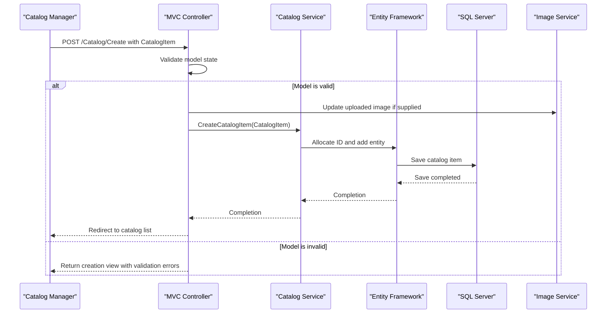

# API & Service Communication Contracts

The application exposes conventional MVC page actions and one attribute-routed image upload action. Requests are handled in-process; the application has no API gateway or independently deployed business services.

## Service Catalog

| Service | Port | Category | Purpose |
|---|---|---|---|
| eShopModernizedMVC | 5115 externally in the Compose override; IIS/IIS Express otherwise | API Layer and UI | Catalog management website and image upload |
| SQL Server | 1433 in the Compose override | Infrastructure | Catalog persistence |
| Azure Blob Storage | External service | Infrastructure | Optional catalog image storage |
| Microsoft Entra ID | External service | Infrastructure | Optional OpenID Connect authentication |

## API Endpoints Inventory

| Service | Method | Path | Request Type | Response Type |
|---|---|---|---|---|
| eShopModernizedMVC | GET | `/Catalog/Index?pageSize={pageSize}&pageIndex={pageIndex}` | Optional query parameters | Catalog list view with `PaginatedItemsViewModel<CatalogItem>` |
| eShopModernizedMVC | GET | `/Catalog/Details/{id}` | Path ID | Catalog item view; 400 if missing ID, 404 if not found |
| eShopModernizedMVC | GET | `/Catalog/Create` | None; authentication required | Catalog item creation view |
| eShopModernizedMVC | POST | `/Catalog/Create` | Bound `CatalogItem` form fields; authentication required | Redirect to catalog list or validation view |
| eShopModernizedMVC | GET | `/Catalog/Edit/{id}` | Path ID; authentication required | Catalog item edit view |
| eShopModernizedMVC | POST | `/Catalog/Edit/{id}` | Bound `CatalogItem` form fields; authentication required | Redirect to catalog list or validation view |
| eShopModernizedMVC | GET | `/Catalog/Delete/{id}` | Path ID; authentication required | Delete confirmation view |
| eShopModernizedMVC | POST | `/Catalog/Delete/{id}` | Path ID; authentication required | Redirect to catalog list |
| eShopModernizedMVC | POST | `/uploadimage` | Multipart file `HelpSectionImages` and form `itemId` | JSON `{ name, url }`; 400 for invalid image |
| eShopModernizedMVC | GET | `/Account/SignIn` | None | OIDC challenge when not authenticated |
| eShopModernizedMVC | GET | `/Account/SignOut` | None | Sign-out from OIDC and cookie authentication |
| eShopModernizedMVC | GET | `/Account/EndSession` | None | End local cookie session |

Catalog routes use the conventional `{controller}/{action}/{id}` route; `/uploadimage` is attribute-routed. The MVC application returns HTML views except for the temporary-image upload response.

## Management & Observability Endpoints

| Service | Endpoint | Custom Metrics (if any) |
|---|---|---|
| eShopModernizedMVC | None found | Application Insights and request/dependency telemetry are configured; no custom metric endpoint or health endpoint was found |

## DTOs & Contracts

No separate API DTO layer or OpenAPI/Swagger specification was found. MVC actions bind catalog create/edit form submissions to the mutable `CatalogItem` model; list actions return a `PaginatedItemsViewModel<CatalogItem>`. The upload action returns an anonymous JSON object containing `name` and `url`. Entity and persistence structure is documented in `data-architecture.md`.

## Communication Patterns

The browser communicates synchronously with MVC actions over HTTP. Controllers call `ICatalogService` and `IImageService` in-process; the EF6 context accesses SQL Server directly. Image storage is local in mock mode or uses the Azure Blob SDK when configured. Authentication uses OWIN cookies and OpenID Connect with Microsoft Entra ID when enabled. No asynchronous message broker use, gateway aggregation, service discovery, circuit breaker, or explicit retry policy was found. TLS is not enforced globally in the application; the configured local logout redirect uses HTTPS.

Catalog create/edit/delete actions are protected with `[Authorize]`. Public catalog browsing and the image-upload action do not show an authorization attribute. The OIDC `AuthenticationFailed` callback redirects to an error page.

## Service Technology Matrix

| Service | Web | Data Access | Discovery | Gateway | Actuator | Cache | Metrics |
|---|---|---|---|---|---|---|---|
| eShopModernizedMVC | ASP.NET MVC 5 | Entity Framework 6 | None | None | None found | Optional Redis session | Application Insights |

## Service Communication Sequence

