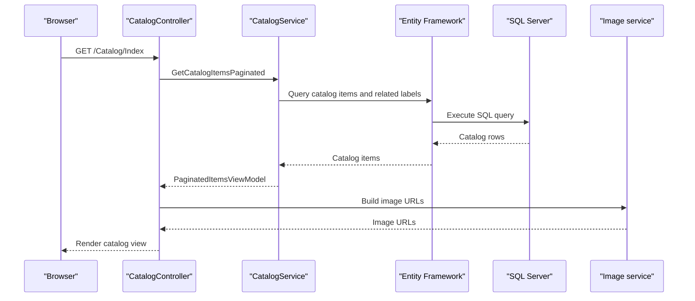

# API & Service Communication Contracts

The application exposes MVC page actions and one image-upload action returning JSON. Requests are handled synchronously in a single web application; no inter-service API calls or message-broker flows were found.

## Service Catalog

| Service | Port | Category | Purpose |
|---|---|---|---|
| eShopModernizedMVC | Container port 80; host port 5115 in Compose | API Layer | Serves catalog pages, account actions, and image uploads |
| sql.data | Container port 1433; host port 5433 in the Compose override | Infrastructure | SQL Server database for catalog persistence |
| Azure Blob Storage | External endpoint, configured by storage connection string | Infrastructure | Optional image storage |
| Azure Active Directory | External identity endpoint | Infrastructure | Optional OpenID Connect authentication |

## API Endpoints Inventory

All paths other than `/uploadimage` use the default MVC route `/{controller}/{action}/{id}`. Responses from CatalogController are rendered views or redirects; the upload action returns JSON.

| Service | Method | Path | Request Type | Response Type |
|---|---|---|---|---|
| eShopModernizedMVC | GET | `/Catalog/Index` | Optional query parameters `pageSize`, `pageIndex` | Catalog view with `PaginatedItemsViewModel<CatalogItem>` |
| eShopModernizedMVC | GET | `/Catalog/Details/{id}` | Optional route parameter `id` | Catalog item view; 400 when missing and 404 when not found |
| eShopModernizedMVC | GET, POST | `/Catalog/Create` | POST binds `CatalogItem` | Form view, redirect, or validation-error view |
| eShopModernizedMVC | GET, POST | `/Catalog/Edit/{id}` | Route `id`; POST binds `CatalogItem` | Form view, redirect, or validation-error view |
| eShopModernizedMVC | GET, POST | `/Catalog/Delete/{id}` | Route or form `id` | Confirmation view or redirect |
| eShopModernizedMVC | POST | `/uploadimage` | Multipart image and optional form `itemId` | JSON object containing image name and URL; 400 for invalid image |
| eShopModernizedMVC | GET | `/Account/SignIn` | No body | OWIN authentication challenge |
| eShopModernizedMVC | GET | `/Account/SignOut` | No body | OWIN sign-out |
| eShopModernizedMVC | GET | `/Account/EndSession` | No body | Local cookie sign-out |

Catalog create, edit, and delete actions are marked with `Authorize`. The upload action has no explicit `Authorize` attribute. There is no API versioning scheme or OpenAPI specification detected.

## Management & Observability Endpoints

| Service | Endpoint | Custom Metrics |
|---|---|---|
| eShopModernizedMVC | None identified | Application Insights telemetry is configured; no custom metrics or management endpoint was found |
| sql.data | Compose health check runs a SQL query | Container health check only; it is not an application HTTP endpoint |

## DTOs & Contracts

There are no dedicated API DTOs. `CatalogItem` is the MVC form/model type, and `PaginatedItemsViewModel<CatalogItem>` is used for catalog listing data. `CatalogBrand` and `CatalogType` are related domain types. The image upload response is an anonymous JSON object containing a name and URL. These classes are mutable; no OpenAPI, protobuf, or GraphQL contracts were found. MVC/Razor handles page rendering, and the upload action uses MVC JSON serialization.

## Communication Patterns

Controllers call application services directly and synchronously. CatalogService uses Entity Framework to communicate with SQL Server. ImageAzureStorage uses the Azure Storage SDK for Blob operations. No queues, event bus, service discovery, gateway aggregation, retry policy, circuit breaker, or client-side load balancing were found.

When `UseAzureActiveDirectory` is enabled, OWIN uses cookie and OpenID Connect middleware. Otherwise, a custom middleware creates a placeholder identity. Catalog mutation actions require `Authorize`; the image-upload action is not explicitly protected. The Compose mapping exposes the application over HTTP; TLS termination is not defined in the project Compose files.

## Service Technology Matrix

| Service | Web | Data Access | Discovery | Gateway | Actuator | Cache | Metrics |
|---|---|---|---|---|---|---|---|
| eShopModernizedMVC | ASP.NET MVC 5 | Entity Framework 6 | None | None | None | No active cache; output cache is disabled | Application Insights |
| sql.data | SQL Server container | SQL Server | None | None | Compose health check | None | None |

## Service Communication Sequence

