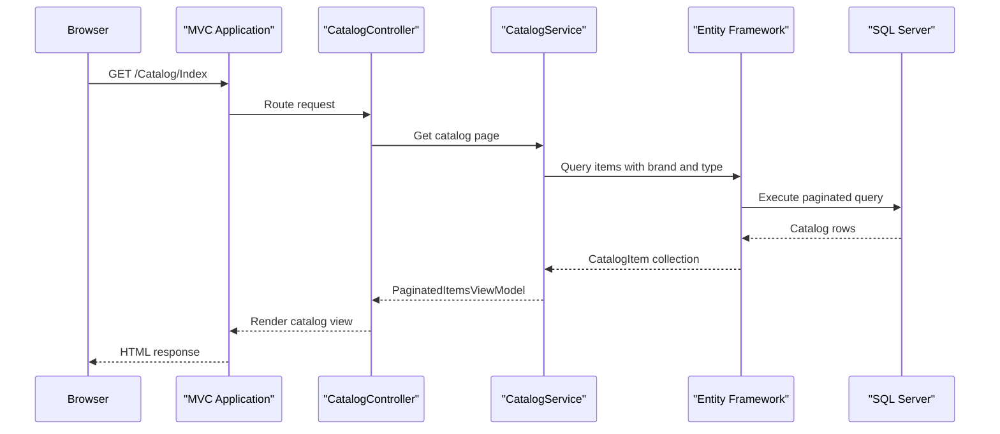

# API & Service Communication Contracts

The application exposes conventional MVC page actions plus one multipart image-upload action that returns JSON. Its service calls are synchronous and remain inside the MVC application, with optional SQL, blob-storage, and identity integrations.

## Service Catalog

| Service | Port | Category | Purpose |
|---|---|---|---|
| `eshop.modernized.mvc` | Container 80; host 5115 in Compose override | API Layer | Serves catalog pages, catalog maintenance actions, and image-upload responses |
| `sql.data` | Container 1433; host 5433 in Compose override | Infrastructure | SQL Server database used when mock catalog data is disabled |
| Azure Blob Storage | External service; configured endpoint | Infrastructure | Optional product-image storage |
| Azure Active Directory | External service; HTTPS identity endpoint | Infrastructure | Optional OpenID Connect sign-in |

The solution has one deployable application project. Blob storage and identity are external dependencies, not additional solution services.

## API Endpoints Inventory

The default MVC route is `/{controller}/{action}/{id}`. No API versioning scheme was found.

| Service | Method | Path | Request Type | Response Type |
|---|---|---|---|---|
| MVC | GET | `/Catalog/Index?pageSize={pageSize}&pageIndex={pageIndex}` | Optional query values | Catalog listing view with `PaginatedItemsViewModel<CatalogItem>` |
| MVC | GET | `/Catalog/Details/{id}` | Path parameter `id` | Catalog item details view; 400 for missing ID or 404 if absent |
| MVC | GET | `/Catalog/Create` | None | Catalog item creation view |
| MVC | POST | `/Catalog/Create` | Form-bound `CatalogItem` | Redirect to catalog index on success; otherwise creation view |
| MVC | GET | `/Catalog/Edit/{id}` | Path parameter `id` | Catalog item edit view |
| MVC | POST | `/Catalog/Edit/{id}` | Form-bound `CatalogItem` | Redirect to catalog index on success; otherwise edit view |
| MVC | GET | `/Catalog/Delete/{id}` | Path parameter `id` | Delete confirmation view |
| MVC | POST | `/Catalog/Delete/{id}` | Path parameter `id` | Redirect to catalog index |
| MVC | POST | `/uploadimage` | Multipart image file and `itemId` form value | JSON object with temporary image name and URL; 400 for invalid image |
| MVC | GET | `/Account/SignIn` | None | Starts sign-in challenge when not authenticated |
| MVC | GET | `/Account/SignOut` | None | Ends the OWIN authentication session |
| MVC | GET | `/Account/EndSession` | None | Ends the cookie session after an identity-provider sign-out |

The catalog maintenance actions carry `[Authorize]`; the image-upload action does not. The upload result is an anonymous JSON object rather than a named response DTO.

## Management & Observability Endpoints

| Service | Endpoint | Custom Metrics |
|---|---|---|
| MVC | None identified | No custom metrics endpoint or metric registration found |

No health-check route or Swagger/OpenAPI endpoint was identified. Application Insights and log4net provide telemetry/logging integrations but do not expose a management endpoint in the application source.

## DTOs & Contracts

- `CatalogItem` is the mutable MVC model used for form binding and catalog responses. It also represents the EF6 entity; persistence mappings are documented in `data-architecture.md`.
- `PaginatedItemsViewModel<CatalogItem>` is the catalog-list response model.
- `CatalogBrand` and `CatalogType` are related domain/entity models included when catalog items are read.
- `PicController.UploadImage` returns an anonymous JSON response containing a temporary image name and URL.
- No separate immutable request/response records, gateway aggregation DTOs, OpenAPI/Swagger document, GraphQL schema, or protobuf contract was found.
- MVC JSON responses use the framework's `JsonResult` serialization; no custom serializer configuration was identified.

## Communication Patterns

Browser requests are handled synchronously by MVC controllers and service methods. `CatalogService` uses EF6 synchronously for SQL reads and writes; `ImageAzureStorage` uses the Azure Storage SDK for blob operations. There is no API gateway, inter-service REST client, message-broker flow, service discovery, client-side load balancing, retry policy, or circuit breaker in the inspected application.

Authentication is configuration-dependent. When `UseAzureActiveDirectory` is enabled, OWIN uses cookie authentication and OpenID Connect with Azure AD. Otherwise, `AuthenticationMiddleware` installs a synthetic authenticated identity, so the non-Azure-AD mode is not an external identity check. Catalog create/edit/delete actions are marked `[Authorize]`; the image-upload action has no authorization attribute. The configured identity redirect is HTTPS, while the checked-in Compose port mapping exposes the application on HTTP and no inbound TLS termination is configured in these files.

In Compose, the MVC container depends on the SQL container when that service is included. The SQL override defines a health check, but the application has no separate readiness endpoint. Azure Blob Storage and Azure AD availability affect their corresponding optional flows only.

## Service Technology Matrix

| Service | Web | Data Access | Discovery | Gateway | Health Checks | Cache | Metrics |
|---|---|---|---|---|---|---|---|
| `eshop.modernized.mvc` | ASP.NET MVC 5 | EF6; optional mock service | None | None | None identified | No active data cache; Redis session configuration is commented | Application Insights SDK |
| `sql.data` | — | SQL Server | None | None | Compose health check | — | — |

## Service Communication Sequence

