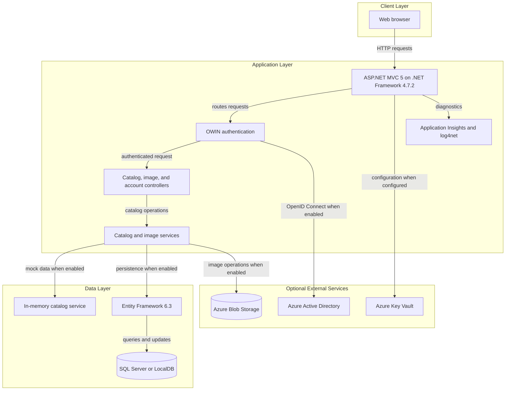
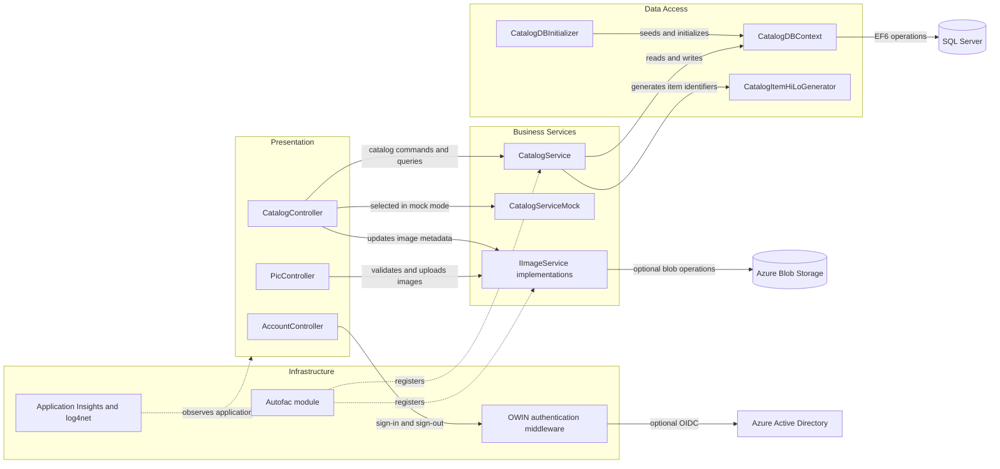

# Architecture Diagram

The application is a server-rendered catalog site with catalog maintenance and image-upload flows. Its runtime can use either mock catalog data or an Entity Framework-backed SQL database, with optional Azure integrations.

## Application Architecture

### Technology Stack Summary

| Layer | Technology | Version | Purpose |
|---|---|---:|---|
| Presentation | ASP.NET MVC | 5.2.7 | Server-rendered catalog pages and MVC actions |
| Runtime | .NET Framework | 4.7.2 | Application runtime |
| Dependency injection | Autofac | 4.9.4 | Controller and service registration |
| Data access | Entity Framework | 6.3.0 | SQL Server persistence and entity mapping |
| Authentication | OWIN and OpenID Connect | OWIN 4.2.2; security package 4.0.1 | Optional Azure AD sign-in; alternate middleware is selected when disabled |
| Image storage | Azure Storage SDK | 9.3.3 | Optional blob-backed product images |
| Observability | Application Insights and log4net | 2.11.0; 2.0.12 | Telemetry and application logging |

### Data Storage & External Services

Catalog records use SQL Server or LocalDB when mock data is disabled; the checked-in configuration enables an in-memory catalog by default. Product images can be served from local `Pics` content or stored in Azure Blob Storage. Azure Active Directory, Azure Key Vault, and Application Insights are optional integrations controlled by configuration.

### Key Architectural Decisions

- Autofac selects the mock or EF-backed catalog service and the local or Azure image service from application settings.
- Entity Framework 6 maps catalog items to required catalog type and brand records; a database initializer creates sequences and seed data.
- Azure AD authentication and managed-identity database access are configuration-dependent rather than unconditional.

## Component Relationships

### Component Inventory

| Component | Layer | Type | Responsibility |
|---|---|---|---|
| CatalogController | Presentation | MVC controller | Browses, creates, edits, and deletes catalog items |
| PicController | Presentation | MVC controller | Validates uploaded image content and returns temporary image URLs |
| AccountController | Presentation | MVC controller | Starts and ends sign-in sessions |
| CatalogService | Business Services | Service | Implements catalog operations using EF6 |
| CatalogServiceMock | Business Services | Mock service | Provides mutable in-memory catalog data when enabled |
| ImageAzureStorage | Business Services | Storage service | Uploads and updates image blobs |
| ImageMockStorage | Business Services | Mock service | Resolves local image paths without blob operations |
| CatalogDBContext | Data Access | EF6 DbContext | Maps catalog entities and their relationships |
| CatalogDBInitializer | Data Access | Database initializer | Creates sequences and seeds catalog data |
| CatalogItemHiLoGenerator | Data Access | Identifier generator | Allocates catalog item identifiers from a SQL sequence |
| ApplicationModule | Infrastructure | Autofac module | Registers the selected catalog, image, and connection services |
| Startup | Infrastructure | OWIN startup | Selects Azure AD authentication or the alternate middleware |
