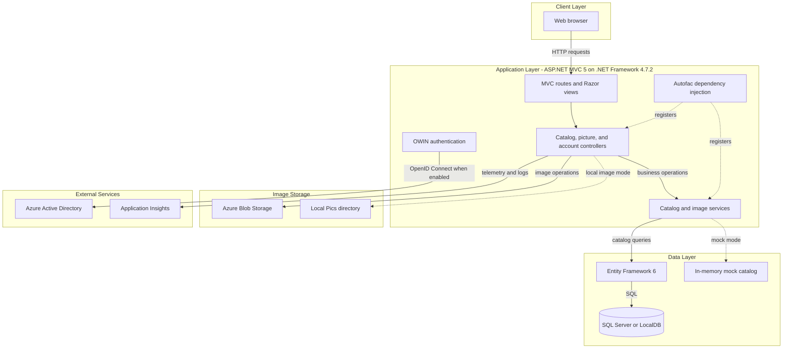
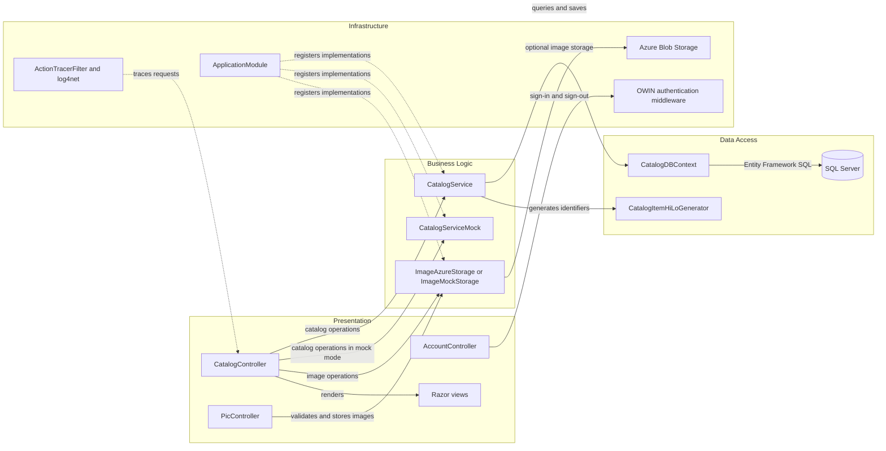

# Architecture Diagram

The application is a server-rendered catalog web application with a single ASP.NET MVC deployment. Catalog persistence and image storage are abstracted behind services, with optional Azure integrations.

## Application Architecture

### Technology Stack Summary

| Layer | Technology | Version | Purpose |
|---|---|---:|---|
| Presentation | ASP.NET MVC and Razor | MVC 5.2.7; Razor 3.2.7 | Server-rendered catalog views and request handling |
| Application | C# on .NET Framework | 4.7.2 | Web application runtime |
| Dependency injection | Autofac MVC integration | 4.9.4; integration 4.0.2 | Controller and service registration |
| Data access | Entity Framework | 6.3.0 | Relational persistence through `CatalogDBContext` |
| Database | SQL Server / LocalDB | Configured externally | Catalog persistence; mock mode is also available |
| Image storage | Azure Storage SDK or local files | 9.3.3 | Product image upload and retrieval |
| Authentication | OWIN and OpenID Connect | OWIN OpenID Connect 4.0.1 | Optional Azure AD sign-in |
| Observability | log4net and Application Insights | 2.0.12; 2.11.x | Application logging and telemetry |

### Data Storage & External Services

Catalog records are stored in SQL Server through Entity Framework 6, with LocalDB configured for local execution and a mock catalog option. Images can use Azure Blob Storage or the local `Pics` directory. Azure Active Directory sign-in and Application Insights instrumentation are optional integrations selected through configuration.

### Key Architectural Decisions

- Controllers depend on `ICatalogService` and `IImageService`; Autofac selects database/mock and Azure/local implementations from configuration.
- Entity Framework's `CatalogDBContext` is the persistence boundary; there is no separate repository layer.
- The web application is a single deployable unit; database and cloud storage are external resources.

## Component Relationships

### Component Inventory

| Component | Layer | Type | Responsibility |
|---|---|---|---|
| CatalogController | Presentation | MVC controller | Lists, views, creates, updates, and deletes catalog items |
| PicController | Presentation | MVC controller | Validates image uploads and returns their temporary URL |
| AccountController | Presentation | MVC controller | Starts and ends the configured authentication session |
| CatalogService | Business Logic | Service | Coordinates catalog queries and Entity Framework writes |
| CatalogServiceMock | Business Logic | In-memory service | Provides catalog behavior when mock data is enabled |
| ImageAzureStorage | Business Logic | Image service | Uploads and updates catalog images in Azure Blob Storage |
| ImageMockStorage | Business Logic | Image service | Supplies local/default image URLs in mock mode |
| CatalogDBContext | Data Access | Entity Framework context | Maps catalog entities and relationships |
| CatalogItemHiLoGenerator | Data Access | Identifier generator | Allocates catalog identifiers using a SQL sequence |
| ApplicationModule | Infrastructure | Autofac module | Registers services and configuration-selected implementations |
| AuthenticationMiddleware | Infrastructure | OWIN middleware | Supplies the non-Azure-AD authentication pipeline |
| ActionTracerFilter | Infrastructure | MVC action filter | Records request/action tracing |
