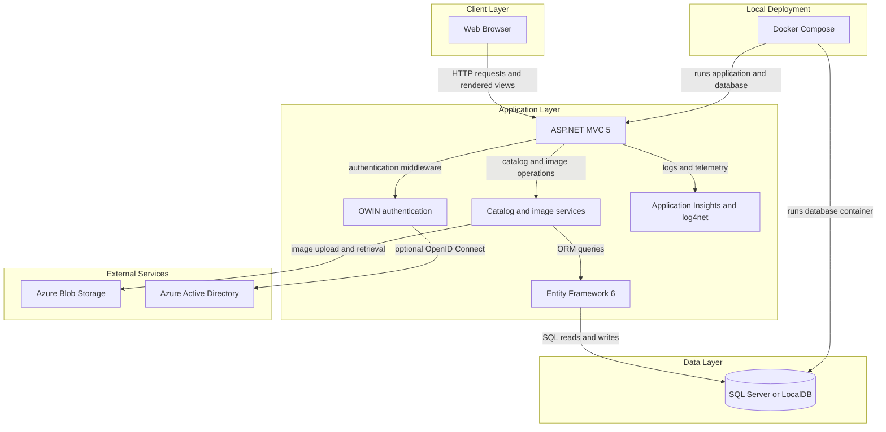
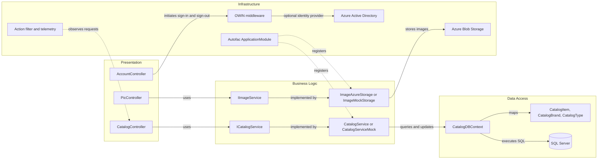

# Architecture Diagram

The application is a server-rendered catalog management site with a single MVC application and external persistence and image-storage integrations. The diagrams show its deployment-level dependencies and the main application component relationships.

## Application Architecture

### Technology Stack Summary

| Layer | Technology | Version | Purpose |
|---|---|---|---|
| Presentation | ASP.NET MVC | 5.2.7 | Server-rendered catalog pages and MVC actions |
| Application | .NET Framework | 4.7.2 | Application runtime and web host |
| Dependency injection | Autofac | 4.9.4 | MVC controller and service registration |
| Data access | Entity Framework | 6.3.0 | ORM over SQL Server |
| Database | SQL Server / LocalDB | Not pinned in all configurations | Catalog persistence |
| Authentication | OWIN and OpenID Connect | OWIN 4.2.2; related package versions vary | Optional Azure Active Directory sign-in |
| Telemetry | Application Insights and log4net | Application Insights 2.11.0; log4net 2.0.12 | Application telemetry and logging |
| Image storage | Azure Blob Storage | WindowsAzure.Storage 9.3.3 | Optional catalog image storage |
| Container runtime | Docker Compose | Compose file format 3.4 | Local application and database orchestration |

### Data Storage & External Services

Catalog items, brands, and types are stored in SQL Server through Entity Framework; the plain .NET configuration uses LocalDB while the Compose configuration points to a SQL Server container. Image storage can use Azure Blob Storage or the local mock implementation. Azure Active Directory is an optional OpenID Connect provider, and Application Insights receives telemetry.

### Key Architectural Decisions

- The MVC application separates controllers from catalog and image services, with Autofac managing their lifetimes.
- Catalog persistence uses an Entity Framework context; mock-data mode substitutes an in-memory catalog service.
- Authentication and Azure image storage are selected through configuration flags.

## Component Relationships

### Component Inventory

| Component | Layer | Type | Responsibility |
|---|---|---|---|
| CatalogController | Presentation | MVC controller | Displays, creates, edits, and deletes catalog items |
| PicController | Presentation | MVC controller | Validates and uploads temporary catalog images |
| AccountController | Presentation | MVC controller | Starts and ends authentication sessions |
| CatalogService | Business Logic | Service | Performs catalog reads and writes through Entity Framework |
| CatalogServiceMock | Business Logic | Mock service | Provides an in-memory catalog when mock mode is enabled |
| ImageAzureStorage | Business Logic | Image service | Stores catalog images in Azure Blob Storage |
| ImageMockStorage | Business Logic | Mock service | Provides local image behavior for mock storage mode |
| CatalogDBContext | Data Access | Entity Framework context | Maps catalog entities to SQL tables |
| ApplicationModule | Infrastructure | Autofac module | Selects and registers services based on configuration |
| AuthenticationMiddleware | Infrastructure | OWIN middleware | Supplies the non-Azure-authentication identity path |
| ActionTracerFilter | Infrastructure | MVC filter | Adds request tracing behavior |
