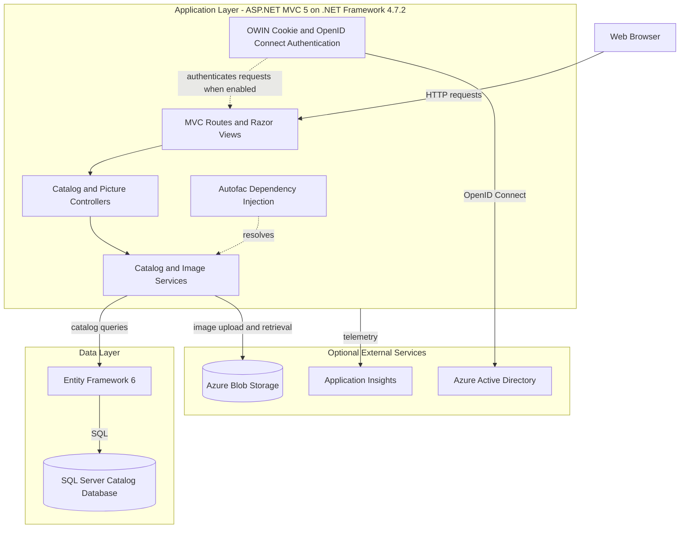
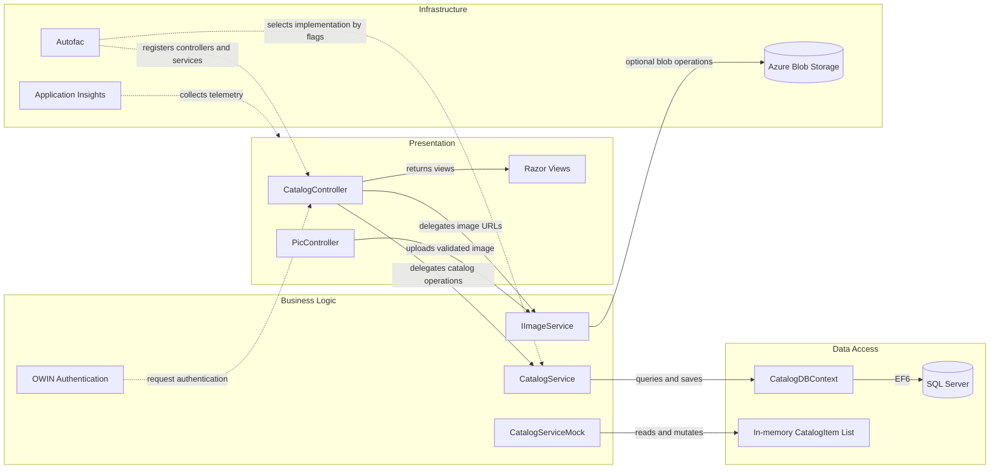

# Architecture Diagram

The workspace contains a single ASP.NET MVC catalog application. It runs with either a mock catalog or Entity Framework-backed SQL Server storage, and can optionally use Azure identity, blob storage, and Application Insights.

## Application Architecture

### Technology Stack Summary

| Layer | Technology | Version | Purpose |
|---|---|---:|---|
| Presentation | ASP.NET MVC and Razor | MVC 5.2.7 | Server-rendered catalog pages and MVC actions |
| Runtime | .NET Framework | 4.7.2 | Web application runtime |
| Dependency injection | Autofac and Autofac.Mvc5 | 4.9.4 / 4.0.2 | Controller and service registration |
| Data access | Entity Framework 6 | 6.3.0 | Catalog entity persistence |
| Database | SQL Server | Compose image version unspecified | Catalog persistence when mock data is disabled |
| Authentication | OWIN cookies and OpenID Connect | OWIN packages 4.0.1–4.2.2 | Optional Azure AD sign-in |
| Image storage | Azure Storage Blobs | WindowsAzure.Storage 9.3.3 | Optional product image storage |
| Observability | Application Insights and log4net | 2.11.0 / 2.0.12 | Request telemetry and application logging |

### Data Storage & External Services

The catalog is stored in SQL Server through Entity Framework when `UseMockData` is false; otherwise the application uses an in-memory mock service. Product images can be stored in Azure Blob Storage, and Azure Active Directory and Application Insights are configured as optional integrations. Redis session support is referenced by a package but its session configuration is commented out.

### Key Architectural Decisions

- The application is a single MVC deployment with controllers, services, and an EF6 context registered through Autofac.
- Configuration flags select mock or database catalog storage, local or Azure image storage, and local or managed-identity SQL authentication.
- MVC actions render Razor views; no separate API gateway or independently deployable business service is present.

## Component Relationships

### Component Inventory

| Component | Layer | Type | Responsibility |
|---|---|---|---|
| CatalogController | Presentation | MVC controller | Displays and edits catalog items |
| PicController | Presentation | MVC controller | Accepts image uploads and validates decoded image format |
| CatalogService | Business Logic | Service | Queries and updates catalog data through EF6 |
| CatalogServiceMock | Business Logic | Mock service | Provides in-memory catalog behavior |
| ImageAzureStorage | Business / Infrastructure | Image service | Initializes, uploads, and moves blobs |
| ImageMockStorage | Business / Infrastructure | Image service | Resolves local mock image URLs |
| CatalogDBContext | Data Access | EF6 DbContext | Maps catalog entities to SQL Server |
| ApplicationModule | Infrastructure | Autofac module | Selects lifetime and implementation for application services |
| Startup | Infrastructure | OWIN startup | Enables OpenID Connect or local authentication middleware |
