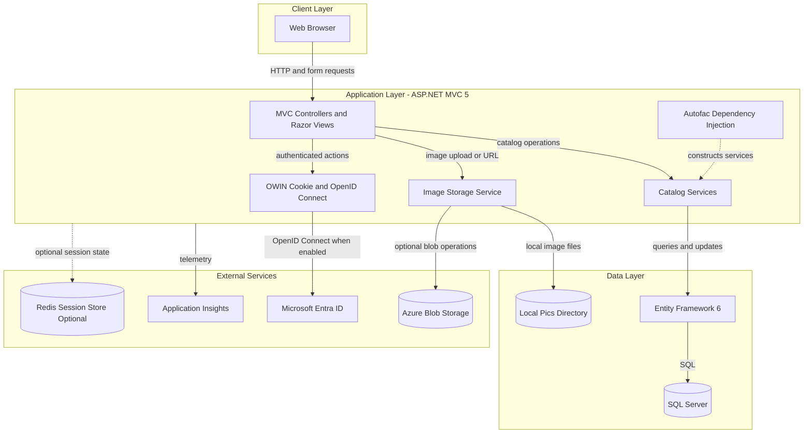

# Architecture Diagram

The application is a server-rendered catalog management website with optional Azure-backed storage and authentication. Its primary request path runs through MVC controllers and services to Entity Framework and SQL Server.

## Application Architecture

### Technology Stack Summary

| Layer | Technology | Version | Purpose |
|---|---|---|---|
| Presentation | ASP.NET MVC | 5.2.7 | Server-rendered catalog UI and request handling |
| Runtime | .NET Framework | 4.7.2 | Application runtime |
| Dependency injection | Autofac MVC | 4.0.2 | Controller and service registration |
| Business and data | Entity Framework | 6.3.0 | Catalog persistence and queries |
| Logging | log4net | 2.0.12 | Application logging |
| Telemetry | Application Insights | 2.11.x | Request and dependency telemetry |

### Data Storage & External Services

Catalog items, brands, and types use SQL Server through Entity Framework. A local SQL Server LocalDB connection is configured for plain .NET execution, while Compose and environment configuration support container/deployed settings. Images use local files in the mock implementation or Azure Blob Storage when enabled. Azure Active Directory/OpenID Connect, Application Insights, and Redis-backed session state are optional integrations.

### Key Architectural Decisions

- Autofac registers a catalog service, image service, SQL connection factory, and a singleton hi-lo ID generator.
- `ICatalogService` has database-backed and in-memory mock implementations selected by configuration.
- Entity Framework maps catalog item relationships directly to catalog type and brand; there is no separate repository layer.

## Component Relationships

```mermaid
flowchart LR
    subgraph Presentation["Presentation"]
        CatalogController["CatalogController"]
        PicController["PicController"]
        AccountController["AccountController"]
        Views["Razor Views"]
    end
    subgraph Business["Business Logic"]
        CatalogService["CatalogService"]
        MockService["CatalogServiceMock"]
        HiLo["CatalogItemHiLoGenerator"]
    end
    subgraph DataAccess["Data Access"]
        Context["CatalogDBContext"]
        Initializer["CatalogDBInitializer"]
        SQL[("SQL Server")]
    end
    subgraph Infrastructure["Infrastructure"]
        Autofac["Autofac ApplicationModule"]
        ImageService["IImageService"]
        ImageAzure["ImageAzureStorage"]
        ImageMock["ImageMockStorage"]
        OIDC["OWIN OpenID Connect"]
        Blob[("Azure Blob Storage")]
    end

    CatalogController -->|"catalog actions"| CatalogService
    CatalogController -->|"image URLs and updates"| ImageService
    PicController -->|"validated image upload"| ImageService
    AccountController -->|"sign-in and sign-out"| OIDC
    CatalogController -->|"renders"| Views
    CatalogService -->|"queries and saves"| Context
    CatalogService -->|"allocates IDs"| HiLo
    Initializer -->|"seeds data"| Context
    Context -->|"Entity Framework"| SQL
    Autofac -.->|"registers"| CatalogService
    Autofac -.->|"registers alternative"| MockService
    ImageService -.->|"implemented by"| ImageAzure
    ImageService -.->|"implemented by"| ImageMock
    ImageAzure -->|"uploads and retrieves"| Blob
```

### Component Inventory

| Component | Layer | Type | Responsibility |
|---|---|---|---|
| CatalogController | Presentation | MVC controller | Lists, views, creates, edits, and deletes catalog items |
| PicController | Presentation | MVC controller | Validates and accepts temporary image uploads |
| AccountController | Presentation | MVC controller | Starts and ends OIDC authentication sessions |
| CatalogService | Business Logic | Service | Performs catalog queries and persistence operations |
| CatalogServiceMock | Business Logic | In-memory service | Supplies catalog operations using preconfigured data |
| CatalogItemHiLoGenerator | Business Logic | ID generator | Allocates catalog identifiers from a SQL sequence |
| CatalogDBContext | Data Access | EF6 DbContext | Maps and persists catalog entities |
| CatalogDBInitializer | Data Access | Database initializer | Creates/seeds catalog data and sequence scripts |
| ImageAzureStorage | Infrastructure | Image service | Stores images in Azure Blob Storage |
| ImageMockStorage | Infrastructure | Image service | Resolves local image files for mock mode |
| ApplicationModule | Infrastructure | Autofac module | Configures service implementations and lifetimes |
