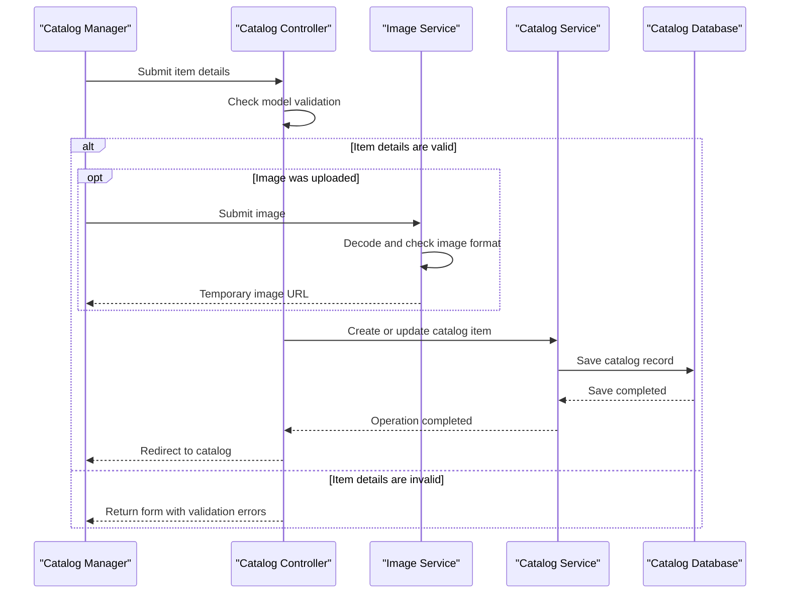

# Core Business Workflows

The application supports maintaining an e-commerce product catalog, including product classification, brand assignment, stock information, and product images. Catalog browsing is available to users, while catalog changes require authentication.

## Domain Entities

| Entity | Service / Bounded Context | Description | Key Relationships |
|---|---|---|---|
| CatalogItem | Catalog Management | Product listing with price, stock, and image reference | Belongs to one CatalogType and one CatalogBrand |
| CatalogType | Catalog Management | Product category | Groups many catalog items |
| CatalogBrand | Catalog Management | Product brand | Labels many catalog items |

## Service-to-Domain Mapping

| Service | Domain Context | Owned Entities | External Dependencies |
|---|---|---|---|
| eShopModernizedMVC | Catalog Management | CatalogItem, CatalogType, CatalogBrand | SQL Server, local or Azure image storage, optional Microsoft Entra ID |

There are no separate business services or cross-context data exchanges. The MVC application is the source of truth for its catalog entities.

## Primary Workflows

### Workflow 1: Browse the Catalog

1. A user opens the catalog listing.
2. `CatalogController` requests a page from `ICatalogService`.
3. The database-backed service loads items with their brand and type; mock mode instead uses in-memory preconfigured data.
4. The controller resolves image URLs and renders the catalog view.
5. A detail request loads one catalog item and returns either the detail page or a not-found response.

### Workflow 2: Maintain a Catalog Item

1. An authenticated catalog manager opens the create or edit form.
2. The manager may upload an image through `PicController`; the action decodes the content and accepts JPEG, PNG, or GIF images.
3. The create/edit action validates the bound `CatalogItem` model. Model annotations validate required name, price range/format, and stock thresholds.
4. `CatalogService` allocates an identifier for a new item, then persists the item through Entity Framework; edits update the entity and deletes remove it.
5. If an image was uploaded, the selected image service stores or copies it to local or Azure storage.
6. Successful writes redirect to the catalog listing; invalid models return the form with validation errors.

### Workflow 3: Seed Catalog Data

At application startup, `CatalogDBInitializer` seeds catalog types, brands, and items from built-in data or optional CSV customization files. It creates/uses SQL sequence values for identifiers and initializes images when configured.

## Cross-Service Data Flows

No cross-service business composition was found. The application accesses SQL Server and image storage directly through its own services. The image service may use Azure Blob Storage when enabled; otherwise the local/mock implementation resolves images from the application `Pics` directory.

## Business Workflow Sequence

## Business Rules & Decision Logic

- Catalog item name is required. Price must be in range and use no more than two decimal places; stock and threshold values are constrained to nonnegative bounded ranges.
- Each catalog item requires a catalog type and brand.
- Only authenticated users can create, edit, or delete catalog items.
- Image upload accepts content decoded as JPEG, PNG, or GIF; the storage implementation depends on configuration.
- New database-backed catalog IDs come from SQL hi-lo sequences; mock mode assigns incrementing in-memory IDs.
- EF6 operations save changes through the catalog service. No multi-service saga, event choreography, audit trail, or compensating transaction was identified.
