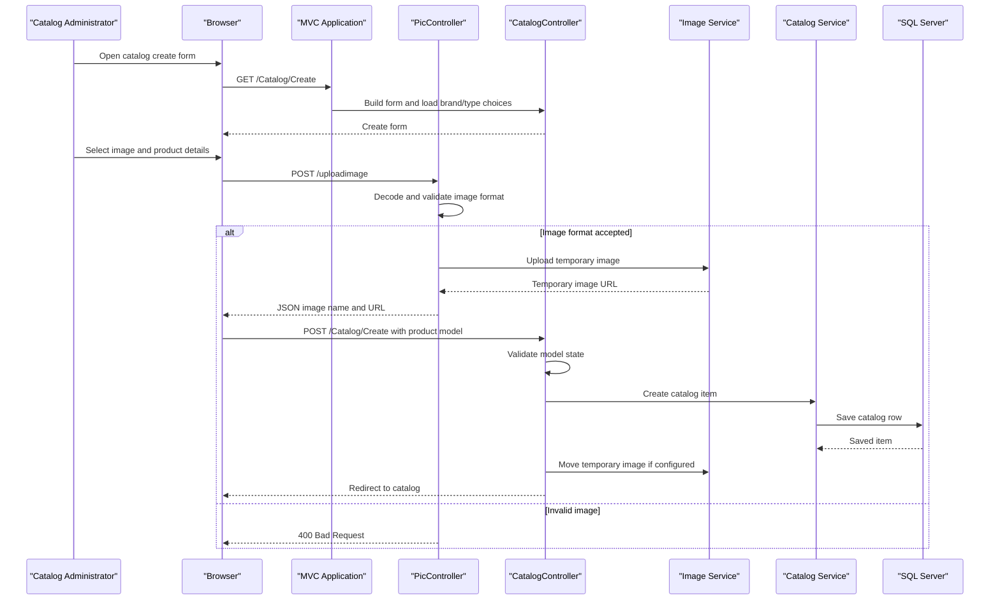

# Core Business Workflows

The application supports browsing and maintaining an online product catalog. It manages catalog items, brands, types, stock thresholds, and product images; no checkout, payment, or order workflow is implemented in this MVC project.

## Domain Entities

| Entity | Service / Bounded Context | Description | Key Relationships |
|---|---|---|---|
| CatalogItem | Catalog Management | Product displayed to shoppers and maintained by administrators | Belongs to one CatalogBrand and one CatalogType |
| CatalogBrand | Catalog Management | Brand classification for products | Has multiple CatalogItem records |
| CatalogType | Catalog Management | Product type/category | Has multiple CatalogItem records |

## Service-to-Domain Mapping

| Service | Domain Context | Owned Entities | External Dependencies |
|---|---|---|---|
| eShopModernizedMVC | Catalog Management | CatalogItem, CatalogBrand, CatalogType | SQL Server / EF6; optional Azure Blob Storage; optional Azure AD |
| CatalogServiceMock | Catalog Management mock | In-memory CatalogItem list | Preconfigured data |

## Primary Workflows

### Workflow 1: Browse the Product Catalog

1. A shopper requests `GET /Catalog/Index`, optionally specifying page size and page index.
2. `CatalogController` delegates the query to `ICatalogService`.
3. The selected implementation loads catalog items and their brand/type associations from EF6/SQL Server, or reads the in-memory mock list.
4. The controller resolves image URLs through `IImageService` and returns the paginated Razor view.

### Workflow 2: Maintain a Product and Its Image

1. An authenticated administrator opens the create or edit form.
2. The browser uploads an image to `/uploadimage`; `PicController` decodes the upload and accepts JPEG, PNG, or GIF image formats.
3. MVC model validation checks the submitted catalog model. The action sets image metadata from the temporary upload response and calls the catalog service.
4. The service persists the catalog item through EF6, or updates mock data.
5. When Azure storage is selected, the image service moves the temporary blob into the catalog item's image location; the controller redirects to the catalog.
6. Delete uses an authenticated POST action to remove a catalog item and then redirects to the list.

## Cross-Service Data Flows

There are no business microservices or gateway aggregation flows. The MVC application is the source of truth for catalog metadata and accesses SQL Server directly through EF6. When configured, image bytes flow to Azure Blob Storage while the catalog row retains the image filename. The default mock implementation keeps catalog state in process and does not persist it.

## Business Workflow Sequence

## Business Rules & Decision Logic

- Catalog item names are required. Prices must be within the configured range and use at most two decimal places.
- Available stock, restock threshold, and maximum stock are constrained to non-negative configured ranges.
- EF mapping requires each item to reference an existing brand and type.
- Image upload accepts only decoded JPEG, PNG, or GIF formats. Image storage implementation is selected by configuration.
- Catalog create, edit, and delete actions use the MVC `Authorize` attribute. The active authentication behavior depends on whether Azure AD is enabled.
- EF database initialization creates the catalog schema if needed, creates HiLo sequences, and seeds built-in or optional CSV data.
- Data changes use EF `SaveChanges`; no distributed transaction, event bus, saga, or audit trail was found.
