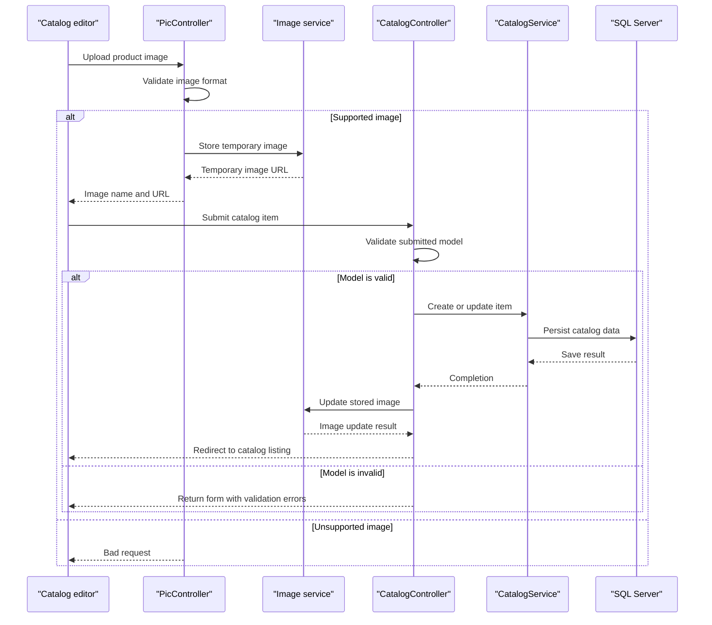

# Core Business Workflows

The application supports browsing and maintaining an online product catalog, including item descriptions, prices, stock thresholds, brands, types, and pictures. It does not implement shopping-cart, checkout, or order-processing workflows in this solution.

## Domain Entities

| Entity | Service / Bounded Context | Description | Key Relationships |
|---|---|---|---|
| CatalogItem | eShopModernizedMVC / Catalog | Product entry displayed and maintained by the catalog | Belongs to one brand and one type |
| CatalogBrand | eShopModernizedMVC / Catalog | Brand classification for products | Can be associated with multiple catalog items |
| CatalogType | eShopModernizedMVC / Catalog | Type classification for products | Can be associated with multiple catalog items |
| Catalog picture | Image service / Catalog media | Image associated with a product | Referenced by the catalog item; image bytes are stored separately |

## Service-to-Domain Mapping

| Service | Domain Context | Owned Entities | External Dependencies |
|---|---|---|---|
| eShopModernizedMVC | Catalog | CatalogItem, CatalogBrand, CatalogType | SQL Server through Entity Framework |
| ImageAzureStorage | Catalog media | Catalog picture blobs | Azure Blob Storage |
| CatalogServiceMock | Catalog (mock mode) | In-memory catalog items | None |

All domain operations are within one application. Image operations are delegated to the configured image service; there are no cross-service domain APIs or event exchanges.

## Primary Workflows

### Workflow 1: Browse the catalog

1. A visitor opens the catalog listing or a product details page.
2. `CatalogController` requests paginated items or one item from `ICatalogService`.
3. The service reads item, brand, and type information from the database, or from the in-memory mock catalog.
4. The controller builds picture URLs and returns a server-rendered view.

### Workflow 2: Create or update a catalog item

1. An authorized user opens the create or edit form and selects catalog type and brand options.
2. The user can upload an image; `PicController` accepts the supported image formats and returns a temporary image URL.
3. The user submits the item form. MVC model validation checks the submitted model; invalid input returns the form with validation errors.
4. For a valid submission, `ICatalogService` creates or updates the catalog record. If a temporary image was selected, the configured image service updates the stored picture.
5. The application redirects to the catalog listing.

### Workflow 3: Delete a catalog item

1. An authorized user views the delete confirmation page.
2. The user confirms deletion.
3. `CatalogController` retrieves the catalog item and asks `ICatalogService` to remove it from the database or mock collection.
4. The application redirects to the catalog listing.

## Cross-Service Data Flows

There is no service-to-service composition. Catalog item data is read from the single relational data store. When Azure image storage is enabled, the application stores image blobs separately and places the resulting image reference in the catalog record. If mock mode is enabled, the mock image service returns local image paths instead.

## Business Workflow Sequence

## Business Rules & Decision Logic

- Catalog item name is required. Price must be nonnegative, at most 1,000,000, and have no more than two decimal places.
- Available stock, restock threshold, and maximum stock threshold must each be between 0 and 10,000,000.
- Items are associated with an existing brand and type. No rule enforcing relationships among the three stock values was identified.
- Catalog mutations are guarded by MVC `Authorize` attributes. Browse and image-upload actions do not have the same explicit attribute.
- Catalog identifiers are generated from SQL sequences in database mode and from the current maximum item identifier in mock mode.
- Startup seeding chooses built-in data or optional CSV customization data. No order lifecycle, payment, approval, or background workflow was identified.
- Persistence is performed synchronously through Entity Framework; no distributed transaction or saga is present.
