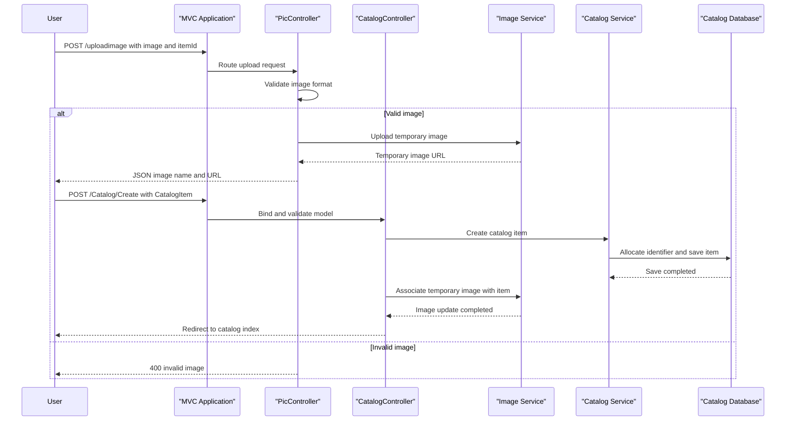

# Core Business Workflows

The application supports browsing and maintaining an online product catalog. Catalog items are associated with a type, brand, stock levels, and an optional product image.

## Domain Entities

| Entity | Service / Bounded Context | Description | Key Relationships |
|---|---|---|---|
| `CatalogItem` | Catalog | A product offered in the catalog, with price, stock, and image reference | Belongs to one `CatalogType` and one `CatalogBrand` |
| `CatalogType` | Catalog | Groups products by type | Can classify multiple catalog items |
| `CatalogBrand` | Catalog | Identifies the brand associated with a product | Can be associated with multiple catalog items |

## Service-to-Domain Mapping

| Service | Domain Context | Owned Entities | External Dependencies |
|---|---|---|---|
| `eShopModernizedMVC` | Product Catalog | `CatalogItem`, `CatalogType`, `CatalogBrand` | SQL Server through EF6 when mock mode is off; optional Azure Blob Storage for images |
| `CatalogServiceMock` | Product Catalog | In-memory catalog item collection | No external data store |

The MVC application is the source of truth for catalog data. There are no separate domain services or cross-context entity identifiers.

## Primary Workflows

### Workflow 1: Browse the Catalog

1. A visitor opens the catalog index; optional `pageSize` and `pageIndex` query values select a page.
2. `CatalogController.Index` asks `ICatalogService` for the requested items and total count.
3. The EF-backed service loads items with their type and brand; mock mode composes the corresponding lookup data in memory.
4. The controller builds image URLs and returns a paginated catalog view.

### Workflow 2: Create or Update a Catalog Item

1. An authorized catalog user opens the create or edit form and submits catalog item data.
2. The MVC model binder creates a `CatalogItem`; the controller proceeds only when `ModelState` is valid.
3. When an image is submitted, `PicController.UploadImage` accepts JPEG, PNG, or GIF image content and returns a temporary image URL.
4. On create, the catalog service assigns an item identifier, persists the item, and the image service associates the temporary image with the new item. On edit, the image service updates the image when a temporary image name is supplied, then the catalog service saves the catalog item.
5. Successful operations redirect to the catalog index. The authorized delete flow removes an item from the selected catalog service and redirects to the index.

Sign-in can use Azure AD OpenID Connect when configured; otherwise the application uses its alternate OWIN middleware. The authorization attributes on catalog maintenance actions are evaluated by the active authentication mode.

## Cross-Service Data Flows

No gateway aggregation or multi-service business flow was identified. The MVC service reads and writes its catalog through EF6 and SQL Server, or uses the in-memory mock service. Image operations are handled directly by the selected image service: local static content in mock mode or Azure Blob Storage in Azure mode. Catalog items store the image filename rather than image bytes.

## Business Workflow Sequence

## Business Rules & Decision Logic

- `CatalogItem.Name` is required; price is constrained to non-negative values up to 1,000,000 and at most two decimal places.
- Available stock, restock threshold, and maximum stock threshold are constrained to the range 0 through 10,000,000.
- Every catalog item must reference an existing catalog type and brand.
- Catalog item IDs are allocated by the SQL hi-lo sequence generator in database mode; mock mode assigns the next ID from the in-memory list.
- Image upload accepts content that decodes as JPEG, PNG, or GIF.
- Catalog create, edit, and delete actions require an authenticated identity. Authentication can be configured for Azure AD or use the alternate middleware.
- Database mode seeds catalog data from built-in values or optional CSV customization data; mock mode uses preconfigured in-memory values.
- The application has no order, payment, inventory reservation, or customer workflow in this solution scope.
