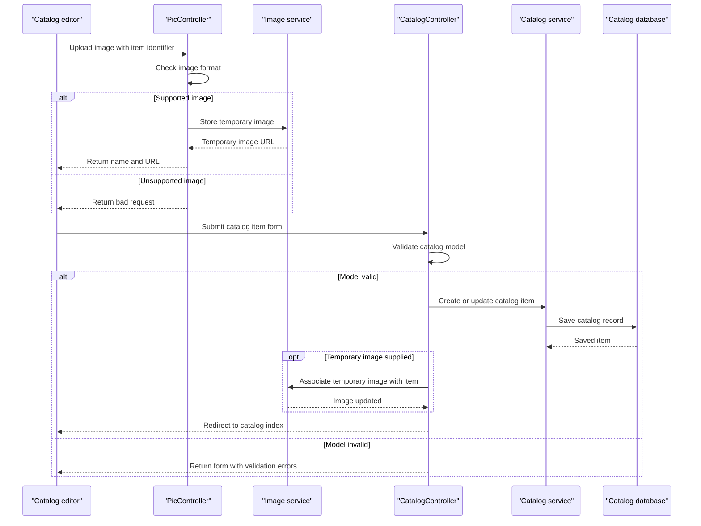

# Core Business Workflows

The application supports browsing and maintaining a product catalog, including product classification, inventory thresholds, and product images. It is a single catalog bounded context with no cross-service business orchestration.

## Domain Entities

| Entity | Service / Bounded Context | Description | Key Relationships |
|---|---|---|---|
| CatalogItem | Catalog Management | Product offered in the catalog with price, stock, reorder thresholds, and image reference | Belongs to one CatalogBrand and one CatalogType |
| CatalogBrand | Catalog Management | Brand classification for catalog items | Has many CatalogItems |
| CatalogType | Catalog Management | Product type/category classification | Has many CatalogItems |

## Service-to-Domain Mapping

| Service | Domain Context | Owned Entities | External Dependencies |
|---|---|---|---|
| eShopModernizedMVC | Catalog Management | CatalogItem, CatalogBrand, CatalogType | SQL Server/LocalDB or in-memory mock; optional Azure Blob Storage |

Catalog data is owned by the MVC application and persisted through its Entity Framework context. No service-to-service calls, shared cross-context identifiers, or event-based data exchange were found.

## Primary Workflows

### Workflow 1: Browse the Catalog

1. A visitor opens the catalog index.
2. `CatalogController` requests the selected page from `ICatalogService`.
3. `CatalogService` loads catalog items and related brand/type data from Entity Framework, or the mock service reads its in-memory list.
4. The controller sets image URLs and renders the paginated catalog view.

### Workflow 2: Create or Update a Catalog Item

1. An authorized user opens the create or edit form and supplies catalog, price, inventory, and optional image information.
2. MVC model validation checks required name, price format/range, and inventory threshold ranges.
3. On valid create, the catalog service assigns an identifier and saves the item; if a temporary image is supplied, the image service moves/copies it to the item location.
4. On valid edit, an optional image is updated, then the catalog record is saved.
5. The user is redirected to the catalog index. Invalid models are returned to the form.

### Workflow 3: Upload a Product Image

1. The client posts a multipart image to `/uploadimage` with an optional catalog item identifier.
2. `PicController` decodes the stream and accepts JPEG, PNG, or GIF formats.
3. The image service stores the temporary image in Azure Blob Storage when enabled; mock mode returns the default image URL.
4. The endpoint returns JSON containing the temporary image name and URL for use by the catalog form.

## Cross-Service Data Flows

No gateway or cross-service data composition exists. Catalog data is read and written within the same application/database boundary. Image storage is a separate optional persistence resource: the upload endpoint returns a temporary image reference, which the create/edit workflow later uses to associate the image with a catalog item. If Azure storage is disabled, the mock image service supplies a local/default image URL.

## Business Workflow Sequence

## Business Rules & Decision Logic

- Catalog item name is required; price must match the configured numeric format and fall within its allowed range.
- Available stock, restock threshold, and maximum stock threshold are range checked.
- Catalog items reference an existing brand and type.
- Create assigns a catalog identifier through a SQL sequence in database mode; mock mode assigns the next list identifier.
- Uploaded images must decode as JPEG, PNG, or GIF before storage.
- Entity Framework `SaveChanges` persists each catalog mutation; no multi-service transaction, saga, or compensating action was identified.
- Catalog create/edit/delete actions require authorization. Image-upload authorization is not explicitly annotated.
- Logging records action/request processing, but no dedicated business audit trail was found.
