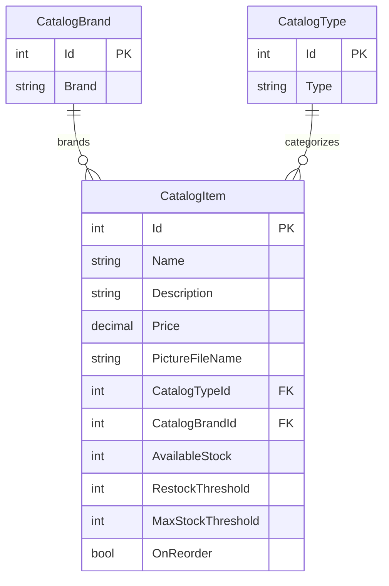

# Data Architecture & Persistence Layer

The application models a product catalog with three Entity Framework entities and persists it in SQL Server when database mode is enabled. Local mock data and local or Azure-backed images are alternative configuration paths.

## Database Configuration

| Service/Module | DB Type | Profile | Driver | Connection | Migration Tool |
|---|---|---|---|---|---|
| eShopModernizedMVC | SQL Server | Compose/database mode | System.Data.SqlClient | Environment/config-builder supplied connection | `CreateDatabaseIfNotExists` initializer and SQL sequence scripts; no versioned migration tool found |
| eShopModernizedMVC | SQL Server LocalDB | Local execution | System.Data.SqlClient | LocalDB connection in `Web.config` | Same initializer |
| eShopModernizedMVC | None | Mock mode | — | In-memory catalog | — |

Catalog setup creates HiLo sequences and seeds catalog data from bundled data or optional CSV files. Image storage is separate from the relational database.

## Data Ownership per Service

| Service | Tables Owned | ORM Framework | Caching | Notes |
|---|---|---|---|---|
| eShopModernizedMVC | Catalog, CatalogBrand, CatalogType | Entity Framework 6 | None identified | `CatalogDBContext` owns all catalog persistence; mock mode uses an in-memory list |

## Entity Model

Entity definitions are in `src/eShopModernizedMVC/Models/CatalogItem.cs`, `CatalogBrand.cs`, and `CatalogType.cs`. `CatalogDBContext` configures the table names, keys, required fields, and relationships.

`CatalogItem` has required `CatalogBrand` and `CatalogType` relationships. Catalog identifiers are generated from SQL sequences by `CatalogItemHiLoGenerator`; `CatalogDBInitializer` creates the sequences and seeds initial records.

## Key Repository Methods

| Service | Repository | Notable Methods | Purpose |
|---|---|---|---|
| eShopModernizedMVC | `CatalogService` (`src/eShopModernizedMVC/Services/CatalogService.cs`) | `GetCatalogItemsPaginated(pageSize, pageIndex)`, `FindCatalogItem(id)` | Queries catalog data with related brand/type entities |
| eShopModernizedMVC | `CatalogService` | `CreateCatalogItem`, `UpdateCatalogItem`, `RemoveCatalogItem` | Persists catalog mutations using `SaveChanges` |
| eShopModernizedMVC | `CatalogItemHiLoGenerator` (`src/eShopModernizedMVC/Models/CatalogItemHiLoGenerator.cs`) | `GetNextSequenceValue(db)` | Reads a SQL sequence while allocating item identifiers |

No repository interface is present; the service accesses `CatalogDBContext` directly.

## Caching Strategy

No application-level cache provider, cache annotations, cache TTL, or query-result caching was identified. The mock catalog is an in-memory data implementation, not a cache of the database.

## Data Ownership Boundaries

All relational catalog entities belong to the single web application and share one SQL Server database context. There are no cross-service database boundaries or service-to-service data calls. Images are stored in Azure Blob Storage or served from the local `Pics` directory, depending on configuration. Catalog reads and writes use the service layer and its Entity Framework context; there is no CQRS or outbox pattern.

### Data Classification & Sensitivity

| Entity | Sensitive Fields | Classification (PII/PHI/PCI/None) | Controls in Place |
|---|---|---|---|
| CatalogItem | Product name, description, price, inventory and image reference | None | No sensitive user data identified |
| CatalogBrand | Brand name | None | No sensitive user data identified |
| CatalogType | Type name | None | No sensitive user data identified |

No PII, PHI, or PCI data was detected in the catalog entity model.
