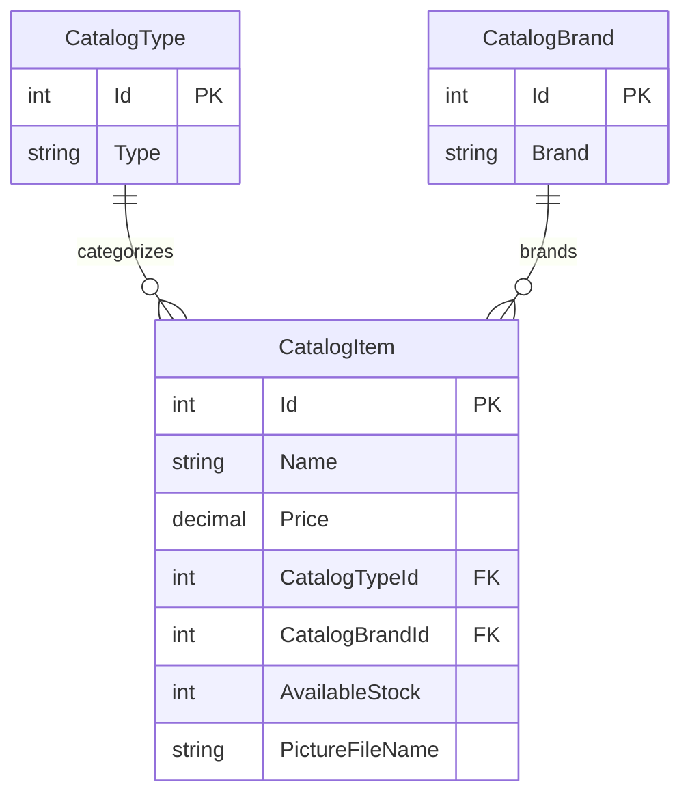

# Data Architecture & Persistence Layer

The data layer contains three catalog entities persisted through Entity Framework 6 to SQL Server. It has no separate repository interfaces or general-purpose application cache.

## Database Configuration

| Service/Module | DB Type | Profile | Driver | Connection | Migration Tool |
|---|---|---|---|---|---|
| eShopModernizedMVC | SQL Server LocalDB | Plain .NET/local | System.Data.SqlClient | `CatalogDBContext` uses localdb with trusted connection | EF6 database initializer and SQL sequence scripts |
| eShopModernizedMVC | SQL Server | Container/deployed | System.Data.SqlClient | Supplied through Compose/environment configuration | EF6 database initializer and SQL sequence scripts |

No database profile-specific migration framework such as Flyway or Liquibase was detected. The initializer seeds catalog types, brands, and items from predefined data or CSV files and creates SQL sequence objects from checked-in scripts.

## Data Ownership per Service

| Service | Tables Owned | ORM Framework | Caching | Notes |
|---|---|---|---|---|
| eShopModernizedMVC | `Catalog`, `CatalogBrand`, `CatalogType` | Entity Framework 6 | None for catalog data; optional Redis session state | All catalog entities are owned by this application and stored in one SQL Server database |

## Entity Model

`CatalogDBContext` maps the `CatalogItem` relationships to required `CatalogType` and `CatalogBrand` foreign keys. Entity definitions are in `Models/CatalogItem.cs`, `Models/CatalogType.cs`, and `Models/CatalogBrand.cs`; mapping is in `Models/CatalogDBContext.cs`. Persistence operations use EF6 `SaveChanges`; no explicit `TransactionScope` or repository unit-of-work layer was identified.

## Key Repository Methods

| Service | Repository | Notable Methods | Purpose |
|---|---|---|---|
| eShopModernizedMVC | `CatalogService` (`Services/CatalogService.cs`) | `GetCatalogItemsPaginated(pageSize, pageIndex)` | Includes brand/type and returns an ordered page of catalog items |
| eShopModernizedMVC | `CatalogService` | `FindCatalogItem(id)` | Loads one catalog item with brand/type |
| eShopModernizedMVC | `CatalogService` | `CreateCatalogItem`, `UpdateCatalogItem`, `RemoveCatalogItem` | Performs catalog mutations and saves them through EF6 |
| eShopModernizedMVC | `CatalogDBInitializer` (`Models/Infrastructure/CatalogDBInitializer.cs`) | CSV readers and `GetSequenceIdFromSelectedDBSequence` | Imports optional seed files and allocates seed IDs |

There is no repository interface; `CatalogService` accesses `CatalogDBContext` directly.

## Caching Strategy

No application-level catalog cache was found. Redis is available through the optional `Microsoft.Web.RedisSessionStateProvider` configuration, but the provider configuration is commented out by default. Azure Blob Storage holds image files when the Azure image service is selected; it is persistent object storage rather than a cache.

## Data Ownership Boundaries

All catalog entities are stored by the MVC application in a single SQL Server database. There are no separate services or cross-service database calls; controllers access catalog data through the application service and EF6 context. Image bytes are stored either in the local `Pics` directory or in the `pics` Azure Blob container.

### Data Classification & Sensitivity

| Entity | Sensitive Fields | Classification (PII/PHI/PCI/None) | Controls in Place |
|---|---|---|---|
| CatalogItem | Product name, description, price, stock, and image filename | None identified | No personal, health, or payment-card data modeled |
| CatalogBrand | Brand name | None identified | No sensitive data modeled |
| CatalogType | Product category name | None identified | No sensitive data modeled |

No PII, PHI, or PCI data was detected in the catalog entity model.
