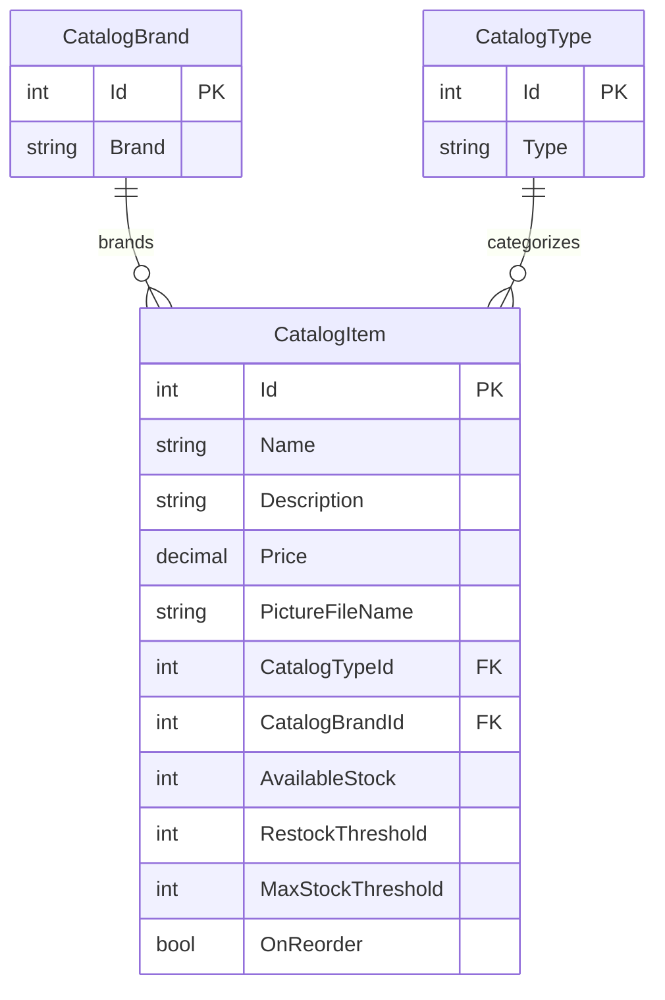

# Data Architecture & Persistence Layer

The primary data store is SQL Server, accessed through Entity Framework 6. The persistence model consists of catalog items, brands, and types; image bytes are stored separately when Azure Blob Storage is enabled.

## Database Configuration

| Service / Module | DB Type | Profile | Driver | Connection | Migration Tool |
|---|---|---|---|---|---|
| eShopModernizedMVC | SQL Server | Local development | System.Data.SqlClient | LocalDB connection in `Web.config` | EF6 `CreateDatabaseIfNotExists` initializer and SQL sequence scripts |
| eShopModernizedMVC | SQL Server | Docker Compose | SQL Server container | Compose environment connection string (password masked) | Same EF6 initializer and scripts |
| eShopModernizedMVC | Azure SQL / SQL Server | Managed identity deployment | System.Data.SqlClient with Azure access token | Configured connection string plus `AzureServiceTokenProvider` | Same EF6 initializer and scripts |

Catalog types, brands, and items are seeded from built-in preconfigured data or optional CSV customization files. Sequence definitions are loaded from SQL scripts during initialization. No Flyway/Liquibase or EF migration history workflow was identified.

## Data Ownership per Service

| Service | Tables Owned | ORM Framework | Caching | Notes |
|---|---|---|---|---|
| eShopModernizedMVC | `Catalog`, `CatalogBrand`, `CatalogType` | Entity Framework 6 | No catalog cache identified | Single application context; no separate data-owning service |
| Azure Blob Storage (optional) | Product image blobs | Azure Storage SDK | None | Image data is separate from relational catalog metadata |

## Entity Model

`CatalogDBContext` maps the item entity to `Catalog`, `CatalogBrand` to `CatalogBrand`, and `CatalogType` to `CatalogType`. An item requires one brand and one type; each brand or type may be associated with multiple catalog items. `PictureUri` and `TempImageName` are view/workflow properties and are ignored by EF mapping.

## Key Repository Methods

| Service | Repository | Notable Methods | Purpose |
|---|---|---|---|
| eShopModernizedMVC | No dedicated repository interface | `CatalogService.GetCatalogItemsPaginated(pageSize, pageIndex)` | Queries item rows with brand/type and applies pagination |
| eShopModernizedMVC | No dedicated repository interface | `CatalogService.FindCatalogItem(id)` | Finds a catalog item and its brand/type |
| eShopModernizedMVC | No dedicated repository interface | `CatalogService.GetCatalogTypes()`, `GetCatalogBrands()` | Supplies selection data for catalog forms |
| eShopModernizedMVC | No dedicated repository interface | `CreateCatalogItem`, `UpdateCatalogItem`, `RemoveCatalogItem` | Adds, updates, or deletes catalog data |

## Caching Strategy

No catalog data cache or EF second-level cache was identified. The project includes `Microsoft.Web.RedisSessionStateProvider`, but the custom Redis session configuration is commented out in `Web.config`. MVC output caching is configured globally with duration zero and no-store.

## Data Ownership Boundaries

The web application is the only service that owns relational catalog data. SQL Server stores catalog metadata; blob storage holds images and is accessed by the image service. No cross-service database access, CQRS split, or event-based data synchronization was found. Mock mode replaces the database service with an in-memory list.

### Data Classification & Sensitivity

| Entity | Sensitive Fields | Classification (PII/PHI/PCI/None) | Controls in Place |
|---|---|---|---|
| CatalogItem | Product names, descriptions, price, stock levels | None | No entity-level PII/PHI/PCI controls apply |
| CatalogBrand | Brand name | None | No sensitive data identified |
| CatalogType | Type label | None | No sensitive data identified |

No PII, PHI, or PCI data was detected in the catalog entity model. Database credentials are configuration/deployment concerns rather than entity data; the local Compose credential is recorded as masked in the configuration and security reports.
