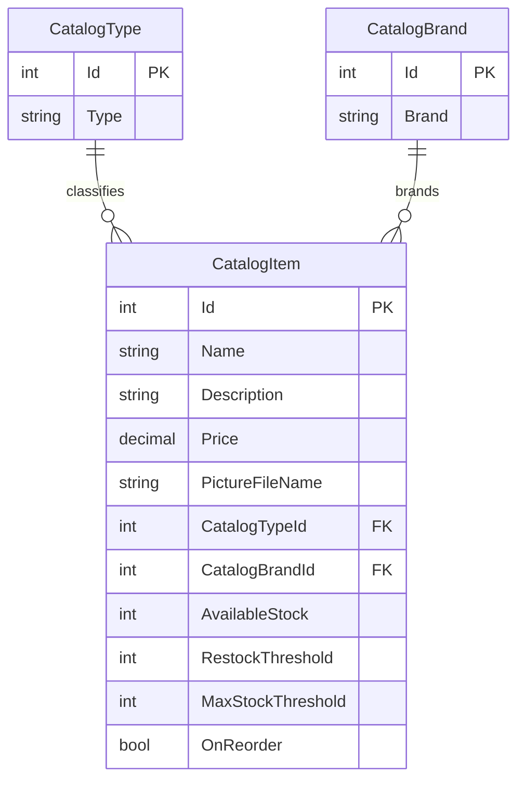

# Data Architecture & Persistence Layer

The catalog data model contains three entities and uses EF6 with SQL Server when database mode is enabled. The checked-in configuration selects an in-memory catalog service by default, while product images can be stored locally or in Azure Blob Storage.

## Database Configuration

| Service/Module | DB Type | Profile | Driver | Connection | Migration Tool |
|---|---|---|---|---|---|
| MVC catalog | None | Mock data enabled by default | — | In-memory `CatalogServiceMock` collection | — |
| MVC catalog | SQL Server / LocalDB | Mock data disabled | `System.Data.SqlClient` | `CatalogDBContext` connection string; LocalDB for local configuration and a SQL Server container in Compose | EF6 `CreateDatabaseIfNotExists` initializer and SQL sequence scripts; no EF migration tool detected |

The initializer seeds catalog types, brands, and items using built-in data or optional CSV customization files. It creates SQL sequence objects from scripts. Configuration property values and secret sources are covered in `configuration-inventory.md`.

## Data Ownership per Service

| Service | Tables Owned | ORM Framework | Caching | Notes |
|---|---|---|---|---|
| `eShopModernizedMVC` catalog | `Catalog`, `CatalogBrand`, `CatalogType` | Entity Framework 6.3.0 | No active catalog-data cache | The same application owns catalog CRUD and its SQL schema; `CatalogServiceMock` substitutes in-memory data when enabled |
| Image service | Product image blobs or local `Pics` files | Azure Storage SDK or filesystem | None identified | Image references are stored on catalog items; image bytes are outside the SQL entity model |

## Entity Model

`CatalogType` and `CatalogBrand` are lookup entities, and each `CatalogItem` has required foreign-key relationships to both. `CatalogItem` is defined in `src/eShopModernizedMVC/Models/CatalogItem.cs`; the lookup classes are in `CatalogBrand.cs` and `CatalogType.cs`. `CatalogDBContext` maps these entities to `Catalog`, `CatalogBrand`, and `CatalogType` tables and ignores the view-only `PictureUri` and `TempImageName` properties.

## Key Repository Methods

| Service | Repository | Notable Methods | Purpose |
|---|---|---|---|
| Catalog | No separate repository interface; `CatalogService` uses `CatalogDBContext` DbSets | `FindCatalogItem(id)`, `GetCatalogItemsPaginated(pageSize, pageIndex)` | Load a catalog item with its type and brand, or fetch a sorted page |
| Catalog | `CatalogService` | `GetCatalogTypes()`, `GetCatalogBrands()` | Supply lookup values for catalog forms |
| Catalog | `CatalogService` | `CreateCatalogItem`, `UpdateCatalogItem`, `RemoveCatalogItem` | Perform EF6 entity changes and save them |
| Catalog mock | `CatalogServiceMock` | Matching `ICatalogService` operations | Provide equivalent operations against an in-memory list |

## Caching Strategy

No catalog query or entity cache was identified. Redis session-state packages are present, but the Redis provider configuration in `Web.config` is commented out; this is not an active data-cache implementation.

## Data Ownership Boundaries

The application is a single catalog bounded context with one SQL database when persistence is enabled. Controllers call `ICatalogService`, which uses the shared `CatalogDBContext`; catalog records are not accessed through another application service. Image bytes are held in local files or an Azure blob container, while the catalog entity stores only the image filename. There is no CQRS or cross-service database access pattern.

### Data Classification & Sensitivity

| Entity | Sensitive Fields | Classification (PII/PHI/PCI/None) | Controls in Place |
|---|---|---|---|
| `CatalogItem` | Catalog name, description, price, and stock values | None | No personal, health, or payment-card fields identified |
| `CatalogBrand` | Brand name | None | No personal, health, or payment-card fields identified |
| `CatalogType` | Type label | None | No personal, health, or payment-card fields identified |

No PII, PHI, or PCI fields were detected in the catalog entity model.
