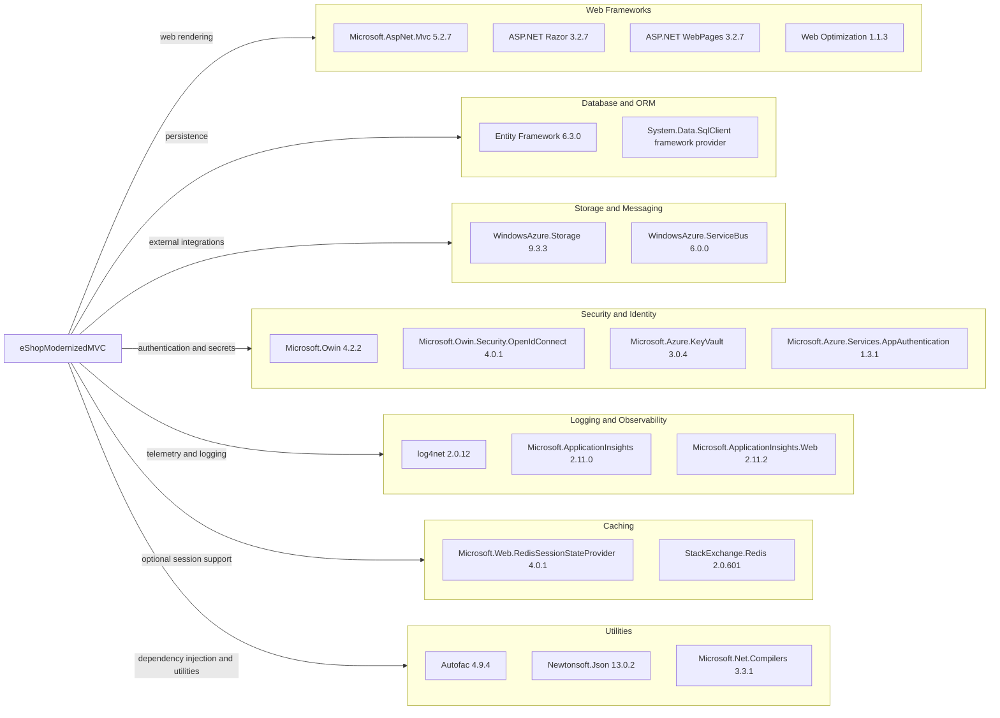

# Dependency Map

The `eShopModernizedMVC` project has 146 package entries in `packages.config`, including the legacy ASP.NET stack and Azure integrations. The list contains no detected test-framework dependencies.

## Dependencies

### Dependency Summary

| Category | Count shown | Key Libraries | Notes |
|---|---:|---|---|
| Web Frameworks | 4 | ASP.NET MVC 5.2.7, Razor 3.2.7, WebPages 3.2.7 | Classic `System.Web` MVC application |
| Database and ORM | 2 | Entity Framework 6.3.0, SQL client provider | SQL Server persistence is optional when mock data is enabled |
| Storage and Messaging | 2 | WindowsAzure.Storage 9.3.3, WindowsAzure.ServiceBus 6.0.0 | Blob storage is used by the Azure image service; no service-bus use was identified in application code |
| Security and Identity | 4 | OWIN 4.2.2, OWIN OpenID Connect 4.0.1, Azure Key Vault 3.0.4 | Azure AD and Key Vault support are configuration-dependent |
| Logging and Observability | 3 | log4net 2.0.12, Application Insights 2.11.0 | Includes Application Insights web and listener integrations |
| Caching | 2 | Redis session provider 4.0.1, StackExchange.Redis 2.0.601 | Redis session configuration in `Web.config` is commented out |
| Utilities | 3 | Autofac 4.9.4, Newtonsoft.Json 13.0.2, Microsoft.Net.Compilers 3.3.1 | The remaining package entries include framework support libraries |

### Version & Compatibility Risks

The application targets .NET Framework 4.7.2 and uses ASP.NET MVC 5, EF6, and older Azure client libraries. These versions are tied to the classic `System.Web` hosting model, so moving to modern .NET requires framework and package replacements rather than a target-framework-only change.

### Notable Observations

- `packages.config` contains 146 entries; most do not represent separately used application features.
- Redis-related packages are present, but the Redis session provider configuration is commented out.
- `WindowsAzure.ServiceBus` appears in the package manifest, but no service-bus usage was found in the application source.
- No test project or test-specific package was found in the solution scope.

## Test Dependencies

| Framework | Version | Notes |
|---|---|---|
| None detected | — | No test project or test-framework package was found |

Total test-scope dependencies: 0

No test dependencies or test infrastructure were detected in the solution.
