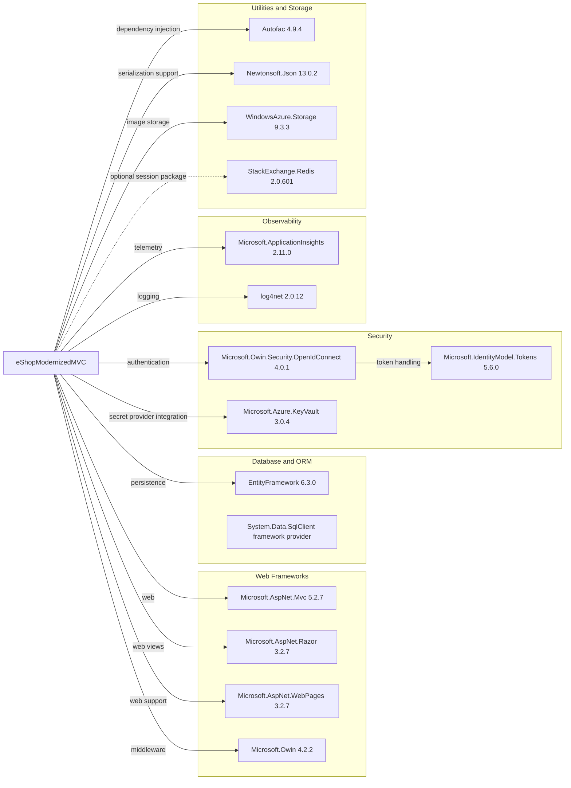

# Dependency Map

The eShopModernizedMVC project declares or resolves 146 NuGet package entries in `packages.config`. The diagram highlights primary libraries; the remaining entries are mainly framework support and transitive packages.

## Dependencies

### Dependency Summary

Counts below are the representative packages shown in the diagram; the full dependency inventory includes 146 entries.

| Category | Count | Key Libraries | Notes |
|---|---:|---|---|
| Web Frameworks | 4 | ASP.NET MVC, Razor, WebPages, OWIN | Classic ASP.NET MVC 5 application |
| Database and ORM | 1 | Entity Framework 6.3.0 | SQL Server provider is provided by the .NET Framework |
| Security | 3 | OWIN OpenID Connect, IdentityModel, Azure Key Vault | Optional Azure Active Directory and Key Vault integration |
| Observability | 2 | Application Insights, log4net | Application telemetry and logging |
| Utilities and Storage | 4 | Autofac, Newtonsoft.Json, WindowsAzure.Storage, StackExchange.Redis | Redis package is present; Redis session setup is commented out |

### Version & Compatibility Risks

The project targets .NET Framework 4.7.2 and uses ASP.NET MVC 5 and Entity Framework 6, so modernization involves a legacy web stack rather than a current .NET platform. Several Azure libraries and supporting packages are older versions. The NuGet CLI dependency listing could not load Visual Studio WebApplication targets in this environment, so this inventory uses the resolved package entries in `packages.config`.

### Notable Observations

- `packages.config` contains 146 package entries, including many `System.*` and Microsoft.Extensions support packages.
- `Microsoft.Net.Compilers` is marked as a development dependency, but no test framework packages or test project were found in this solution.
- Azure Key Vault, managed identity, Blob Storage, and Application Insights integrations are configured as optional application capabilities.
- GitHub Advisory checks for the 146 package entries returned no matching advisories; this does not establish that packages are current or risk-free.

## Test Dependencies

| Framework | Version | Notes |
|---|---|---|
| None detected | — | No test-scoped packages or test project are declared in the solution |

Total test-scope dependencies: 0

No test dependencies were detected in `packages.config`.
