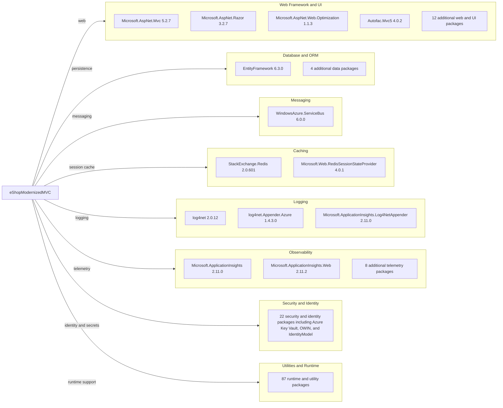

# Dependency Map

The eShopModernizedMVC project declares 146 NuGet packages through `packages.config`. The diagram highlights key dependencies; minor framework-support packages are aggregated for readability.

## Dependencies

### Dependency Summary

| Category | Count | Key Libraries | Notes |
|---|---:|---|---|
| Web Framework and UI | 16 | ASP.NET MVC, Razor, Web Optimization, Autofac.Mvc5 | ASP.NET MVC 5 application |
| Database and ORM | 5 | Entity Framework 6.3.0 | SQL Server persistence |
| Messaging | 1 | WindowsAzure.ServiceBus | Declared messaging library; no message flow found in application code |
| Caching | 2 | StackExchange.Redis, Redis Session State Provider | Redis is used for optional session state |
| Logging | 3 | log4net, Azure appender, Application Insights log appender | Logging configuration is externalized in log4net.xml |
| Observability | 10 | Application Insights and telemetry components | Classic Application Insights integration |
| Security and Identity | 22 | Azure Key Vault, Azure App Authentication, OWIN, IdentityModel | Optional OIDC and secrets configuration |
| Utilities and Runtime | 87 | System.* and other support libraries | Includes framework compatibility packages |

### Version & Compatibility Risks

The project targets .NET Framework 4.7.2 and uses the classic ASP.NET MVC 5 and Entity Framework 6 stack. Several dependency families are older, including IdentityModel 5.6.0, Newtonsoft.Json 13.0.2, and log4net 2.0.12; the security assessment also identified medium-severity advisories for IdentityModel token packages and log4net.

### Notable Observations

- `packages.config` is the dependency source; the project does not use central package management or a lock file.
- Azure Key Vault and configuration-builder packages are present, but the application enables those integrations through configuration.
- Redis is declared for optional session storage; no general-purpose application cache was identified.
- No test-scoped packages or separate test project were found in the target solution.

## Test Dependencies

| Framework | Version | Notes |
|---|---|---|
| None detected | — | No test framework package or test project was found in this solution. |

Total test-scope dependencies: 0

The target solution contains no declared test dependencies; automated test coverage could not be identified from its project structure.
