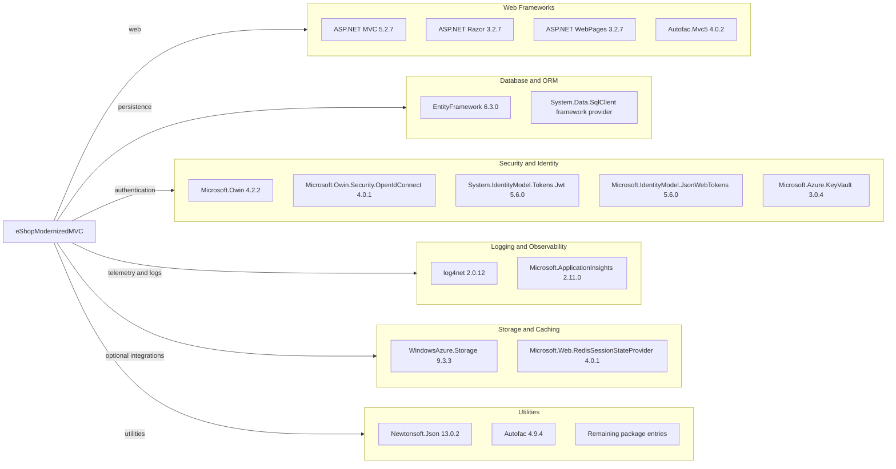

# Dependency Map

The MVC project has 146 package entries in `packages.config`. The legacy project format does not distinguish top-level from transitive packages in that manifest, and the NuGet dependency-tree command could not load the legacy Visual Studio WebApplication target.

## Dependencies

### Dependency Summary

| Category | Count | Key Libraries | Notes |
|---|---:|---|---|
| Web Frameworks | Multiple | ASP.NET MVC 5.2.7, Razor 3.2.7, WebPages 3.2.7 | Classic System.Web MVC application |
| Database / ORM | Multiple | EntityFramework 6.3.0 | SQL Server provider is supplied by the framework/package references |
| Security | Multiple | OWIN OpenID Connect 4.0.1, JWT 5.6.0, Azure Key Vault 3.0.4 | Identity integrations are conditional on configuration |
| Logging / Observability | Multiple | log4net 2.0.12, Application Insights 2.11.0 | Includes dependency and request telemetry components |
| Storage / Caching | Multiple | WindowsAzure.Storage 9.3.3, Redis Session State 4.0.1 | Blob storage is optional; Redis session setup is commented out |
| Utilities | Remaining entries | Autofac 4.9.4, Newtonsoft.Json 13.0.2 | The package manifest includes 146 entries overall |

### Version & Compatibility Risks

The project targets .NET Framework 4.7.2 and ASP.NET MVC 5, so moving to modern .NET requires a framework migration rather than a runtime-only update. Several packages are legacy versions; the security scan identified medium-severity advisories for log4net 2.0.12 and JWT-related packages at 5.6.0. Redis session support and Azure integration packages should be reviewed against the intended deployment configuration.

### Notable Observations

- The project uses `packages.config` and assembly `HintPath` references rather than SDK-style `PackageReference`.
- The package list contains 146 entries but does not indicate which are direct versus transitive.
- Redis session-state support is installed, but the corresponding `sessionState` provider configuration is commented out.
- No test project or test-scoped package set was found in the MVC solution.

## Test Dependencies

| Framework | Version | Notes |
|---|---|---|
| None detected | — | No test project or test-scoped dependency was found in the target solution. |

Total test-scope dependencies: 0

No test dependencies were detected in the project manifest.
