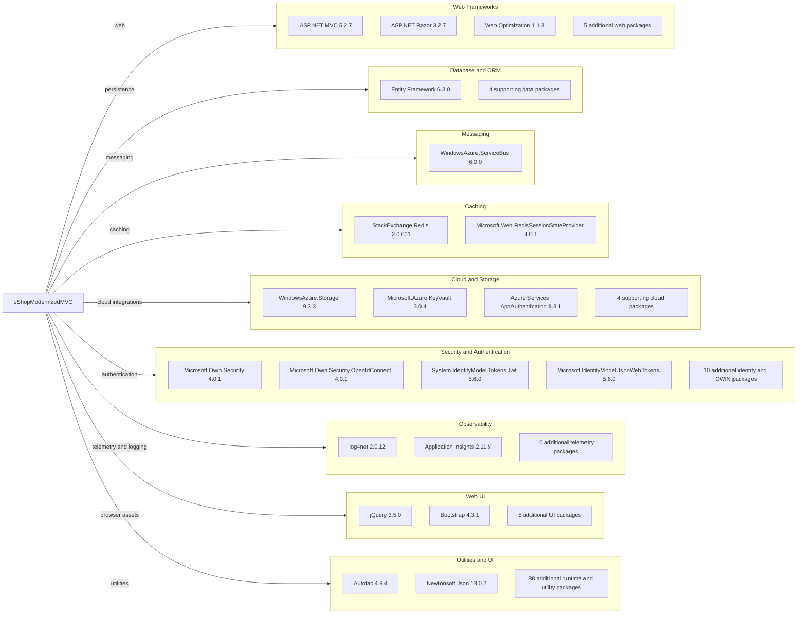

# Dependency Map

The `eShopModernizedMVC` project declares 146 NuGet packages in `packages.config`. The diagram highlights major functional groups; the remaining framework and compatibility packages are summarized to keep it readable.

## Dependencies

### Dependency Summary

| Category | Count shown | Key Libraries | Notes |
|---|---:|---|---|
| Web Frameworks | 8 | ASP.NET MVC 5.2.7, Razor 3.2.7, Web Optimization 1.1.3 | Includes MVC runtime, session, and web infrastructure packages |
| Database / ORM | 5 | Entity Framework 6.3.0, Microsoft.Data.OData 5.8.4 | Includes supporting data and spatial packages |
| Messaging | 1 | WindowsAzure.ServiceBus 6.0.0 | Declared message-bus client |
| Caching | 2 | StackExchange.Redis 2.0.601, Redis session provider 4.0.1 | Redis client/session packages are declared |
| Cloud and Storage | 7 | Azure Storage 9.3.3, Azure Key Vault 3.0.4, AppAuthentication 1.3.1 | Optional blob, vault, and managed-identity integrations |
| Security / Authentication | 14 | OWIN OpenID Connect 4.0.1, JWT libraries 5.6.0 | Azure AD authentication is configurable |
| Observability | 12 | log4net 2.0.12, Application Insights 2.11.x | Multiple telemetry-related packages are declared |
| Web UI | 7 | jQuery 3.5.0, Bootstrap 4.3.1 | Browser libraries and validation assets |
| Utilities | 90 | Autofac 4.9.4, Newtonsoft.Json 13.0.2 | Includes the large System.* compatibility and configuration package set |

### Version & Compatibility Risks

The application targets .NET Framework 4.7.2 and uses the legacy `packages.config` dependency model. Several packages are old, including Entity Framework 6.3.0, log4net 2.0.12, OWIN components, and Azure SDK packages. The .NET 10 upgrade assessment also flags package compatibility and framework modernization concerns. CVE results are documented in the security assessment; the NuGet dependency-tree command could not resolve this classic web project because the runner lacks `Microsoft.WebApplication.targets`, so this inventory reflects declared packages only.

### Notable Observations

- The project declares 146 packages across the groups above, including 90 runtime, configuration, and framework utility packages.
- Both `Microsoft.Azure.KeyVault` and older Azure Storage SDK packages are present; these are modernization-sensitive dependencies.
- Authentication dependencies include JWT packages as well as OWIN OpenID Connect.
- No test-scoped package references were declared in this project.

## Test Dependencies

| Framework | Version | Notes |
|---|---|---|
| None detected | — | The project's `packages.config` has no test-scoped package references. |

Total test-scope dependencies: 0

No test dependencies were detected in the assessed application project.
