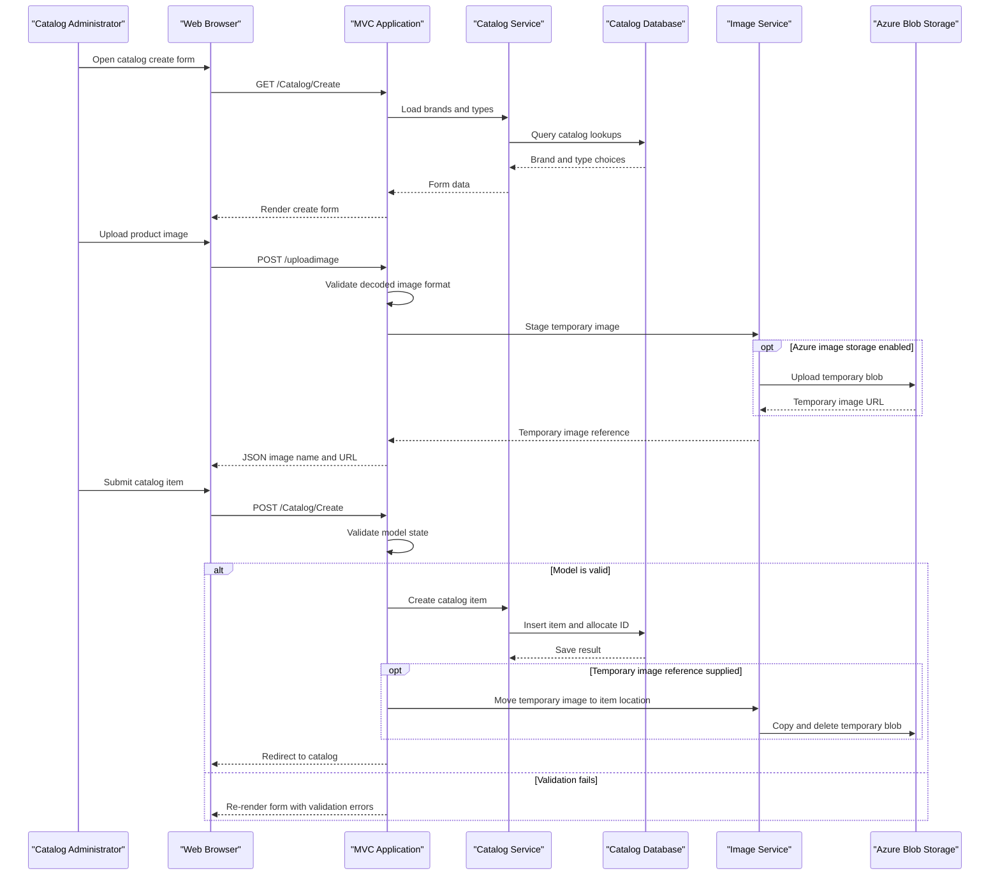

# API & Service Communication Contracts

The application exposes MVC page and form actions plus a single image-upload action that returns JSON. It uses synchronous in-process service calls and optional direct integrations with SQL Server, Azure Blob Storage, and Azure Active Directory.

## Service Catalog

| Service | Port | Category | Purpose |
|---|---:|---|---|
| eShopModernizedMVC | Container 80; host 5115 in Compose override | API Layer | Server-rendered catalog management and image upload |
| sql.data | Container 1433; host 5433 in Compose override | Infrastructure | SQL Server catalog database |

## API Endpoints Inventory

| Service | Method | Path | Request Type | Response Type |
|---|---|---|---|---|
| eShopModernizedMVC | GET | `/Catalog/Index?pageSize={pageSize}&pageIndex={pageIndex}` | Optional query values | Paginated catalog Razor view |
| eShopModernizedMVC | GET | `/Catalog/Details/{id}` | Route ID | Catalog item Razor view or 404 |
| eShopModernizedMVC | GET | `/Catalog/Create` | None | Create form with brand and type choices |
| eShopModernizedMVC | POST | `/Catalog/Create` | `CatalogItem` form model | Redirect or validation form |
| eShopModernizedMVC | GET | `/Catalog/Edit/{id}` | Route ID | Edit form or 404 |
| eShopModernizedMVC | POST | `/Catalog/Edit/{id}` | `CatalogItem` form model | Redirect or validation form |
| eShopModernizedMVC | GET | `/Catalog/Delete/{id}` | Route ID | Delete confirmation view |
| eShopModernizedMVC | POST | `/Catalog/Delete/{id}` | Route ID | Redirect to catalog |
| eShopModernizedMVC | POST | `/uploadimage` | Multipart image and item ID | JSON image name and URL; 400 for invalid image |
| eShopModernizedMVC | GET | `/Account/SignIn` | None | OWIN authentication challenge when enabled |
| eShopModernizedMVC | GET | `/Account/SignOut` | None | OWIN sign-out |
| eShopModernizedMVC | GET | `/Account/EndSession` | None | Local cookie sign-out |

The catalog paths use the conventional MVC route `{controller}/{action}/{id}`; `uploadimage` is an attribute route. No explicit API versioning scheme was identified.

## Management & Observability Endpoints

| Service | Endpoint | Custom Metrics |
|---|---|---|
| eShopModernizedMVC | None identified | Application Insights telemetry and log4net are configured; no custom metric endpoint was found |
| sql.data | Compose health check runs `sqlcmd` | No HTTP management endpoint |

No Swagger/OpenAPI or health-check HTTP endpoint was found.

## DTOs & Contracts

`CatalogItem` is a mutable MVC form model and EF entity used for catalog create and edit requests and catalog responses. `CatalogBrand` and `CatalogType` provide catalog lookup data. `PaginatedItemsViewModel<CatalogItem>` is the catalog-list response model. The image-upload action returns an anonymous JSON object containing an image name and URL. No separate gateway DTOs, immutable records, protobuf schema, GraphQL schema, or OpenAPI document was identified; JSON output uses the MVC/System.Web serialization path.

## Communication Patterns

- Browser-to-application requests use synchronous HTTP and server-rendered MVC views; the image upload returns JSON.
- Controllers call `ICatalogService` and `IImageService` directly. The SQL-backed catalog service uses Entity Framework and `CatalogDBContext`; there is no inter-service REST or message-broker workflow.
- Optional image operations use Azure Blob Storage; the SQL connection can use a configured connection string or an Azure managed identity token.
- Azure AD OpenID Connect and cookie authentication can be enabled by configuration. When disabled, custom middleware assigns an application identity to each request; catalog write actions carry `[Authorize]`.
- No service discovery, API gateway, retry, circuit breaker, bulkhead, or asynchronous messaging mechanism was identified.
- Compose maps the MVC container to HTTP on port 80 and does not configure TLS. The application does not declare a transport-security policy in the selected deployment files.
- The app container declares a dependency on SQL Server, but the main Compose file does not wait for the SQL health check before startup.

## Service Technology Matrix

| Service | Web | Data Access | Discovery | Gateway | Health Checks | Cache | Metrics |
|---|---|---|---|---|---|---|---|
| eShopModernizedMVC | ASP.NET MVC 5 | EF6 and optional mock data | None | None | None found | None found | Application Insights |
| sql.data | SQL Server container | SQL Server | None | None | Compose `sqlcmd` check in override | None | None found |

## Service Communication Sequence

