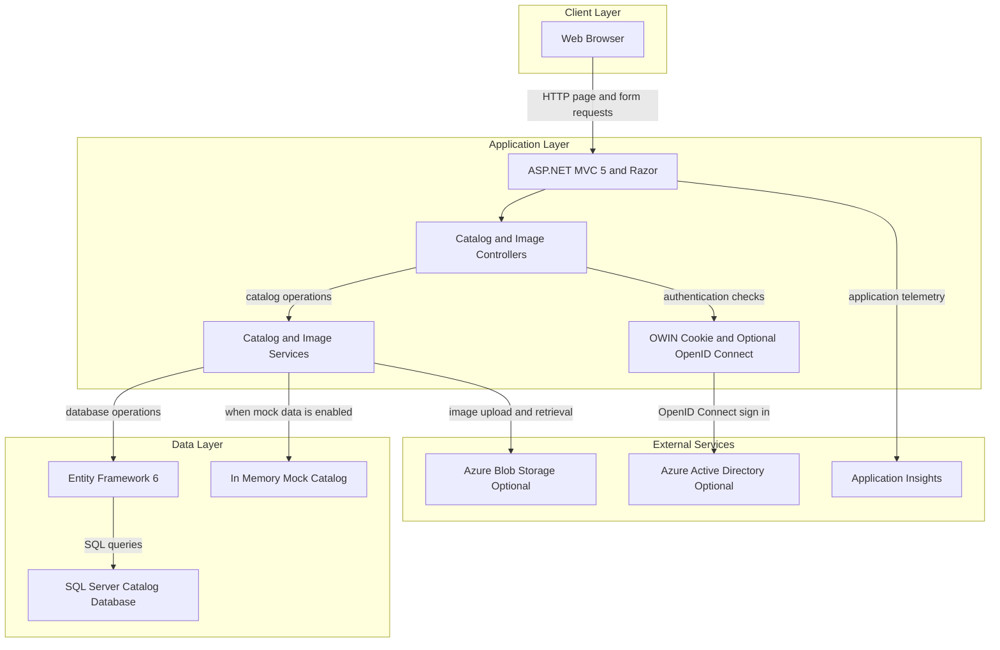
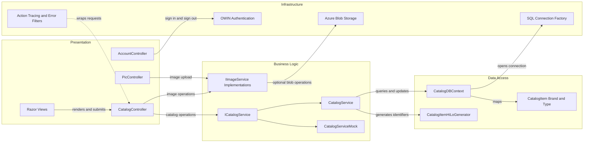

# Architecture Diagram

The application is a server-rendered catalog management site with optional Azure integrations. Its primary request path is a browser, MVC controller, catalog service, and either SQL Server or an in-memory mock catalog.

## Application Architecture

### Technology Stack Summary

| Layer | Technology | Version | Purpose |
|---|---|---:|---|
| Presentation | ASP.NET MVC and Razor | MVC 5.2.7 | Server-rendered catalog management pages |
| Application | .NET Framework | 4.7.2 | Web application runtime |
| Dependency injection | Autofac MVC integration | 4.0.2 | Registers controllers and application services |
| Data access | Entity Framework | 6.3.0 | Maps catalog entities to SQL Server |
| Authentication | OWIN cookies and OpenID Connect | OWIN 4.2.2 packages | Optional Azure AD sign-in |
| Telemetry | Application Insights and log4net | 2.11.0 / 2.0.12 | Application telemetry and logging |
| Container runtime | Windows ASP.NET Framework image | 4.7.2 | Hosts the MVC application in IIS |

### Data Storage & External Services

The application stores catalog items, brands, and types in SQL Server through Entity Framework, or serves mutable in-memory catalog data when mock mode is enabled. Image storage can use local mock behavior or Azure Blob Storage; Azure Active Directory and Application Insights are optional integrations. The Compose configuration also defines a SQL Server container.

### Key Architectural Decisions

- Autofac selects mock or SQL-backed catalog behavior from configuration and registers request-scoped services.
- The MVC application owns catalog persistence; there is no separate catalog API or gateway service.
- Image storage and Azure AD integrations are optional and selected through configuration flags.

## Component Relationships

### Component Inventory

| Component | Layer | Type | Responsibility |
|---|---|---|---|
| CatalogController | Presentation | MVC Controller | Catalog browsing and authorized catalog edits |
| PicController | Presentation | MVC Controller | Validates and stages uploaded catalog images |
| AccountController | Presentation | MVC Controller | Starts and ends authentication flows |
| CatalogService | Business Logic | Service | Performs catalog queries and SQL-backed updates |
| CatalogServiceMock | Business Logic | Service | Serves and mutates preconfigured in-memory catalog data |
| ImageAzureStorage | Business Logic | Storage Service | Uploads and moves catalog images in Azure Blob Storage |
| ImageMockStorage | Business Logic | Storage Service | Supplies local image URLs for mock operation |
| CatalogDBContext | Data Access | Entity Framework DbContext | Maps catalog entities and relationships |
| CatalogItemHiLoGenerator | Data Access | Identifier Generator | Allocates catalog item identifiers from a SQL sequence |
| ApplicationModule | Infrastructure | Autofac Module | Selects and registers service implementations |
| Startup | Infrastructure | OWIN Startup | Configures optional authentication middleware |
