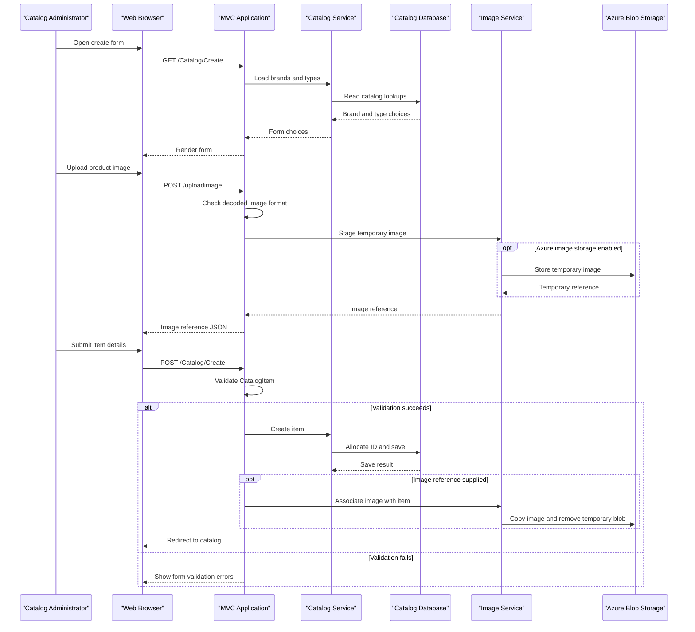

# Core Business Workflows

The application lets catalog administrators browse and maintain the products, brands, and categories presented by the eShop catalog. It supports optional image upload and storage, while purchasing, checkout, and customer-order workflows are outside this application.

## Domain Entities

| Entity | Service / Bounded Context | Description | Key Relationships |
|---|---|---|---|
| CatalogItem | Catalog Management | Product offered in the catalog, including price, stock thresholds, and image reference | Belongs to one brand and one type |
| CatalogBrand | Catalog Management | Brand classification for catalog items | Can be associated with many items |
| CatalogType | Catalog Management | Category/type classification for catalog items | Can be associated with many items |

## Service-to-Domain Mapping

| Service | Domain Context | Owned Entities | External Dependencies |
|---|---|---|---|
| eShopModernizedMVC | Catalog Management | CatalogItem, CatalogBrand, CatalogType | SQL Server, optional Azure Blob Storage, optional Azure AD |

Catalog persistence has a single source of truth in this application. Mock mode replaces SQL-backed catalog operations with an in-memory list; no cross-context entity ownership or service API exchange was identified.

## Primary Workflows

### Workflow 1: Browse the Catalog

1. A visitor opens the catalog list or a product detail page.
2. `CatalogController` requests paginated items or one item from `ICatalogService`.
3. In SQL mode, `CatalogService` queries `CatalogDBContext` and includes the brand/type relations; in mock mode, `CatalogServiceMock` reads the in-memory catalog.
4. The controller adds image URLs and renders the Razor view.

### Workflow 2: Create or Edit a Catalog Item

1. An authorized administrator opens the create or edit form; the controller supplies available brands and types.
2. The browser can upload an image through `POST /uploadimage`. `PicController` accepts only content decoded as JPEG, PNG, or GIF, then the image service stages it and returns a temporary reference.
3. The administrator submits the catalog form. MVC model validation checks the submitted `CatalogItem`.
4. The catalog service creates or updates the item. SQL mode allocates an item ID from a SQL sequence and saves through EF6; mock mode mutates its in-memory list.
5. If a temporary image reference is present, the image service moves the staged image to the item location. The controller redirects to the catalog.

### Workflow 3: Delete a Catalog Item

1. An authorized administrator requests the confirmation page for an item.
2. The controller loads the item and renders the confirmation view.
3. On POST, `DeleteConfirmed` loads and removes the item through the catalog service, then redirects to the catalog.

## Cross-Service Data Flows

There are no independently deployed business services or gateway aggregation flows. The MVC application directly reads and writes its catalog data in SQL Server and optionally calls Azure Blob Storage for image operations. When image storage is unavailable or disabled, the selected image service implementation controls the fallback behavior; no retry or circuit-breaker policy was identified. Database updates and blob operations are separate, non-atomic actions.

## Business Workflow Sequence

## Business Rules & Decision Logic

- `CatalogItem.Name` is required. Price must be between 0 and 1,000,000 and match the configured decimal format with at most two fractional digits.
- Available stock, restock threshold, and maximum stock threshold must each be between 0 and 10,000,000. EF mapping requires an item to reference an existing brand and type.
- The database mapping limits item name to 50 characters and brand/type labels to 100 characters. `OnReorder` is a boolean domain indicator; no explicit item lifecycle state machine was identified.
- Item identifiers are allocated from the catalog HiLo SQL sequence in SQL mode. The in-memory mock service assigns the next ID from the current maximum.
- Catalog write actions use `[Authorize]`; Azure AD cookie/OpenID Connect authentication is optional. When AAD is disabled, the application installs custom middleware that assigns a claims identity.
- EF persistence uses individual `SaveChanges` operations. Image storage is performed separately from database persistence, so these changes do not share an atomic transaction.
- Account and catalog actions emit log4net informational messages; the authentication failure notification redirects but does not log the failure event.
