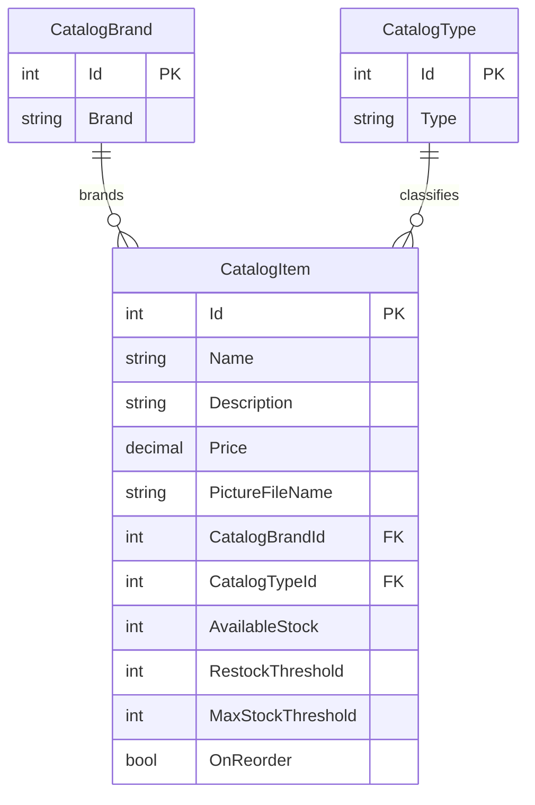

# Data Architecture & Persistence Layer

The application models a catalog of items, brands, and types and uses Entity Framework 6 over SQL Server when mock mode is disabled. A mock service provides in-memory catalog behavior for development and demonstration.

## Database Configuration

| Service/Module | DB Type | Profile | Driver | Connection | Migration Tool |
|---|---|---|---|---|---|
| eShopModernizedMVC | SQL Server | Default SQL mode; Compose supplies `sql.data` | .NET `System.Data.SqlClient` | `CatalogDBContext` connection string is externalized; values are not reproduced here | No EF migration tool detected; `CreateDatabaseIfNotExists` initializer and SQL sequence scripts are used |
| eShopModernizedMVC | In-memory list | Mock mode | None | No database connection | Not applicable |

Database initialization seeds catalog data from source-defined records or optional CSV customization files. The initializer executes checked-in SQL scripts for catalog sequences. Mock mode skips database initialization.

## Data Ownership per Service

| Service | Tables Owned | ORM Framework | Caching | Notes |
|---|---|---|---|---|
| eShopModernizedMVC | `Catalog`, `CatalogBrand`, `CatalogType` | Entity Framework 6 | None identified | Single application and data owner; mock mode keeps data in a process-local list |

## Entity Model

`CatalogItem` is mapped to the `Catalog` table; the other entities map to `CatalogBrand` and `CatalogType`. The item-to-brand and item-to-type relationships are required, with each lookup entity related to many catalog items. Sources: `src/eShopModernizedMVC/Models/CatalogItem.cs`, `CatalogBrand.cs`, `CatalogType.cs`, and `CatalogDBContext.cs`.

## Key Repository Methods

| Service | Repository | Notable Methods | Purpose |
|---|---|---|---|
| eShopModernizedMVC | No repository interface; `CatalogService` uses `CatalogDBContext` directly | `GetCatalogItemsPaginated(pageSize, pageIndex)` | Loads and pages items with brand and type data |
| eShopModernizedMVC | No repository interface; `CatalogService` uses `CatalogDBContext` directly | `FindCatalogItem(id)` | Finds a catalog item with its lookup entities |
| eShopModernizedMVC | No repository interface; `CatalogService` uses `CatalogDBContext` directly | `CreateCatalogItem`, `UpdateCatalogItem`, `RemoveCatalogItem` | Persists catalog changes through EF6 |
| eShopModernizedMVC | `CatalogItemHiLoGenerator` | `GetNextSequenceValue(db)` | Allocates item identifiers using the SQL sequence |

Sources: `src/eShopModernizedMVC/Services/CatalogService.cs` and `src/eShopModernizedMVC/Models/CatalogItemHiLoGenerator.cs`.

## Caching Strategy

No active application data cache was identified. ASP.NET output caching is globally configured with a zero-second duration and `NoStore=true`; session uses the framework default in-process behavior. Redis session-state packages are declared but no active Redis provider configuration was found.

## Data Ownership Boundaries

The MVC application is the sole owner of the catalog tables and accesses SQL Server directly through EF6. There are no separate service databases, cross-service queries, CQRS read models, or service-to-service aggregation patterns. Image files are optionally stored in an Azure Blob Storage container; this is separate from catalog relational data. The mock implementation keeps catalog state in an in-memory list.

### Data Classification & Sensitivity

| Entity | Sensitive Fields | Classification (PII/PHI/PCI/None) | Controls in Place |
|---|---|---|---|
| CatalogItem | Product name, description, pricing, stock, and image reference | None | No PII, PHI, or PCI identified; no field-level encryption or masking configured |
| CatalogBrand | Brand name | None | No sensitive data identified |
| CatalogType | Type label | None | No sensitive data identified |

No PII, PHI, or PCI data was detected in the catalog entity model.
