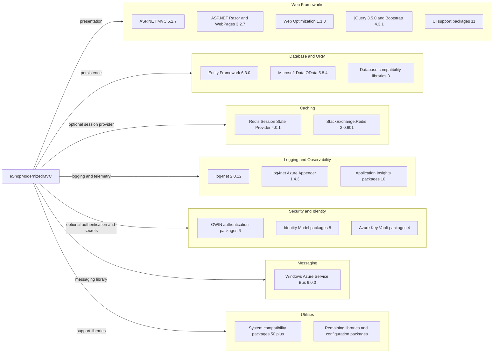

# Dependency Map

The eShopModernizedMVC project declares 146 NuGet package entries in `src/eShopModernizedMVC/packages.config`; the legacy packages.config format also lists installed transitive packages.

## Dependencies

### Dependency Summary

| Category | Count | Key Libraries | Notes |
|---|---:|---|---|
| Web Frameworks | 16 | ASP.NET MVC, Razor, Web Optimization, jQuery, Bootstrap | Legacy server-rendered MVC stack |
| Database / ORM | 5 | Entity Framework, Microsoft.Data.OData, Microsoft.Data.Edm | SQL Server access is through EF6 |
| Caching | 2 | Redis Session State Provider, StackExchange.Redis | Packages are declared; active Redis session configuration was not found |
| Logging / Observability | 12 | log4net, Application Insights | Application Insights and Azure appender integrations |
| Security | 17 | OWIN, IdentityModel, Azure Key Vault, Azure App Authentication | Optional OIDC and configuration-builder integration |
| Messaging | 1 | Windows Azure Service Bus | No message-broker usage was identified in the application flow |
| Utilities | 92 | System compatibility packages and other libraries | Includes many framework-support packages from packages.config |

### Version & Compatibility Risks

The application targets .NET Framework 4.7.2 and ASP.NET MVC 5.2.7, with several older integration packages. The package set includes beta configuration-builder packages and legacy System.* support libraries; moving to a newer .NET runtime will require compatibility review rather than only changing a target framework.

### Notable Observations

- The project uses classic `packages.config`, and its 146 entries include framework support and transitive packages as well as application-facing libraries.
- The ASP.NET Redis session provider and Redis client are present, but no active Redis session configuration was found.
- Messaging and blob libraries are declared although the app's primary business path is catalog management.
- The selected solution contains no separate test project or test-scoped package set.

## Test Dependencies

| Framework | Version | Notes |
|---|---|---|
| None detected | — | No test project or test-only dependency was found in the selected solution. |

Total test-scope dependencies: 0

No test dependencies were detected in the selected project.
