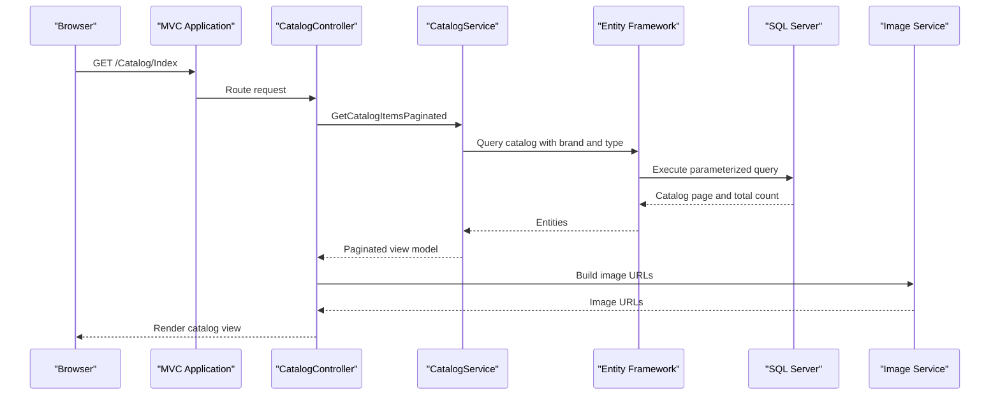

# API & Service Communication Contracts

The application exposes MVC page and form actions rather than a separately versioned REST API. Controllers call in-process service interfaces; persistence and optional image storage are the only identified external service interactions.

## Service Catalog

| Service | Port | Category | Purpose |
|---|---:|---|---|
| eShopModernizedMVC | Container 80; Docker host 5115 | API Layer / Web | Serves catalog pages, catalog management forms, and image upload responses |
| SQL Server (`sql.data`) | Container 1433; Docker host 5433 | Infrastructure | Stores catalog data when mock data is disabled |
| Azure Blob Storage | External | Infrastructure | Optional image storage |
| Microsoft Entra ID | External | Infrastructure | Optional OpenID Connect identity provider |

## API Endpoints Inventory

The default route is `{controller}/{action}/{id}` and defaults to `Catalog/Index`; the image upload uses an attribute route.

| Service | Method | Path | Request Type | Response Type |
|---|---|---|---|---|
| eShopModernizedMVC | GET | `/Catalog/Index` | Optional `pageSize`, `pageIndex` query values | `PaginatedItemsViewModel<CatalogItem>` rendered as a view |
| eShopModernizedMVC | GET | `/Catalog/Details/{id}` | `id` path/query parameter | Catalog item view; 400 or 404 on invalid/missing item |
| eShopModernizedMVC | GET | `/Catalog/Create` | None; authorization required | Create view with `CatalogItem` form |
| eShopModernizedMVC | POST | `/Catalog/Create` | Bound `CatalogItem`; authorization required | Redirect to catalog or validation view |
| eShopModernizedMVC | GET | `/Catalog/Edit/{id}` | `id` path/query parameter; authorization required | Edit view |
| eShopModernizedMVC | POST | `/Catalog/Edit` | Bound `CatalogItem`; authorization required | Redirect to catalog or validation view |
| eShopModernizedMVC | GET | `/Catalog/Delete/{id}` | `id` path/query parameter; authorization required | Delete confirmation view |
| eShopModernizedMVC | POST | `/Catalog/Delete/{id}` | `id` path parameter; authorization required | Redirect to catalog |
| eShopModernizedMVC | GET | `/Account/SignIn` | None | Starts OpenID Connect challenge when not authenticated |
| eShopModernizedMVC | GET | `/Account/SignOut` | None | Signs out of OpenID Connect and cookie middleware |
| eShopModernizedMVC | GET | `/Account/EndSession` | None | Ends the local cookie session |
| eShopModernizedMVC | POST | `/uploadimage` | Multipart image file and `itemId` form value | JSON object with image name and URL; 400 for invalid image |

The project has no API versioning scheme, OpenAPI/Swagger document, GraphQL schema, or protobuf contract.

## Management & Observability Endpoints

| Service | Endpoint | Custom Metrics |
|---|---|---|
| eShopModernizedMVC | No application health or metrics endpoint identified | Application Insights telemetry is optional; no custom metric registration found |

## DTOs & Contracts

`CatalogItem`, `CatalogBrand`, and `CatalogType` are mutable EF entity classes; `CatalogItem` is also used as the MVC form-binding type. `PaginatedItemsViewModel<CatalogItem>` is the catalog-list response model. Image upload returns an anonymous JSON response with a name and URL. No immutable API DTOs, gateway aggregation DTOs, explicit serialization customization, or API specification was found.

## Communication Patterns

Controller-to-service communication is synchronous and in-process through `ICatalogService` and `IImageService`. The database service uses EF6 over SQL Server; Azure image storage is optional and is called directly from the MVC process. No asynchronous message broker flow, API gateway, service discovery, retry policy, circuit breaker, or client-side load balancing was found. Startup initializes Autofac and routes, conditionally initializes the SQL database, initializes catalog images, and configures telemetry.

Authentication is configuration-dependent: Microsoft Entra ID OpenID Connect and cookies are enabled only when the corresponding feature flag is true; otherwise a custom OWIN middleware supplies a claims identity. Catalog mutations have `[Authorize]` attributes, but no role-based policy was found. The Docker port mapping exposes the application container’s HTTP port; no application-level TLS enforcement was identified.

## Service Technology Matrix

| Service | Web | Data Access | Discovery | Gateway | Health | Cache | Metrics |
|---|---|---|---|---|---|---|---|
| eShopModernizedMVC | ASP.NET MVC 5 | EF6 / SQL Server | None | None | None found | None active | Optional Application Insights |
| SQL Server (`sql.data`) | Database service | SQL Server | Compose service name | N/A | Compose health check | N/A | N/A |

## Service Communication Sequence

