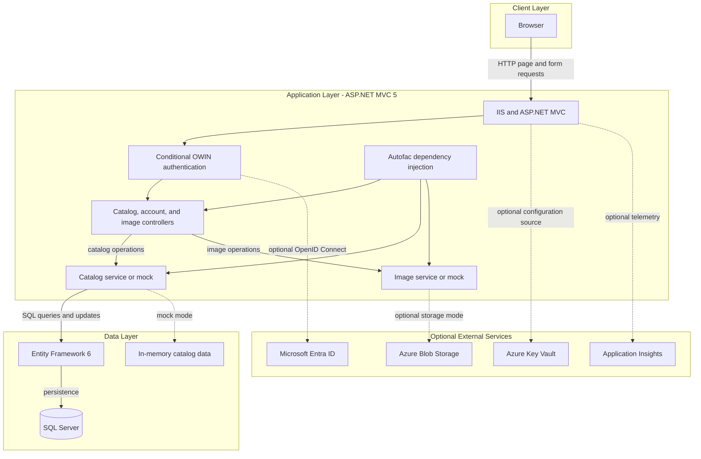
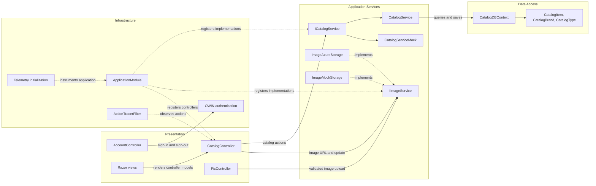

# Architecture Diagram

The target is a server-rendered catalog application with MVC presentation, application services, and an Entity Framework persistence layer. It runs in IIS on .NET Framework and can use SQL Server and Azure services, while mock implementations are enabled by default.

## Application Architecture

### Technology Stack Summary

| Layer | Technology | Version | Purpose |
|---|---|---:|---|
| Presentation | ASP.NET MVC | 5.2.7 | Server-rendered catalog pages and form actions |
| Runtime | .NET Framework | 4.7.2 | Application runtime |
| Dependency injection | Autofac | 4.9.4 | Registers application services and controllers |
| Data access | Entity Framework | 6.3.0 | Maps catalog entities to SQL Server |
| Persistence | SQL Server | Compose image; LocalDB by default | Stores catalog items, brands, and types |
| Image storage | Azure Storage SDK or local mock | WindowsAzure.Storage 9.3.3 | Stores and serves catalog images when enabled |
| Authentication | OWIN cookies and OpenID Connect | OWIN 4.2.2 packages | Optional Microsoft Entra ID sign-in |
| Telemetry | Application Insights and log4net | 2.11.x; 2.0.12 | Application telemetry and logging |

### Data Storage & External Services

The application persists catalog data through EF6 to SQL Server when mock mode is disabled; the default configuration uses mock catalog data. Images use a mock implementation by default and can use Azure Blob Storage. Microsoft Entra ID, Azure Key Vault configuration, and Application Insights are optional integrations. No active message-broker or distributed-cache usage was identified.

### Key Architectural Decisions

- The MVC application is a single deployable web application with interface-based catalog and image services.
- Autofac selects mock or production-oriented implementations from configuration.
- Catalog persistence uses an EF6 context directly; there is no separate repository layer.

## Component Relationships

### Component Inventory

| Component | Layer | Type | Responsibility |
|---|---|---|---|
| CatalogController | Presentation | MVC controller | Catalog browsing and authorized catalog management |
| PicController | Presentation | MVC controller | Accepts and validates catalog image uploads |
| AccountController | Presentation | MVC controller | Starts and ends authentication sessions |
| Razor views | Presentation | Views | Renders catalog pages and forms |
| CatalogService | Business | Service | Reads and writes catalog data through EF6 |
| CatalogServiceMock | Business | Mock service | Provides mutable in-memory catalog behavior |
| ImageAzureStorage | Business / Infrastructure | Image service | Uploads and updates Azure Blob images |
| ImageMockStorage | Business / Infrastructure | Image service | Provides local mock image URLs |
| CatalogDBContext | Data Access | EF6 DbContext | Maps catalog entities and relationships |
| ApplicationModule | Infrastructure | Autofac module | Selects service implementations from configuration |
| AuthenticationMiddleware | Infrastructure | OWIN middleware | Supplies the fallback claims identity when Entra sign-in is disabled |
| ActionTracerFilter | Infrastructure | MVC filter | Emits action trace information |
