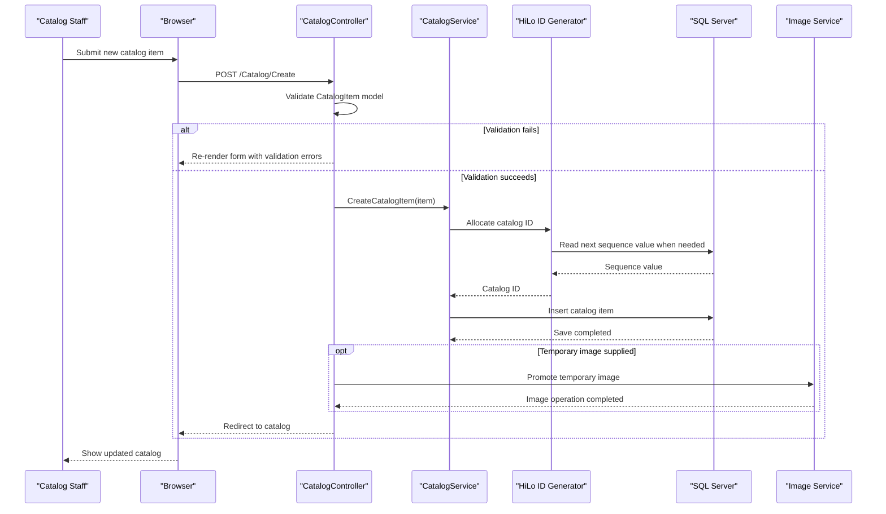

# Core Business Workflows

The application supports maintaining and browsing an e-commerce product catalog. Catalog staff can create, edit, and remove products, while visitors browse products and view details; product imagery is handled through a separate image service.

## Domain Entities

| Entity | Service / Bounded Context | Description | Key Relationships |
|---|---|---|---|
| CatalogItem | eShopModernizedMVC / Product Catalog | A product offered in the catalog with price, stock, and image metadata | Belongs to one catalog brand and one catalog type |
| CatalogBrand | eShopModernizedMVC / Product Catalog | Brand classification for products | Can classify multiple catalog items |
| CatalogType | eShopModernizedMVC / Product Catalog | Category/type classification for products | Can categorize multiple catalog items |

## Service-to-Domain Mapping

| Service | Domain Context | Owned Entities | External Dependencies |
|---|---|---|---|
| eShopModernizedMVC | Product Catalog | CatalogItem, CatalogBrand, CatalogType | SQL Server when database mode is enabled; optional Azure Blob Storage |
| CatalogServiceMock | Product Catalog (development/mock) | In-memory CatalogItem list | Preconfigured in-process data |
| Image service | Catalog media | Image metadata/URL only; bytes are outside the catalog database in Azure mode | Azure Blob Storage or mock local image paths |

All domain operations occur in one application. There are no separate bounded-context services, cross-service events, or distributed data exchanges.

## Primary Workflows

### Workflow 1: Browse the catalog

1. A visitor opens `GET /Catalog/Index`, optionally supplying `pageSize` and `pageIndex`.
2. `CatalogController` asks `ICatalogService` for an ordered catalog page with associated brand and type data.
3. The selected database-backed or mock service returns a paginated view model.
4. The controller builds the image URLs and renders the catalog view.

### Workflow 2: Create or update a catalog item

1. An authorized catalog user opens the create or edit form and submits a `CatalogItem`.
2. MVC model validation checks the entity; invalid values return the form with validation state.
3. The service persists the item through EF6 and assigns an application-generated identifier for new items.
4. When a temporary image is present, the image service promotes it to the item’s final image location.
5. The user is redirected to the catalog listing.

### Workflow 3: Upload a catalog image

1. The browser posts an image and item identifier to `/uploadimage`.
2. `PicController` attempts to decode the input as an image and accepts JPEG, PNG, or GIF formats.
3. The configured image service stores the image in Azure Blob Storage or uses the mock implementation.
4. The controller returns a JSON object with the image URL and name for the form workflow.

### Workflow 4: Remove a catalog item

1. An authorized user opens the delete confirmation for a catalog item.
2. The POST delete action resolves the item through `ICatalogService`, removes it, and redirects to the catalog.

## Cross-Service Data Flows

No service-to-service data composition exists. The MVC application reads and writes catalog entities through its own EF context. When Azure storage is enabled, image operations are a direct application-to-Blob interaction; there is no downstream service fallback policy. The mock image implementation returns local image URLs instead of performing a remote upload.

## Business Workflow Sequence

## Business Rules & Decision Logic

- A catalog item requires a name; price is constrained to 0 through 1,000,000 and at most two decimal places.
- Available stock, restock threshold, and maximum stock threshold are constrained to 0 through 10,000,000.
- Catalog items require a valid brand and type relationship.
- New database-backed catalog items use a Hi-Lo sequence generator; mock items receive an identifier based on the current in-memory list.
- Image upload accepts decoded JPEG, PNG, and GIF formats. Image storage behavior is selected by configuration.
- Create, edit, and delete catalog actions are marked `[Authorize]`; reads and image upload are not marked with that attribute.
- No order, payment, checkout, inventory reservation, audit-trail, or multi-service transaction workflow was found.
