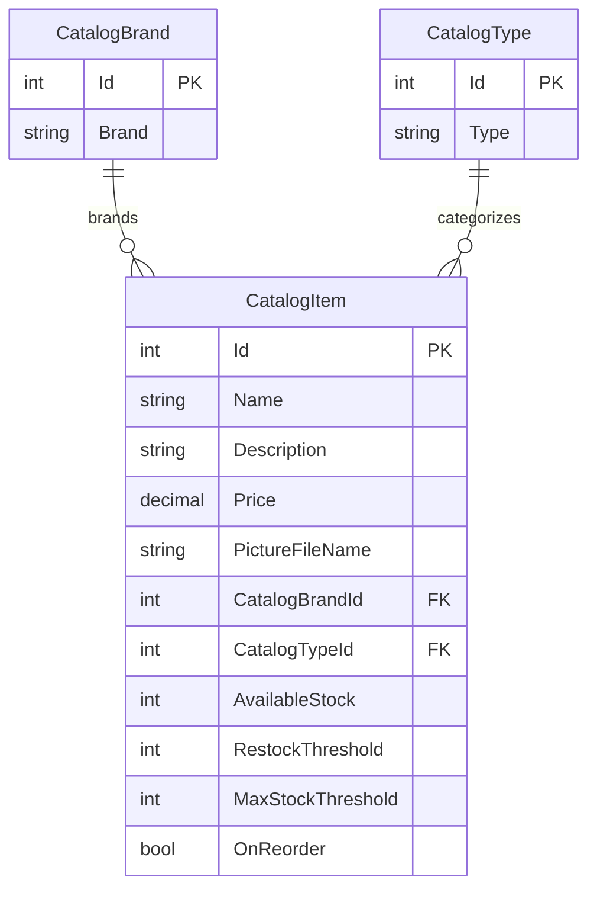

# Data Architecture & Persistence Layer

The catalog data model contains three EF6 entities stored in SQL Server when the database-backed mode is enabled. The application also supports a default in-memory catalog mock and optional image storage outside the relational database.

## Database Configuration

| Service/Module | DB Type | Profile | Driver | Connection | Migration Tool |
|---|---|---|---|---|---|
| eShopModernizedMVC | SQL Server | Local development default | System.Data.SqlClient | LocalDB connection in `Web.config`, externalized through config builders | EF6 `CreateDatabaseIfNotExists` initializer and SQL sequence scripts |
| eShopModernizedMVC | SQL Server | Docker SQL mode | System.Data.SqlClient | Compose SQL service; connection supplied by environment configuration | Database initializer and seed scripts |
| eShopModernizedMVC | In-memory mock | Default application configuration | N/A | Process memory | Preconfigured data |

The initializer seeds catalog types, brands, and items from preconfigured data or CSV files. SQL sequence creation scripts are executed during database initialization; no EF migration history or separate migration tool was identified.

## Data Ownership per Service

| Service | Tables Owned | ORM Framework | Caching | Notes |
|---|---|---|---|---|
| eShopModernizedMVC | `Catalog`, `CatalogBrand`, `CatalogType` | Entity Framework 6.3.0 | None active | One application owns all catalog entities; mock catalog is an in-memory alternative |

## Entity Model

`CatalogItem` is the central catalog entity and has required foreign-key relationships to `CatalogBrand` and `CatalogType`. The EF context maps these to the `Catalog`, `CatalogBrand`, and `CatalogType` tables; the item identifier is generated by an application-side Hi-Lo sequence mechanism.

## Key Repository Methods

| Service | Repository | Notable Methods | Purpose |
|---|---|---|---|
| eShopModernizedMVC | No repository interface; `CatalogService` uses `CatalogDBContext` directly | `GetCatalogItemsPaginated(pageSize, pageIndex)`, `FindCatalogItem(id)` | Retrieves ordered catalog items with related brand/type data or one item |
| eShopModernizedMVC | No repository interface; `CatalogService` uses `CatalogDBContext` directly | `GetCatalogTypes()`, `GetCatalogBrands()` | Returns selector data for catalog forms |
| eShopModernizedMVC | No repository interface; `CatalogService` uses `CatalogDBContext` directly | `CreateCatalogItem(item)`, `UpdateCatalogItem(item)`, `RemoveCatalogItem(item)` | Persists catalog mutations |

The mock service implements the same interface against a shared in-memory list. The relational service uses EF `DbSet` operations and `SaveChanges`; no custom SQL repository or stored procedure layer was found beyond the sequence queries used by the ID generator.

## Caching Strategy

No application data cache was identified. Redis client and Redis session-state packages are declared, but the Redis session configuration in `Web.config` is commented out and no active cache provider is registered.

## Data Ownership Boundaries

This is a single application and database boundary: the MVC application is the source of truth for catalog items, brands, and types. There is no cross-service database access or service-to-service data composition. Catalog item image bytes are stored in Azure Blob Storage only when Azure storage is enabled; otherwise the mock image service returns local image URLs. Mock catalog mode uses a process-wide in-memory list rather than a persistent store.

### Data Classification & Sensitivity

| Entity | Sensitive Fields | Classification (PII/PHI/PCI/None) | Controls in Place |
|---|---|---|---|
| CatalogItem | Product name, description, price, image name, and stock values | None | No PII, PHI, or PCI data identified in this entity |
| CatalogBrand | Brand name | None | No sensitive personal or payment data identified |
| CatalogType | Type name | None | No sensitive personal or payment data identified |

No PII, PHI, or PCI data was detected in the catalog entity model.
