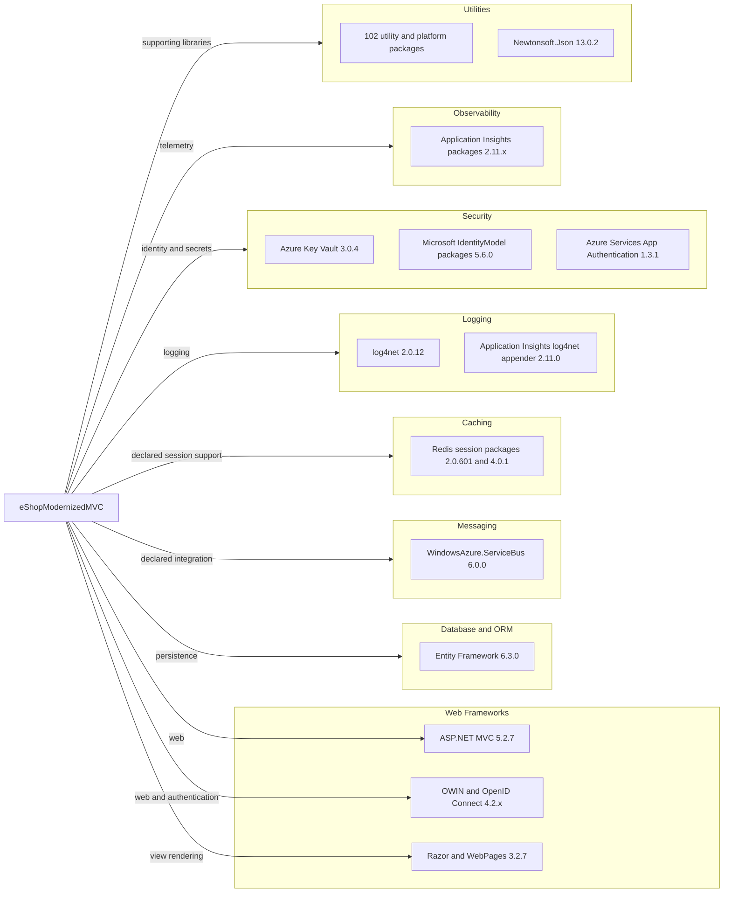

# Dependency Map

The eShopModernizedMVC project targets .NET Framework 4.7.2 and records 146 NuGet package entries in `packages.config`, including packages pulled in transitively.

## Dependencies

### Dependency Summary

| Category | Count | Key Libraries | Notes |
|---|---:|---|---|
| Web Frameworks | 9 | ASP.NET MVC 5.2.7, OWIN 4.2.2, Razor 3.2.7 | Legacy System.Web MVC application |
| Database / ORM | 1 | Entity Framework 6.3.0 | SQL Server access through EF6 |
| Messaging | 1 | WindowsAzure.ServiceBus 6.0.0 | Declared package; no active service usage found |
| Caching | 2 | StackExchange.Redis 2.0.601, Redis session provider 4.0.1 | Redis session configuration is commented out |
| Logging | 2 | log4net 2.0.12, Application Insights Log4Net Appender 2.11.0 | The app uses log4net and tracing |
| Security | 19 | Azure Key Vault, Microsoft IdentityModel, Azure App Authentication | Includes configuration builders and identity dependencies |
| Observability | 10 | Microsoft.ApplicationInsights 2.11.x family | Optional telemetry integration |
| Utilities | 102 | Newtonsoft.Json 13.0.2 and supporting libraries | Count includes framework support and transitive entries from `packages.config` |

### Version & Compatibility Risks

The application remains on .NET Framework 4.7.2, ASP.NET MVC 5, and EF6, which require Windows hosting and have a migration path to modern .NET rather than a direct framework retarget. The CVE scan found medium-severity advisories affecting log4net 2.0.12 and IdentityModel packages 5.6.0; see the security assessment for the affected package ranges.

### Notable Observations

- `packages.config` contains 146 package entries, including many transitive `System.*` and Microsoft support packages.
- Redis and Azure Service Bus packages are present, but corresponding active application usage was not found; the Redis session block is commented out.
- `System.Data.SqlClient` is used by the application but is provided as a framework reference, not a package entry.
- No test framework dependencies or test project were found in the target solution.

## Test Dependencies

| Framework | Version | Notes |
|---|---|---|
| None detected | — | No test-scoped packages or test project were found in the assessed solution |

Total test-scope dependencies: 0

No test dependencies were detected in the project package manifest.
