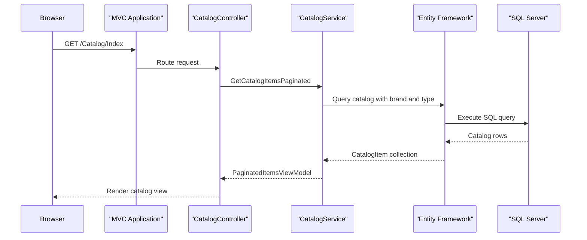

# API & Service Communication Contracts

The application exposes MVC page and form actions plus one image-upload action. Communication is synchronous HTTP from a browser to the MVC application, with direct calls from application services to SQL Server and optional Azure Blob Storage.

## Service Catalog

| Service | Port | Category | Purpose |
|---|---:|---|---|
| eShopModernizedMVC | 80 in the Windows container | API Layer | Server-rendered catalog pages, catalog administration, and image uploads |
| sql.data | 1433 in the Compose network | Infrastructure | SQL Server database for catalog persistence |
| Azure Blob Storage | HTTPS endpoint | Infrastructure | Optional image storage |
| Azure Active Directory | HTTPS endpoint | Infrastructure | Optional OpenID Connect identity provider |

## API Endpoints Inventory

Routes use the conventional `{controller}/{action}/{id}` route unless noted; response types are MVC views except where specified.

| Service | Method | Path | Request Type | Response Type |
|---|---|---|---|---|
| eShopModernizedMVC | GET | `/Catalog/Index?pageSize={pageSize}&pageIndex={pageIndex}` | Query parameters | Catalog view with `PaginatedItemsViewModel<CatalogItem>` |
| eShopModernizedMVC | GET | `/Catalog/Details/{id}` | Path parameter | Catalog item view |
| eShopModernizedMVC | GET / POST | `/Catalog/Create` | Form fields bound to `CatalogItem` | Form view or redirect to index |
| eShopModernizedMVC | GET / POST | `/Catalog/Edit/{id}` | Path / form fields bound to `CatalogItem` | Form view or redirect to index |
| eShopModernizedMVC | GET / POST | `/Catalog/Delete/{id}` | Path / form identifier | Confirmation view or redirect to index |
| eShopModernizedMVC | POST | `/uploadimage` | Multipart image and `itemId`; attribute route | JSON object containing image name and URL |
| eShopModernizedMVC | Any MVC verb | `/Account/SignIn` | No body | Sign-in redirect or no-op for an already authenticated request |
| eShopModernizedMVC | Any MVC verb | `/Account/SignOut` | No body | Sign-out response |
| eShopModernizedMVC | Any MVC verb | `/Account/EndSession` | No body | Session sign-out response |

No API versioning scheme or OpenAPI contract was found.

## Management & Observability Endpoints

| Service | Endpoint | Custom Metrics |
|---|---|---|
| eShopModernizedMVC | None identified | Application Insights telemetry is configured; no custom metric registration was found |

## DTOs & Contracts

`CatalogItem` is both the catalog domain entity and the form model for create/edit requests. `PaginatedItemsViewModel<CatalogItem>` is the catalog listing response model. `PicController.UploadImage` returns an anonymous JSON contract with `name` and `url`. These models are mutable classes; no immutable records, generated OpenAPI schema, protobuf, or GraphQL schema was found. MVC JSON serialization is used for the upload response.

## Communication Patterns

- Browser requests and MVC controller-to-service calls are synchronous.
- Catalog persistence is performed through Entity Framework and a SQL Server connection.
- Image operations use the `IImageService` abstraction, selecting mock storage or Azure Blob Storage from configuration.
- Azure AD OpenID Connect and cookie authentication are optional. Catalog administration actions are decorated with `[Authorize]`; the image-upload action does not have a controller-level or action-level `[Authorize]` attribute. With Azure AD disabled, custom middleware assigns a `ClaimsIdentity` to each request without validating credentials, so `[Authorize]` does not provide an identity check in that configuration.
- No retry, circuit-breaker, service-discovery, API gateway, or message-broker communication policy was found in the application source.
- The application does not enforce HTTPS in its MVC routing configuration; TLS depends on the hosting environment.
- Compose declares the SQL dependency, but no readiness wait or database health check is configured.

## Service Technology Matrix

| Service | Web | Data Access | Discovery | Gateway | Health | Cache | Metrics |
|---|---|---|---|---|---|---|---|
| eShopModernizedMVC | ASP.NET MVC 5 | Entity Framework 6 | None | None | None found | Redis session package is not active | Application Insights |
| sql.data | SQL Server | SQL Server engine | Compose service name | None | No Compose health check found | None | None identified |

## Service Communication Sequence

