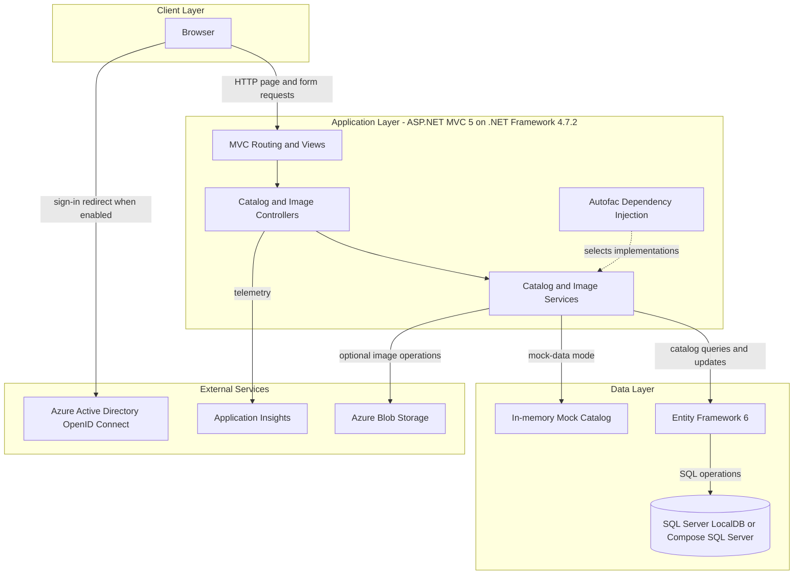
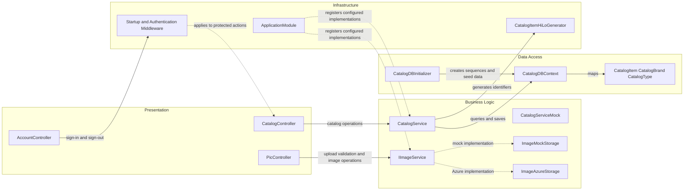

# Architecture Diagram

The application is a single ASP.NET MVC catalog site with configurable mock or SQL-backed data and mock or Azure Blob image storage. Optional identity, telemetry, and container settings are selected through configuration.

## Application Architecture

### Technology Stack Summary

| Layer | Technology | Version | Purpose |
|---|---|---:|---|
| Presentation | ASP.NET MVC | 5.2.7 | Server-rendered catalog pages and form actions |
| Runtime | .NET Framework | 4.7.2 | Application runtime |
| Dependency injection | Autofac | 4.9.4 | Selects catalog, storage, and SQL connection implementations |
| Data access | Entity Framework | 6.3.0 | SQL Server persistence |
| Authentication | OWIN Cookie and OpenID Connect | 4.0.1 | Optional Azure AD sign-in |
| Observability | Application Insights | 2.11.0 | Application telemetry |
| Hosting | IIS in Windows container | 4.7.2 image | Hosts the MVC application |

### Data Storage & External Services

Catalog data is held in an in-memory mock service or persisted through Entity Framework to SQL Server LocalDB / the Compose SQL Server service. Images use a mock service or Azure Blob Storage. Azure AD OpenID Connect is optional; Application Insights is configured for telemetry. No active message-broker workflow was found.

### Key Architectural Decisions

- Autofac selects mock or production-style services from configuration.
- Catalog persistence uses an EF6 context directly from the catalog service; there is no separate repository implementation.
- Image storage is abstracted behind `IImageService`, with mock and Azure Blob implementations.

## Component Relationships

### Component Inventory

| Component | Layer | Type | Responsibility |
|---|---|---|---|
| CatalogController | Presentation | MVC Controller | Catalog list, details, and authorized catalog administration |
| PicController | Presentation | MVC Controller | Validates image uploads and returns image URL data |
| AccountController | Presentation | MVC Controller | Sign-in, sign-out, and session-end actions |
| CatalogService | Business Logic | Service | Queries and mutates SQL-backed catalog items |
| CatalogServiceMock | Business Logic | Service | Serves and mutates an in-memory catalog |
| ImageAzureStorage | Business Logic | Storage service | Reads and writes catalog image blobs |
| ImageMockStorage | Business Logic | Storage service | Supplies local image URLs in mock mode |
| CatalogDBContext | Data Access | EF6 DbContext | Maps catalog entities to SQL Server |
| CatalogDBInitializer | Data Access | Initializer | Creates sequence objects and seeds catalog data |
| ApplicationModule | Infrastructure | Autofac module | Registers service implementations and lifetimes |
| Startup | Infrastructure | OWIN startup | Configures authentication middleware |
