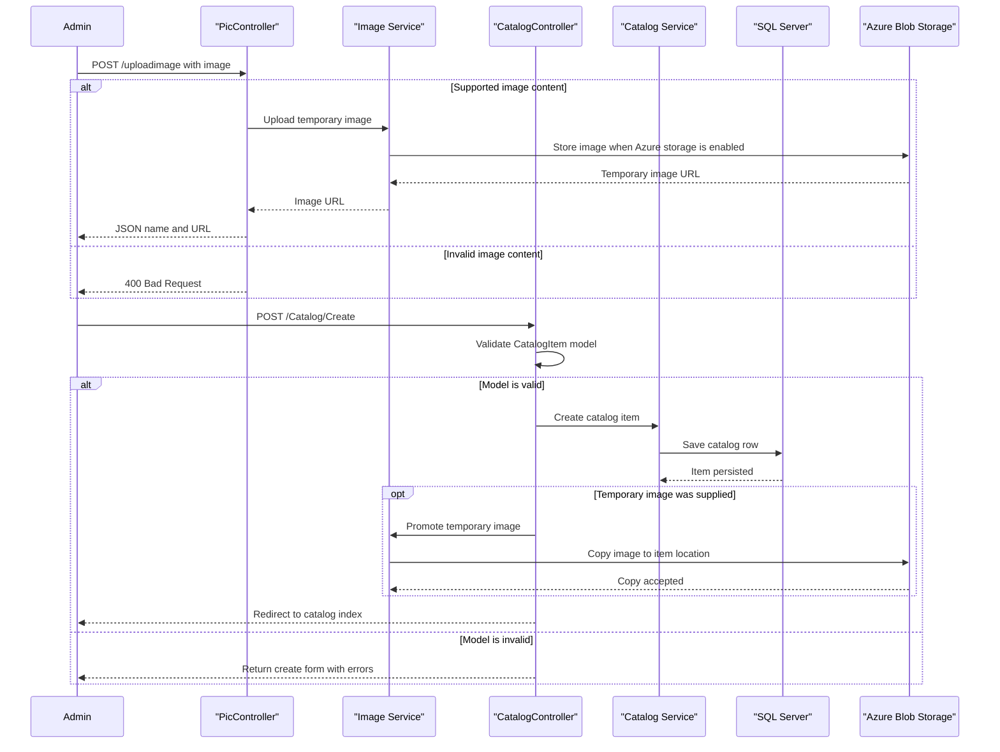

# Core Business Workflows

The application supports browsing and maintaining an e-commerce product catalog. Administrators can create, edit, and delete catalog items, while product images are handled separately through the configured image-storage implementation.

## Domain Entities

| Entity | Service / Bounded Context | Description | Key Relationships |
|---|---|---|---|
| CatalogItem | Catalog Management | Product offered in the catalog, with price, stock, and image reference | Belongs to one CatalogBrand and one CatalogType |
| CatalogBrand | Catalog Management | Brand classification for products | Has many catalog items |
| CatalogType | Catalog Management | Product type classification | Has many catalog items |

## Service-to-Domain Mapping

| Service | Domain Context | Owned Entities | External Dependencies |
|---|---|---|---|
| eShopModernizedMVC | Catalog Management | CatalogItem, CatalogBrand, CatalogType | SQL Server or in-memory mock data; optional Azure Blob image storage |

There are no independently deployed business services or cross-context data exchanges. The MVC application is the source of truth for catalog entities.

## Primary Workflows

### Workflow 1: Browse catalog

1. A visitor opens the catalog index with optional page size and page index.
2. `CatalogController` asks the catalog service for a sorted page of items.
3. The service loads related brand and type data and returns pagination metadata.
4. The controller resolves image URLs and renders the catalog view.

### Workflow 2: Create or edit a catalog item

1. An authorized user opens the create or edit form.
2. If an image is selected, the browser posts it to the image-upload action; the handler accepts JPEG, PNG, or GIF content and returns a temporary image URL.
3. The authorized create/edit action validates the submitted `CatalogItem` model.
4. On create, the service assigns an identifier and persists the item. On edit, it updates the selected item.
5. If a temporary image is present, the image service promotes it to the catalog item’s image location.
6. The controller redirects to the catalog index.

### Workflow 3: Delete a catalog item

1. An authorized user reviews the item and submits the delete form.
2. The controller loads the item, removes it through the catalog service, saves the change, and redirects to the index.

## Cross-Service Data Flows

No business-service aggregation or cross-service joins were found. Catalog metadata is retrieved from the catalog store; image files use the selected mock or Azure Blob storage service. Blob operations and SQL updates are separate and do not participate in a distributed transaction. No circuit-breaker fallback behavior was found.

## Business Workflow Sequence

## Business Rules & Decision Logic

- Catalog item name is required. Price is constrained to 0–1,000,000 and at most two decimal places.
- Available stock, restock threshold, and maximum stock threshold each have a 0–10,000,000 range.
- Entity Framework requires each catalog item to reference an existing brand and type.
- Create, edit, delete, and image mutation decisions are guarded by model validity and/or authorization attributes on catalog administration actions.
- Startup seeds catalog types, brands, and items from predefined data or CSV files, depending on `UseCustomizationData`.
- SQL persistence uses `SaveChanges`; image storage is a separate operation with no cross-resource transaction or compensation flow.
