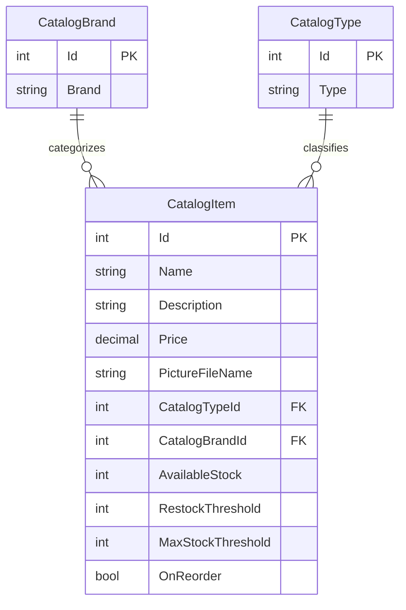

# Data Architecture & Persistence Layer

The catalog data model contains three EF6 entities stored in SQL Server, with an in-memory mock alternative. Entity Framework maps catalog items to required brand and type relationships.

## Database Configuration

| Service/Module | DB Type | Profile | Driver | Connection | Migration Tool |
|---|---|---|---|---|---|
| eShopModernizedMVC | SQL Server LocalDB | Plain .NET default | System.Data.SqlClient | LocalDB with integrated authentication | No migration tool found |
| eShopModernizedMVC | SQL Server | Windows container / Compose | System.Data.SqlClient | SQL service connection supplied through Compose configuration | No migration tool found |
| eShopModernizedMVC | In-memory list | `UseMockData=true` | None | Process memory | Not applicable |

The EF initializer creates three HiLo sequence objects and seeds data from built-in values or CSV customization files. It uses `CreateDatabaseIfNotExists`; no EF migration set was found.

## Data Ownership per Service

| Service | Tables Owned | ORM Framework | Caching | Notes |
|---|---|---|---|---|
| eShopModernizedMVC | Catalog, CatalogBrand, CatalogType | Entity Framework 6 | None | One application context owns the catalog tables; mock mode uses an in-memory list |

## Entity Model

`CatalogDBContext` maps the entities in `src/eShopModernizedMVC/Models/CatalogDBContext.cs`; the entity classes are `CatalogItem.cs`, `CatalogBrand.cs`, and `CatalogType.cs`. `PictureUri` and `TempImageName` are ignored by EF. Brand and type references are required many-to-one relationships. Changes are persisted through `SaveChanges`; no explicit transaction scope was found.

## Key Repository Methods

| Service | Repository | Notable Methods | Purpose |
|---|---|---|---|
| eShopModernizedMVC | No separate repository class | `CatalogService.GetCatalogItemsPaginated(pageSize, pageIndex)` | Eager-loads brand/type, orders by ID, and pages catalog results |
| eShopModernizedMVC | No separate repository class | `CatalogService.FindCatalogItem(id)` | Looks up one catalog item |
| eShopModernizedMVC | No separate repository class | `CreateCatalogItem`, `UpdateCatalogItem`, `RemoveCatalogItem` | Persists catalog administration changes |
| eShopModernizedMVC | `CatalogItemHiLoGenerator` | `GetNextSequenceValue(db)` | Obtains the next catalog item identifier from a SQL sequence |

## Caching Strategy

No active application data cache was found. The mock catalog is mutable process-local state, not a cache. Redis packages are present, but the Redis session-state provider configuration in `Web.config` is commented out.

## Data Ownership Boundaries

The MVC application owns and accesses one catalog database; no service-to-service database boundary or cross-service data aggregation exists. The mock-data option replaces SQL persistence with an in-memory list. Image files are stored separately through the image service abstraction, so SQL updates and blob operations do not share a transaction.

### Data Classification & Sensitivity

| Entity | Sensitive Fields | Classification | Controls in Place |
|---|---|---|---|
| CatalogItem | Product description, price, stock, and image name | None | Not applicable |
| CatalogBrand | Brand name | None | Not applicable |
| CatalogType | Type name | None | Not applicable |

No PII, PHI, or PCI data was identified in the catalog entity model.
