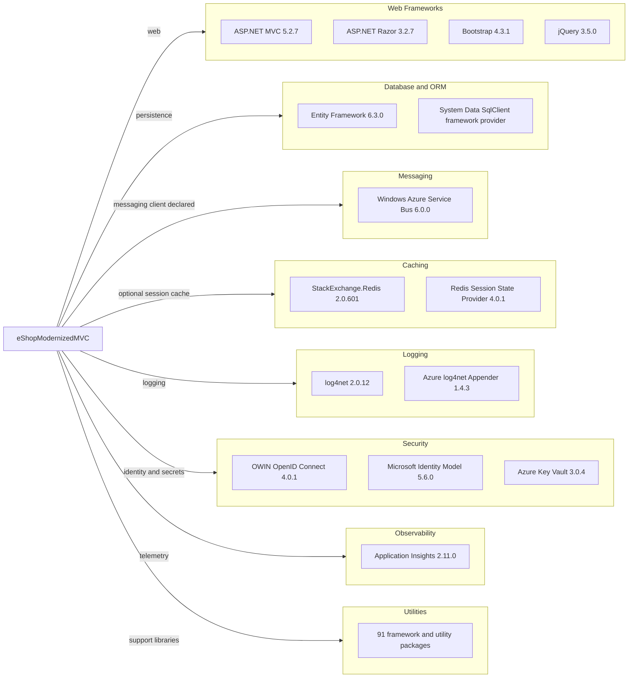

# Dependency Map

The eShopModernizedMVC project has 146 package entries in `packages.config`, including framework-support and transitive packages. The diagram shows the major modernization-relevant libraries and aggregates the long tail.

## Dependencies

### Dependency Summary

| Category | Count | Key Libraries | Notes |
|---|---:|---|---|
| Web Frameworks | 15 | ASP.NET MVC, Razor, Bootstrap, jQuery | Legacy server-rendered MVC application |
| Database and ORM | 5 | Entity Framework, Microsoft.Data client libraries, System.Spatial | SQL Server persistence |
| Messaging | 1 | Windows Azure Service Bus | Package declared; no active messaging flow was identified |
| Caching | 2 | StackExchange.Redis, Redis Session State Provider | Redis session configuration is commented out |
| Logging | 2 | log4net, Azure log4net Appender | Application logging |
| Security | 19 | OWIN Security, Identity Model, Azure Key Vault | Optional identity and configuration integrations |
| Observability | 11 | Application Insights packages | Includes collectors and framework integration packages |
| Utilities | 91 | System.* packages, Azure client libraries, serialization and build support | Aggregated for readability |

### Version & Compatibility Risks

The project targets .NET Framework 4.7.2 and ASP.NET MVC 5, rather than modern .NET. Several package families are legacy versions, including Microsoft.Extensions 3.0.0, older Azure client libraries, and the 5.6.0 Identity Model packages. Moving to a modern runtime will require replacing or upgrading framework-specific packages and reviewing binding redirects.

### Notable Observations

- The project uses a legacy `packages.config` dependency model and contains 146 package entries.
- Redis packages are present, but the Redis session-state configuration is commented out.
- Azure Service Bus is declared but no application-level message publishing or receiving path was identified.
- Application Insights is represented by multiple integration and collector packages.

## Test Dependencies

| Framework | Version | Notes |
|---|---|---|
| None detected | — | No test project or test-scoped package entries are present in the solution. |

Total test-scope dependencies: 0

No test dependencies were detected in the solution package manifests.
