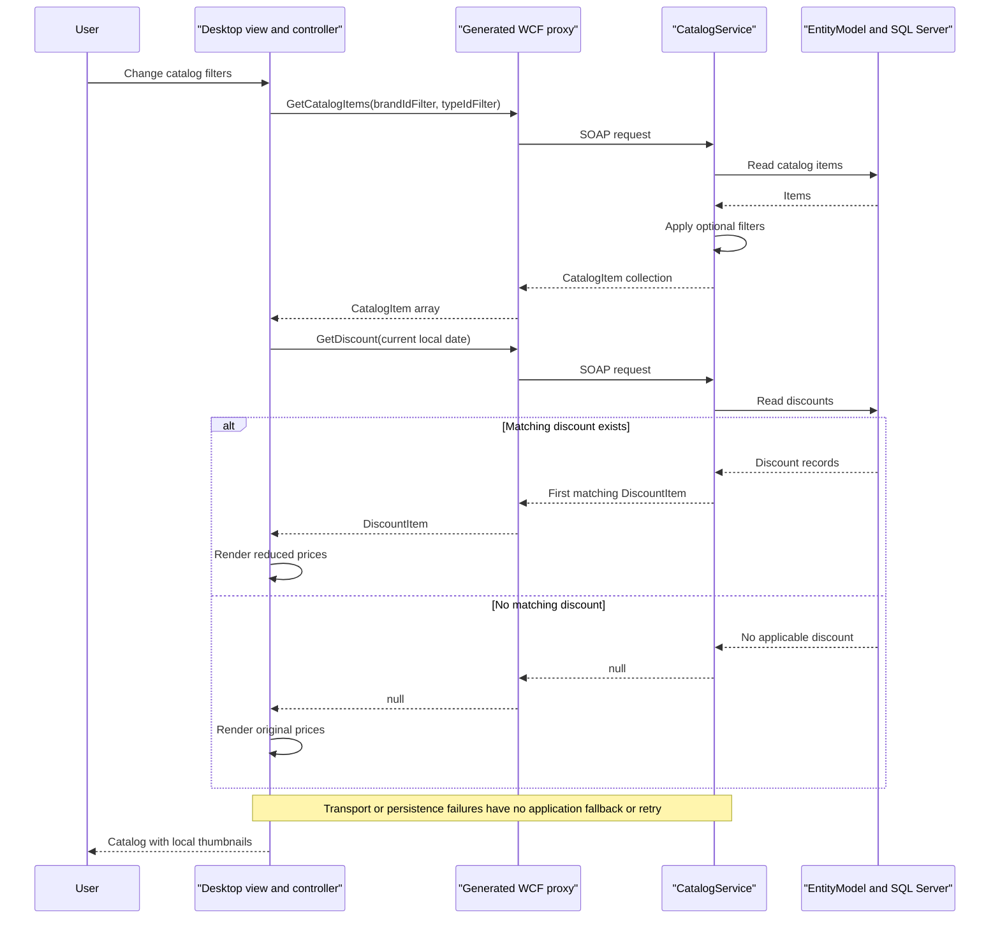

# API & Service Communication Contracts

The scoped application exposes **10 SOAP operations on one WCF service endpoint**, not ten REST URLs. Its desktop client performs synchronous request/reply calls; generated async methods are alternatives, not broker-based messaging ([contract][contract], [controller][controller]).

## Service Catalog

| Service | Port | Category | Purpose |
|---|---|---|---|
| `eShopWCFService` / `eshopwcfservice` | Container 80; host 5113; IIS development URL uses 5200 | Business | Catalog and inventory SOAP service; WCF and EF6 |
| `eShopWinForms` | No listening service port | Client, outside API/Business/Infrastructure server categories | Desktop consumer; Windows Forms and WCF client packages |
| `sql.data` | Container 1433; host 5433 | Infrastructure | Third-party SQL Server container; not a source-built business service |

The solution and Compose identify these boundaries; no gateway, service registry or separate observability service is defined ([solution][solution], [Compose][compose], [override][override], [IIS settings][iis], [desktop manifest][desktop]).

## API Endpoints Inventory

All operations use **POST `/CatalogService.svc`**, with the operation selected through SOAPAction rather than a REST path. SOAP actions have the prefix `http://tempuri.org/ICatalogService/` plus the operation name, as confirmed by the generated proxy. There is no explicit API versioning ([binding][web], [generated contract][proxycontract]).

| Service | Method | Path | Request Type | Response Type |
|---|---|---|---|---|
| CatalogService | POST / SOAP `FindCatalogItem` | `/CatalogService.svc` | `int id` in SOAP body | `CatalogItem`, or null when absent |
| CatalogService | POST / SOAP `GetCatalogBrands` | Same endpoint | Empty operation body | `List<CatalogBrand>`; proxy `CatalogBrand[]` |
| CatalogService | POST / SOAP `GetCatalogItems` | Same endpoint | `int brandIdFilter`, `int typeIdFilter` | `List<CatalogItem>`; proxy `CatalogItem[]` |
| CatalogService | POST / SOAP `GetCatalogTypes` | Same endpoint | Empty operation body | `List<CatalogType>`; proxy `CatalogType[]` |
| CatalogService | POST / SOAP `GetAvailableStock` | Same endpoint | `DateTime date`, `int catalogItemId` | `int`; zero when no matching record |
| CatalogService | POST / SOAP `CreateAvailableStock` | Same endpoint | `CatalogItemsStock` | Void reply |
| CatalogService | POST / SOAP `CreateCatalogItem` | Same endpoint | `CatalogItem` | Void reply; allocated ID is not returned |
| CatalogService | POST / SOAP `UpdateCatalogItem` | Same endpoint | `CatalogItem` | Void reply |
| CatalogService | POST / SOAP `RemoveCatalogItem` | Same endpoint | `CatalogItem` | Void reply; see implementation caveat below |
| CatalogService | POST / SOAP `GetDiscount` | Same endpoint | `DateTime day` | `DiscountItem`, or null when none applies |

Normal SOAP request/reply success uses HTTP 200; unhandled service exceptions use WCF SOAP fault behavior, typically HTTP 500, rather than custom REST 400/404 contracts. No `[FaultContract]`, explicit HTTP status mapping or declared validation-fault DTO exists. Null item and missing-stock results are normal replies, not HTTP 404 responses. `RemoveCatalogItem` passes the deserialized entity directly to `DbSet.Remove` without attaching or fetching it; successful deletion of a detached remote object is not established by the implementation ([implementation][service]).

## Management & Observability Endpoints

| Service | Endpoint | Custom Metrics (if any) |
|---|---|---|
| CatalogService | `/CatalogService.svc?wsdl` | WCF HTTP metadata enabled; no custom metrics |
| CatalogService | `/CatalogService.svc/mex` | Explicit HTTP metadata exchange endpoint |
| CatalogService | HTTPS metadata enabled in behavior | No HTTPS listener/certificate deployment demonstrated |
| All scoped application modules | No health, Swagger, OpenAPI UI or metrics HTTP route discovered | No metric registration/exporter discovered |

Metadata configuration is in [Web.config][web]. SQL's Compose healthcheck is an internal command, not an application management API; see `configuration-inventory.md`.

## DTOs & Contracts

- `CatalogItem`, `CatalogBrand`, `CatalogType`, `CatalogItemsStock` and `DiscountItem` are mutable service-owned EF entity/data-contract classes. They double as wire models; there are no gateway aggregation DTOs or immutable record contracts ([entity example][entity], [contract][contract]).
- WCF uses `[DataContract]` / `[DataMember]` XML serialization. The generated desktop namespace is `eShopWinForms.eShopServiceReference`; collection returns are arrays and it generates both synchronous and task-based methods ([proxy contract][proxycontract]).
- `FilterEventArgs`, `AvailabilityEventArgs`, `SearchStockEventArgs` are local UI event payloads, not network DTOs ([view contract][viewcontract]).
- Metadata is exposed dynamically by WCF. No checked-in OpenAPI document, protobuf schema or GraphQL schema was found. See `data-architecture.md` for entity fields and mappings, and `business-workflows.md` for validation rules.

## Communication Patterns

- **Synchronous:** desktop controller → generated WCF proxy → SOAP service → direct EF calls. Although async proxy methods exist, the actual controller calls their synchronous counterparts on the UI execution path ([controller][controller], [startup][program]).
- **Asynchronous:** no broker, event bus, background message handler or distributed workflow was discovered.
- **Resilience:** no application retry, circuit breaker, bulkhead, fallback response, custom fault recovery or explicit timeout override was found. The generated binding inherits WCF defaults (normally open/send 1 minute, close 1 minute, receive 10 minutes; these are framework defaults, not project-defined policies). Receive timeout is not a client-side retry policy. The generated client increases message/buffer limits to `int.MaxValue`, uses maximum XML quotas and allows cookies ([generated binding][proxybinding]).
- **Discovery / routing:** a hardcoded localhost address is chosen by the generated default constructor. There is no dynamic discovery or client-side load balancing. Compose's SQL service name is a database hostname, not a registry.
- **Gateway composition:** none. The desktop combines catalog and discount results from the same backend to render prices; it is not an independently deployed API gateway.
- **Startup availability:** desktop initial data loading precedes the visible dialog. Database readiness can affect service requests; Compose startup order alone does not guarantee readiness. Details are in `configuration-inventory.md`.
- **API security posture:** actual client traffic is plain HTTP with a default basicHttpBinding. No API credentials, authenticated principal checks, roles or resource authorization appear in the contract/implementation. HTTPS protocol mapping and HTTPS metadata are declared, but transport TLS is not enforced on the explicit HTTP endpoint or configured desktop connection. Do not infer a working HTTPS deployment from metadata flags ([Web.config][web], [proxy binding and address][proxybinding]).

## Service Technology Matrix

| Service | Web | Data Access | Discovery | Gateway | Actuator | Cache | Metrics |
|---|---|---|---|---|---|---|---|
| eShopWCFService | WCF / IIS | EF6 SQL Server | None | None | Metadata only; no health API | No explicit application cache | None found |
| eShopWinForms | Desktop; no HTTP listener | Service proxy; EF6 package declared | Hardcoded address | None | None | None found | None found |
| sql.data | No application web framework | SQL Server engine | Compose DNS name | None | Command healthcheck | Engine-internal only, not app cache | No exporter configured |

## Service Communication Sequence

[contract]: https://github.com/kaushganguly/eShopModernizing/blob/1732cb32a4e3e096341ca098b8fb54e2e8e9f08f/eShopModernizedNTier/src/eShopWCFService/ICatalogService.cs#L12-L34
[controller]: https://github.com/kaushganguly/eShopModernizing/blob/1732cb32a4e3e096341ca098b8fb54e2e8e9f08f/eShopModernizedNTier/src/eShopWinForms/Controllers/CatalogController.cs#L35-L157
[solution]: https://github.com/kaushganguly/eShopModernizing/blob/1732cb32a4e3e096341ca098b8fb54e2e8e9f08f/eShopModernizedNTier/eShopModernizedNTier.sln#L6-L10
[compose]: https://github.com/kaushganguly/eShopModernizing/blob/1732cb32a4e3e096341ca098b8fb54e2e8e9f08f/eShopModernizedNTier/docker-compose.yml#L3-L13
[override]: https://github.com/kaushganguly/eShopModernizing/blob/1732cb32a4e3e096341ca098b8fb54e2e8e9f08f/eShopModernizedNTier/docker-compose.override.yml#L5-L20
[iis]: https://github.com/kaushganguly/eShopModernizing/blob/1732cb32a4e3e096341ca098b8fb54e2e8e9f08f/eShopModernizedNTier/src/eShopWCFService/eShopWCFService.csproj#L121-L127
[desktop]: https://github.com/kaushganguly/eShopModernizing/blob/1732cb32a4e3e096341ca098b8fb54e2e8e9f08f/eShopModernizedNTier/src/eShopWinForms/eShopWinForms.csproj#L1-L28
[web]: https://github.com/kaushganguly/eShopModernizing/blob/1732cb32a4e3e096341ca098b8fb54e2e8e9f08f/eShopModernizedNTier/src/eShopWCFService/Web.config#L22-L42
[proxycontract]: https://github.com/kaushganguly/eShopModernizing/blob/1732cb32a4e3e096341ca098b8fb54e2e8e9f08f/eShopModernizedNTier/src/eShopWinForms/Connected%20Services/eShopServiceReference/Reference.cs#L366-L428
[service]: https://github.com/kaushganguly/eShopModernizing/blob/1732cb32a4e3e096341ca098b8fb54e2e8e9f08f/eShopModernizedNTier/src/eShopWCFService/CatalogService.svc.cs#L28-L118
[entity]: https://github.com/kaushganguly/eShopModernizing/blob/1732cb32a4e3e096341ca098b8fb54e2e8e9f08f/eShopModernizedNTier/src/eShopWCFService/Models/CatalogItem.cs#L10-L35
[viewcontract]: https://github.com/kaushganguly/eShopModernizing/blob/1732cb32a4e3e096341ca098b8fb54e2e8e9f08f/eShopModernizedNTier/src/eShopWinForms/Controllers/ICatalogView.cs#L18-L63
[program]: https://github.com/kaushganguly/eShopModernizing/blob/1732cb32a4e3e096341ca098b8fb54e2e8e9f08f/eShopModernizedNTier/src/eShopWinForms/Program.cs#L17-L27
[proxybinding]: https://github.com/kaushganguly/eShopModernizing/blob/1732cb32a4e3e096341ca098b8fb54e2e8e9f08f/eShopModernizedNTier/src/eShopWinForms/Connected%20Services/eShopServiceReference/Reference.cs#L591-L621
