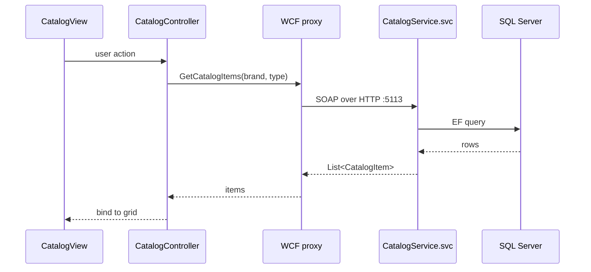

# API and Service Contracts

## WCF service `eShopWCFService.CatalogService`

- Endpoint: `CatalogService.svc` (basicHttpBinding, SOAP 1.1) plus `mex` (mexHttpBinding) metadata; HTTP/HTTPS metadata GET enabled.
- Contract: `eShopWCFService.ICatalogService` (`[ServiceContract]`).
- Authentication: none configured (anonymous).
- Hosted in IIS with ASP.NET compatibility enabled.

| Operation | Request | Response |
|-----------|---------|----------|
| FindCatalogItem | `int id` | `CatalogItem` (null if missing) |
| GetCatalogBrands | - | `List<CatalogBrand>` |
| GetCatalogTypes | - | `List<CatalogType>` |
| GetCatalogItems | `int brandIdFilter, int typeIdFilter` (0 = no filter) | `List<CatalogItem>` |
| GetAvailableStock | `DateTime date, int catalogItemId` | `int` |
| CreateAvailableStock | `CatalogItemsStock` | void (upsert by item/date) |
| CreateCatalogItem | `CatalogItem` | void |
| UpdateCatalogItem | `CatalogItem` | void |
| RemoveCatalogItem | `CatalogItem` | void |
| GetDiscount | `DateTime day` | `DiscountItem` (null if none) |

Data contracts: `CatalogItem`, `CatalogBrand`, `CatalogType`, `CatalogItemsStock`, `DiscountItem` (`[DataContract]`/`[DataMember]`).

Client endpoint (`eShopWinForms/App.config`): `http://localhost:5113/CatalogService.svc`, binding `BasicHttpBinding_ICatalogService`.
