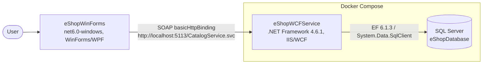

# Architecture Diagram

eShopModernizedNTier is a two-tier .NET application: a Windows Forms desktop client (`eShopWinForms`) that calls a WCF service (`eShopWCFService`) over SOAP/basicHttpBinding. The service uses Entity Framework 6 (Code First) against SQL Server. Both tiers are built with MVC/MVP-style separation (Controller + View on the client).

## Components

| Component | Technology | Responsibility |
|-----------|------------|----------------|
| eShopWinForms | WinForms, WPF flags, WCF client (System.ServiceModel 4.8.0) | Catalog browse/edit UI (`CatalogView`, `CatalogController`) |
| eShopWCFService | WCF (`CatalogService.svc`), EF 6.1.3 | Catalog operations, stock, discount |
| SQL Server | `microsoft/mssql-server-windows-developer` (compose) or LocalDB (dev) | Persistence |

## Deployment
`docker-compose.yml` runs `eshopwcfservice` (Windows container on `mcr.microsoft.com/dotnet/framework/wcf:4.7.2`, host port 5113 -> 80) and `sql.data` (host port 5433 -> 1433) on the external `nat` network. The WinForms client runs on the host.
