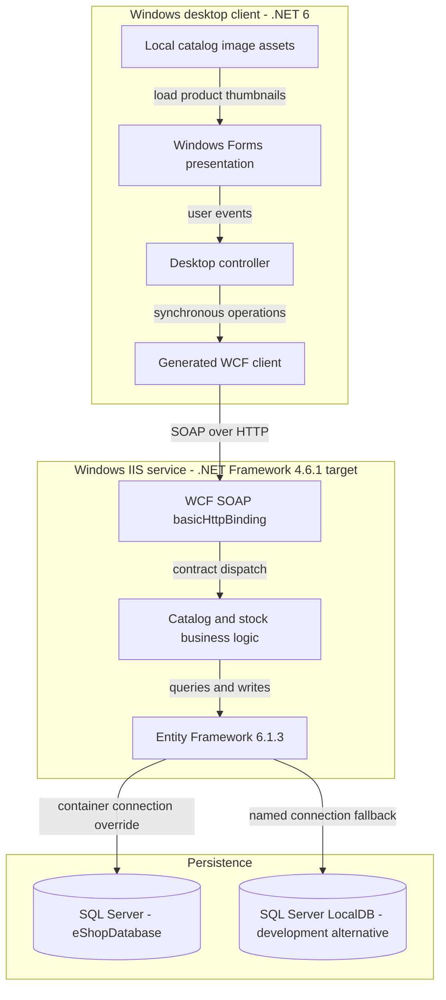
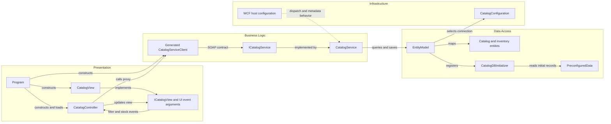

# Architecture Diagram

Source assessment of `D:\a\eShopModernizing\eShopModernizing\eShopModernizedNTier` only. The solution contains a Windows desktop client and an IIS-hosted WCF catalog service; SQL Server is the external persistence dependency ([solution][solution], [deployment][compose]).

## Application Architecture

### Technology Stack Summary

| Layer | Technology | Version | Purpose |
|---|---|---|---|
| Desktop | Windows Forms; WPF also enabled in project | `net6.0-windows` | Catalog, discount display, stock lookup and shipment entry |
| Desktop communication | System.ServiceModel client packages | 4.8.0 | Generated SOAP client |
| Service host | IIS / WCF, .NET Framework | Project 4.6.1; container image 4.7.2 | SOAP request dispatch |
| Persistence | Entity Framework | Service 6.1.3; desktop declares 6.4.4 | Service DbContext and SQL Server provider |
| Database | SQL Server / LocalDB | Container database image is untagged; LocalDB engine version unspecified | Catalog, taxonomy, stock and discounts |
| Deployment | Windows Docker Compose | Root Compose schema 3.4 | WCF plus database containers on external `nat` network |
| Alternate project | Legacy Windows Forms project | .NET Framework 4.7.1 | Retained `.fx.csproj`, not referenced by the solution |

Evidence: [desktop project][desktop], [service project][server], [service packages][packages], [Dockerfile][docker], [configuration][web], [alternate project][legacy].

### Data Storage & External Services

All five entity sets are owned by the WCF service. An environment-supplied connection selects SQL Server in Compose; otherwise EF resolves the named LocalDB connection. These are alternatives, not replicated databases. The desktop loads catalog images from local files; there is no discovered object-storage service, message broker, remote business API, or distributed cache. See [DbContext][model], [connection resolution][connection] and [image loading][view].

### Key Architectural Decisions

- A desktop controller coordinates the view and generated WCF proxy; `Program.Main` wires them manually. The commented registration code in `ApplicationModule` is not an active DI container ([composition][program], [module][module]).
- The service implements the contract and queries `EntityModel` directly, without a separate repository or domain-service tier ([contract][contract], [implementation][service]).
- Database initialization is create-if-absent with programmatic seed data; it is not a migration pipeline ([initializer][seed]).

## Component Relationships

### Component Inventory

| Component | Layer | Type | Responsibility |
|---|---|---|---|
| `Program` | Presentation | Entry point | Constructs proxy, view and controller; loads data before opening the dialog |
| `CatalogView` / `ICatalogView` | Presentation | Form and view port | Renders catalog, emits filter/stock events, formats discounted prices |
| `CatalogController` | Presentation | Desktop controller | Coordinates catalog, lookup lists, discounts and stock operations |
| Generated `eShopServiceReference.CatalogServiceClient` | Business boundary | WCF proxy | Marshals ten service operations and their async alternatives |
| `ICatalogService` | Business boundary | Service contract | Defines ten SOAP operations |
| `CatalogService` | Business logic | WCF implementation | Implements queries, item mutation and date-specific stock replacement |
| `EntityModel` | Data access | EF6 DbContext | Maps five entity sets |
| Catalog models | Data access | Mutable data contracts / entities | Catalog items, brands, types, stock and discounts |
| `CatalogDBInitializer` / `PreconfiguredData` | Data access | Initializer and seed source | Creates initial data when database is absent |
| `CatalogConfiguration` | Infrastructure | Configuration adapter | Environment connection override, then named connection fallback |
| `Web.config` | Infrastructure | WCF / IIS configuration | Binding, metadata, debug behavior and provider configuration |

The service-side `CatalogServiceClient.cs` is **not** in the service project's compile items; it is not the running desktop proxy. `CatalogServiceMock` is compiled but not selected by the actual desktop composition; `CatalogItemHiLoGenerator` is compiled but not called by the service's insert paths. These artifacts are not shown as active components ([compile items][compile], [service][service], [program][program]).

[solution]: https://github.com/kaushganguly/eShopModernizing/blob/1732cb32a4e3e096341ca098b8fb54e2e8e9f08f/eShopModernizedNTier/eShopModernizedNTier.sln#L6-L15
[compose]: https://github.com/kaushganguly/eShopModernizing/blob/1732cb32a4e3e096341ca098b8fb54e2e8e9f08f/eShopModernizedNTier/docker-compose.yml#L1-L13
[desktop]: https://github.com/kaushganguly/eShopModernizing/blob/1732cb32a4e3e096341ca098b8fb54e2e8e9f08f/eShopModernizedNTier/src/eShopWinForms/eShopWinForms.csproj#L1-L28
[server]: https://github.com/kaushganguly/eShopModernizing/blob/1732cb32a4e3e096341ca098b8fb54e2e8e9f08f/eShopModernizedNTier/src/eShopWCFService/eShopWCFService.csproj#L1-L48
[packages]: https://github.com/kaushganguly/eShopModernizing/blob/1732cb32a4e3e096341ca098b8fb54e2e8e9f08f/eShopModernizedNTier/src/eShopWCFService/packages.config#L1-L4
[docker]: https://github.com/kaushganguly/eShopModernizing/blob/1732cb32a4e3e096341ca098b8fb54e2e8e9f08f/eShopModernizedNTier/src/eShopWCFService/Dockerfile#L1-L5
[web]: https://github.com/kaushganguly/eShopModernizing/blob/1732cb32a4e3e096341ca098b8fb54e2e8e9f08f/eShopModernizedNTier/src/eShopWCFService/Web.config#L18-L64
[legacy]: https://github.com/kaushganguly/eShopModernizing/blob/1732cb32a4e3e096341ca098b8fb54e2e8e9f08f/eShopModernizedNTier/src/eShopWinForms/eShopWinForms.fx.csproj#L1-L14
[model]: https://github.com/kaushganguly/eShopModernizing/blob/1732cb32a4e3e096341ca098b8fb54e2e8e9f08f/eShopModernizedNTier/src/eShopWCFService/EntityModel.cs#L10-L40
[connection]: https://github.com/kaushganguly/eShopModernizing/blob/1732cb32a4e3e096341ca098b8fb54e2e8e9f08f/eShopModernizedNTier/src/eShopWCFService/Models/Infrastructure/CatalogConfiguration.cs#L10-L18
[view]: https://github.com/kaushganguly/eShopModernizing/blob/1732cb32a4e3e096341ca098b8fb54e2e8e9f08f/eShopModernizedNTier/src/eShopWinForms/Views/CatalogView.cs#L48-L62
[program]: https://github.com/kaushganguly/eShopModernizing/blob/1732cb32a4e3e096341ca098b8fb54e2e8e9f08f/eShopModernizedNTier/src/eShopWinForms/Program.cs#L17-L27
[module]: https://github.com/kaushganguly/eShopModernizing/blob/1732cb32a4e3e096341ca098b8fb54e2e8e9f08f/eShopModernizedNTier/src/eShopWinForms/Modules/ApplicationModule.cs#L12-L34
[contract]: https://github.com/kaushganguly/eShopModernizing/blob/1732cb32a4e3e096341ca098b8fb54e2e8e9f08f/eShopModernizedNTier/src/eShopWCFService/ICatalogService.cs#L12-L34
[service]: https://github.com/kaushganguly/eShopModernizing/blob/1732cb32a4e3e096341ca098b8fb54e2e8e9f08f/eShopModernizedNTier/src/eShopWCFService/CatalogService.svc.cs#L14-L118
[seed]: https://github.com/kaushganguly/eShopModernizing/blob/1732cb32a4e3e096341ca098b8fb54e2e8e9f08f/eShopModernizedNTier/src/eShopWCFService/Models/Infrastructure/CatalogDBInitializer.cs#L11-L79
[compile]: https://github.com/kaushganguly/eShopModernizing/blob/1732cb32a4e3e096341ca098b8fb54e2e8e9f08f/eShopModernizedNTier/src/eShopWCFService/eShopWCFService.csproj#L72-L92
