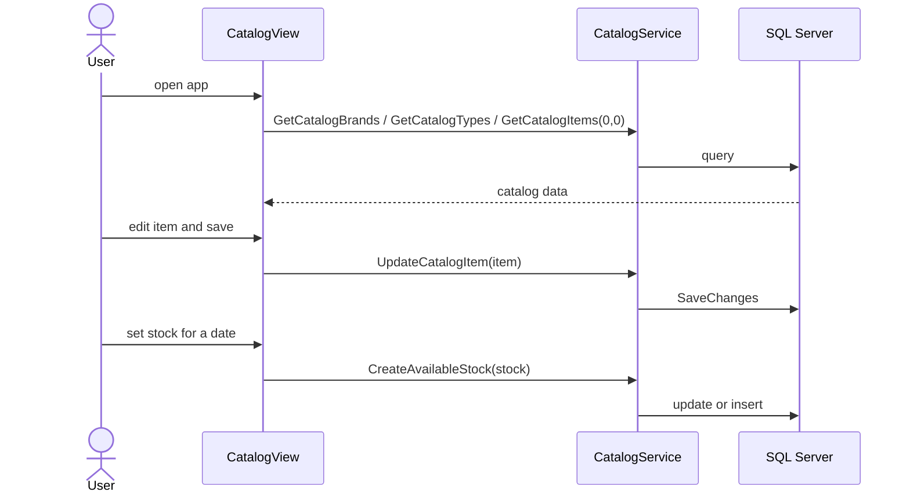

# Business Workflows

The application manages a product catalog for the eShop sample.

## Browse catalog
1. Client loads brands and types (`GetCatalogBrands`, `GetCatalogTypes`).
2. User picks optional brand/type filters; client calls `GetCatalogItems(brandId, typeId)` (0 = all).
3. Selecting an item calls `FindCatalogItem(id)` to load brand/type details.

## Maintain catalog items
Create (`CreateCatalogItem`: id = max id + 1), edit (`UpdateCatalogItem`), delete (`RemoveCatalogItem`).

## Stock and discounts
`GetAvailableStock(date, itemId)` returns the stock for that date (0 if none). `CreateAvailableStock` upserts the stock record for an item/date. `GetDiscount(day)` returns the discount whose Start/End range contains the day.

