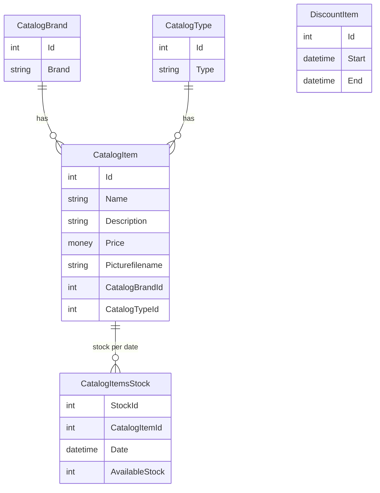

# Data Architecture

- Store: SQL Server database `eShopDatabase` (LocalDB `(localdb)\MSSQLLocalDB` in development, `sql.data` container via compose).
- Access: Entity Framework 6.1.3 Code First, `EntityModel : DbContext` (`System.Data.SqlClient` provider).
- Connection string: environment variable `ConnectionString` if set, else named connection `EntityModel` in `Web.config` (`CatalogConfiguration.ConnectionString`).
- Initialization: `CatalogDBInitializer` seeds data from `PreconfiguredData`; `CatalogItemHiLoGenerator` exists for id generation. Catalog item and stock ids are generated in service code as `Max(Id)+1`.

Notes: several queries call `ToList()` before filtering (client-side evaluation); `CatalogItem.Price` is `money` / precision (19,4). The service holds an `EntityModel` per service instance.
