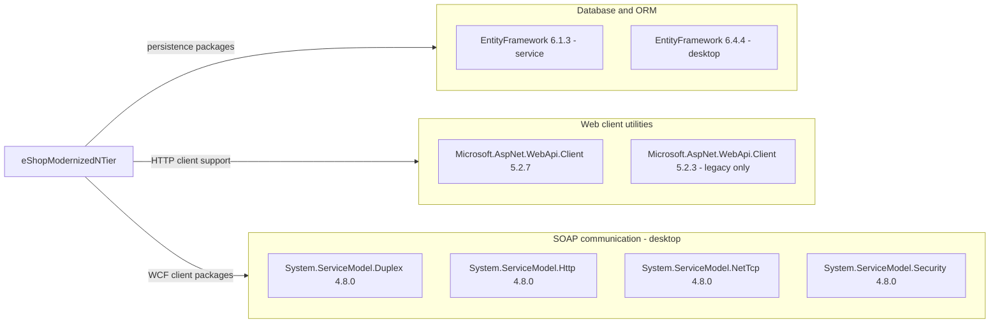

# Dependency Map

Build-manifest-only assessment of `D:\a\eShopModernizing\eShopModernizing\eShopModernizedNTier`: **6 distinct NuGet package IDs, 9 distinct package/version pairs, 9 declaration occurrences**, including the retained legacy desktop project. Solution-selected projects contribute 7 occurrences and 7 package/version pairs; framework assembly references and container images are listed separately rather than counted as NuGet packages.

## Dependencies

`EntityFramework 6.1.3` is shared by the service and retained `.fx.csproj`, so it appears once. The same six package IDs are present across the scope; versions are not flattened into an assumed common version.

### Dependency Summary

| Category | Count | Key Libraries | Notes |
|---|---|---|---|
| Database / ORM | 1 ID / 2 versions / 3 declarations | EntityFramework 6.1.3, 6.4.4 | Service `packages.config`: 6.1.3; selected desktop: 6.4.4; legacy desktop: 6.1.3 |
| Web client utilities | 1 ID / 2 versions / 2 declarations | Microsoft.AspNet.WebApi.Client 5.2.7, 5.2.3 | Selected desktop 5.2.7; legacy desktop 5.2.3 |
| SOAP communication | 4 IDs / 4 versions / 4 declarations | System.ServiceModel.Duplex, Http, NetTcp, Security 4.8.0 | Selected desktop only; Security package counted here, not twice |
| Test | 0 | None | No test-scoped package declarations found |

Declaration evidence: [service packages][servicepackages], [selected desktop packages][desktop], [legacy packages][legacy].

| Non-NuGet dependency | Declared version / scope | Evidence |
|---|---|---|
| .NET desktop framework | `net6.0-windows`; Windows Forms and WPF framework switches | [Selected desktop project][desktop] |
| .NET Framework service assemblies | Target 4.6.1; System.ServiceModel, System.ServiceModel.Web, System.Web, System.Data and related framework references | [Service project][serviceproject] |
| Retained desktop framework assemblies | Target 4.7.1; System.Windows.Forms, System.ServiceModel and related references | [Legacy project][legacyframework] |
| WCF Windows container base | `mcr.microsoft.com/dotnet/framework/wcf:4.7.2` | [Dockerfile][docker] |
| Database container | `microsoft/mssql-server-windows-developer`, no explicit tag/digest | [Compose][compose] |
| Build integration | Microsoft.NET.Sdk; Microsoft.Docker.Sdk; legacy MSBuild ToolsVersion 15.0 | [Desktop][desktop], [Docker project][dcproj], [service][serviceproject] |

### Version & Compatibility Risks

The selected desktop targets .NET 6 and the service targets .NET Framework 4.6.1, both past their support windows at this assessment date (2026-10-26). The retained 4.7.1 desktop file and 4.7.2 service container do not change those selected project targets. EF6 versions differ between projects; a move to EF Core is not a package-only replacement. WCF client packages do not provide a modern .NET WCF server host. The unpinned SQL Server container image does not identify a reproducible engine version. These are compatibility observations, **not a CVE assessment**.

### Notable Observations

- The solution selects `eShopWinForms.csproj`, not `eShopWinForms.fx.csproj`; the latter's older versions are not active solution package selections ([solution][solution]).
- There are no scoped `Directory.Packages.props`, central version catalog, package lock files or visible resolved dependency graph. Transitive dependencies cannot be enumerated reliably from these manifests; do not infer them from package names.
- EF6 is explicitly declared in the desktop as well as the service. Manifest analysis alone establishes declaration, not runtime use.
- No declared messaging, distributed caching, observability, DI-container or resilience packages were found. Framework assemblies are not silently treated as independent NuGet packages.

## Test Dependencies

| Framework | Version | Notes |
|---|---|---|
| None detected | Not applicable | No test project or test-scoped dependency in the scoped solution/manifests |

Total test-scope dependencies: **0**.

No test dependencies detected. This does not establish that the application was never tested; it establishes that no test infrastructure is declared in this scope.

[servicepackages]: https://github.com/kaushganguly/eShopModernizing/blob/1732cb32a4e3e096341ca098b8fb54e2e8e9f08f/eShopModernizedNTier/src/eShopWCFService/packages.config#L1-L4
[desktop]: https://github.com/kaushganguly/eShopModernizing/blob/1732cb32a4e3e096341ca098b8fb54e2e8e9f08f/eShopModernizedNTier/src/eShopWinForms/eShopWinForms.csproj#L1-L28
[legacy]: https://github.com/kaushganguly/eShopModernizing/blob/1732cb32a4e3e096341ca098b8fb54e2e8e9f08f/eShopModernizedNTier/src/eShopWinForms/eShopWinForms.fx.csproj#L264-L270
[legacyframework]: https://github.com/kaushganguly/eShopModernizing/blob/1732cb32a4e3e096341ca098b8fb54e2e8e9f08f/eShopModernizedNTier/src/eShopWinForms/eShopWinForms.fx.csproj#L1-L73
[serviceproject]: https://github.com/kaushganguly/eShopModernizing/blob/1732cb32a4e3e096341ca098b8fb54e2e8e9f08f/eShopModernizedNTier/src/eShopWCFService/eShopWCFService.csproj#L1-L70
[docker]: https://github.com/kaushganguly/eShopModernizing/blob/1732cb32a4e3e096341ca098b8fb54e2e8e9f08f/eShopModernizedNTier/src/eShopWCFService/Dockerfile#L1-L5
[compose]: https://github.com/kaushganguly/eShopModernizing/blob/1732cb32a4e3e096341ca098b8fb54e2e8e9f08f/eShopModernizedNTier/docker-compose.yml#L1-L13
[dcproj]: https://github.com/kaushganguly/eShopModernizing/blob/1732cb32a4e3e096341ca098b8fb54e2e8e9f08f/eShopModernizedNTier/docker-compose.dcproj#L1-L17
[solution]: https://github.com/kaushganguly/eShopModernizing/blob/1732cb32a4e3e096341ca098b8fb54e2e8e9f08f/eShopModernizedNTier/eShopModernizedNTier.sln#L6-L15
