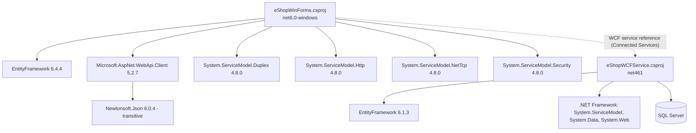

# Dependency Map

| Project | Target | Packages |
|---------|--------|----------|
| eShopWCFService | .NET Framework 4.6.1 (non-SDK) | EntityFramework 6.1.3 |
| eShopWinForms | net6.0-windows (SDK) | EntityFramework 6.4.4, Microsoft.AspNet.WebApi.Client 5.2.7, System.ServiceModel.{Duplex,Http,NetTcp,Security} 4.8.0 |
| eShopWinForms.fx | .NET Framework 4.7.1 variant of the client | see project file |

There is no project reference between client and service; the client consumes the service through a generated WCF proxy (`Connected Services/eShopServiceReference/Reference.cs`).
