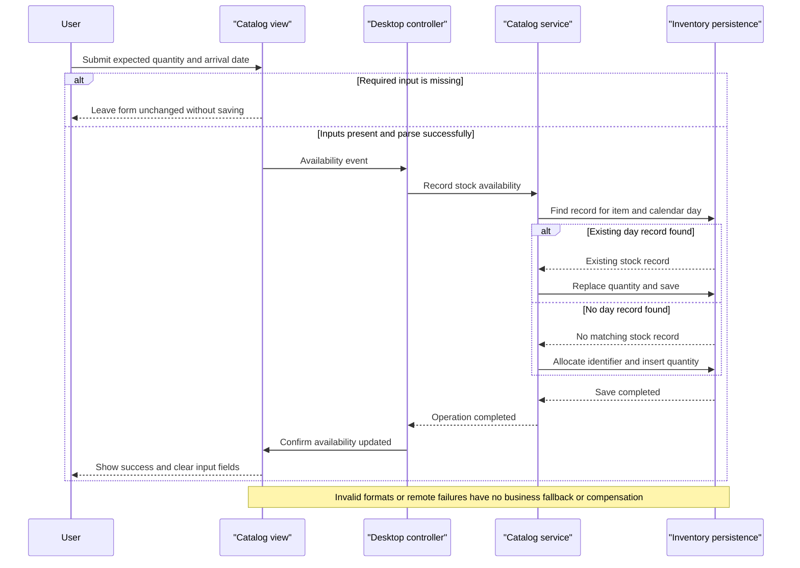

# Core Business Workflows

The scoped application lets users browse merchandise by brand/type, see currently discounted prices, inspect stock for a chosen day, and record expected stock availability. It does not implement shopping baskets, checkout, payment, shipping execution or customer identity workflows.

## Domain Entities

| Entity | Service / Bounded Context | Description | Key Relationships |
|---|---|---|---|
| CatalogItem | CatalogService / Merchandise catalog | Sellable merchandise displayed with local image and price | Classified by one brand and one type; referenced by dated stock records |
| CatalogBrand | CatalogService / Catalog taxonomy | Brand filter choices | Shared by catalog items |
| CatalogType | CatalogService / Catalog taxonomy | Merchandise-category filter choices | Shared by catalog items |
| CatalogItemsStock | CatalogService / Inventory availability | Quantity expected to be available for an item on a calendar day | Logically references a catalog item |
| DiscountItem | CatalogService / Promotions | Global promotion applicable during a date window | Applied to displayed prices; not tied to a specific product |

Evidence: [service decisions][service], [desktop coordination][controller], [view behavior][view]. Persistence field lists and mapping details are in `data-architecture.md`.

## Service-to-Domain Mapping

| Service | Domain Context | Owned Entities | External Dependencies |
|---|---|---|---|
| eShopWCFService | Catalog, taxonomy, inventory and promotion rules in one service | All five domain entities | One SQL Server/LocalDB database |
| eShopWinForms | User interaction and display composition | No authoritative persisted domain entities | WCF service; local image assets |
| sql.data | Persistence infrastructure, not a business context | Hosts service-owned data | Windows container runtime |

There are logical concerns inside a single service, not independently deployed bounded-context microservices. The service is authoritative for catalog and stock state; the desktop alone calculates the displayed discounted amount ([program][program], [controller][controller], [view][view]).

## Primary Workflows

### Workflow 1: Browse filtered catalog with current promotion

1. Startup constructs the view, real proxy and controller, then calls `LoadView` before showing the dialog. The controller loads the banner, catalog, brand/type selectors and shipment product selectors ([startup][program], [load sequence][controller]).
2. Selecting a brand/type emits a view event. `CatalogController` clears the grid and requests matching items using the optional-filter rule.
3. The service reads catalog data and applies the requested selections; this filtering occurs after materialization.
4. The controller separately asks for the current promotion using the desktop's local clock. The promotion-window rule selects the first applicable discount.
5. The view applies the display-price rule and loads the thumbnail corresponding to each product. Prices are not persisted back to the service.
6. No discount is an ordinary condition: render full prices. A failed SOAP/database call or missing image has no implemented fallback or retry; the grid may already have been cleared.

Evidence: [filter handlers and price rendering][view], [controller catalog/discount calls][controller], [service filters][service].

### Workflow 2: Record expected stock for an item and day

1. The user selects a product and enters quantity and arrival date.
2. The view applies the shipment-entry presence/parsing rule and emits an availability event.
3. The controller creates a `CatalogItemsStock` request and calls the service.
4. The service looks for the first record matching item and calendar day. If one exists it **replaces** that day's quantity; this is not an additive shipment ledger. Otherwise it allocates a new identifier and inserts.
5. After `SaveChanges` and the SOAP call return, the view displays the success message and clears the entry controls. No success is displayed before the remote write completes.

Evidence: [entry and success UI][view], [request construction][controller], [stock upsert][service]. No domain compensation or duplicate-submission coordination is implemented.

### Workflow 3: Look up date-specific availability

1. The user selects a catalog item from the shipment list and a calendar date.
2. The view parses the selected item's display string and raises a stock-search event.
3. The controller requests availability from the service.
4. The service uses the stock-match rule; when no row exists, it returns zero.
5. The view appends a result row containing the requested day, product and returned quantity. Repeated searches append rather than replace results.

Evidence: [search and result display][view], [controller lookup][controller], [service lookup][service].

### Workflow 4: Initialize a new catalog database

On first EF initialization against an absent database, `CatalogDBInitializer` seeds taxonomy, merchandise, date-specific inventory and historical promotions. It is not a recurring import, scheduler or event-driven process. Existing databases are not reset or refreshed. Historical seed discounts end in 2017, so they do not create a current promotion on the assessment date ([initializer][initializer], [seed dates][seeds]).

The service additionally declares item create/update/remove operations, but the provided desktop controller does not expose an item-maintenance workflow. They must not be described as working catalog-edit screens. No scheduler or event listener was found.

## Cross-Service Data Flows

There is one remote business-service boundary: desktop → CatalogService. The desktop joins catalog results with a separate global discount result to compute display prices and joins product IDs to locally stored image files. It does not aggregate multiple backends, persist joined state, or publish events. Stock operations traverse the same service and database.

There is no circuit-breaker degraded mode. A null discount means no promotion, not a service-outage fallback; zero stock means no matching row or an actual zero quantity, not an infrastructure fallback. The actual composition selects the real generated client; the compiled mock is not wired into startup ([program][program], [controller][controller]).

## Business Workflow Sequence

## Business Rules & Decision Logic

| Rule | Actual decision / limitation | Evidence |
|---|---|---|
| Optional catalog filters | Filter ID zero means “All”; nonzero brand and type restrictions are ANDed. Desktop adds its own “All” entry to lookup lists. | [Controller][controller], [service][service] |
| Promotion window | Inclusive comparison of calendar dates; first matching record wins with no explicit ordering, overlap priority or stacking. Caller supplies date; desktop uses `DateTime.Now`. | [Service][service], [controller][controller] |
| Display price | Convert catalog decimal price to double, multiply by `1 - discount.Size`, format with a literal dollar sign and fixed-point text. No persisted sale price, tax or checkout total. Banner percentage is rounded from fraction × 100. | [View][view], [controller][controller] |
| Shipment-entry presence/parsing | Product must be selected; quantity/date strings must be nonempty, otherwise silently return. `int.Parse` and `Convert.ToDateTime` parse without a handled format-error path. No nonnegative quantity or future-date restriction appears. | [View][view] |
| Stock search selection | Selected display item is dereferenced and parsed without a null-selection guard in the handler. Calendar selection supplies a day. | [View][view] |
| Stock-match / replacement | Match by item ID and date only; first matching row is used. Existing quantity is overwritten rather than incremented; missing lookup returns zero. | [Service][service] |
| Identifier allocation | Catalog and new stock inserts use table maximum plus one. No explicit serialization, empty-table fallback or concurrency coordination around allocation. | [Service][service] |
| Data annotations | Brand and type text each have maximum length 50. No application `Required`, stock range, price range or discount fraction/date-order validation is declared. EF annotations do not constitute a service-level validation/fault protocol. | [Brand][brand], [type][type], [item][item], [stock][stock], [discount][discount] |
| Item maintenance | Create adds, update marks supplied entity modified, remove directly removes the supplied entity; no ownership check or domain lifecycle state machine. Detached removal success is not established. | [Service][service] |
| Transactions | Each write calls `SaveChanges`; no explicit multi-operation transaction, saga or compensation. ID selection and later insert are not protected by a project-defined allocation transaction. | [Service][service] |
| Error handling / audit | No custom business exception/fault contract, retry, dead-letter processing or business audit trail found. Generated service behavior suppresses exception detail in faults. | [Contract][contract], [service][service], [WCF behavior][web] |
| Authorization | No business roles, resource-owner checks or permission decisions appear in actual controller/service methods. | [Controller][controller], [service][service] |

No order states or checkout lifecycle transitions exist in this scoped domain.

[program]: https://github.com/kaushganguly/eShopModernizing/blob/1732cb32a4e3e096341ca098b8fb54e2e8e9f08f/eShopModernizedNTier/src/eShopWinForms/Program.cs#L17-L27
[controller]: https://github.com/kaushganguly/eShopModernizing/blob/1732cb32a4e3e096341ca098b8fb54e2e8e9f08f/eShopModernizedNTier/src/eShopWinForms/Controllers/CatalogController.cs#L27-L157
[view]: https://github.com/kaushganguly/eShopModernizing/blob/1732cb32a4e3e096341ca098b8fb54e2e8e9f08f/eShopModernizedNTier/src/eShopWinForms/Views/CatalogView.cs#L48-L195
[service]: https://github.com/kaushganguly/eShopModernizing/blob/1732cb32a4e3e096341ca098b8fb54e2e8e9f08f/eShopModernizedNTier/src/eShopWCFService/CatalogService.svc.cs#L28-L118
[initializer]: https://github.com/kaushganguly/eShopModernizing/blob/1732cb32a4e3e096341ca098b8fb54e2e8e9f08f/eShopModernizedNTier/src/eShopWCFService/Models/Infrastructure/CatalogDBInitializer.cs#L11-L79
[seeds]: https://github.com/kaushganguly/eShopModernizing/blob/1732cb32a4e3e096341ca098b8fb54e2e8e9f08f/eShopModernizedNTier/src/eShopWCFService/Models/Infrastructure/PreconfiguredData.cs#L41-L50
[brand]: https://github.com/kaushganguly/eShopModernizing/blob/1732cb32a4e3e096341ca098b8fb54e2e8e9f08f/eShopModernizedNTier/src/eShopWCFService/Models/CatalogBrand.cs#L10-L19
[type]: https://github.com/kaushganguly/eShopModernizing/blob/1732cb32a4e3e096341ca098b8fb54e2e8e9f08f/eShopModernizedNTier/src/eShopWCFService/Models/CatalogType.cs#L10-L19
[item]: https://github.com/kaushganguly/eShopModernizing/blob/1732cb32a4e3e096341ca098b8fb54e2e8e9f08f/eShopModernizedNTier/src/eShopWCFService/Models/CatalogItem.cs#L10-L35
[stock]: https://github.com/kaushganguly/eShopModernizing/blob/1732cb32a4e3e096341ca098b8fb54e2e8e9f08f/eShopModernizedNTier/src/eShopWCFService/Models/CatalogItemsStock.cs#L10-L25
[discount]: https://github.com/kaushganguly/eShopModernizing/blob/1732cb32a4e3e096341ca098b8fb54e2e8e9f08f/eShopModernizedNTier/src/eShopWCFService/Models/DiscountItem.cs#L11-L31
[contract]: https://github.com/kaushganguly/eShopModernizing/blob/1732cb32a4e3e096341ca098b8fb54e2e8e9f08f/eShopModernizedNTier/src/eShopWCFService/ICatalogService.cs#L12-L34
[web]: https://github.com/kaushganguly/eShopModernizing/blob/1732cb32a4e3e096341ca098b8fb54e2e8e9f08f/eShopModernizedNTier/src/eShopWCFService/Web.config#L22-L30
