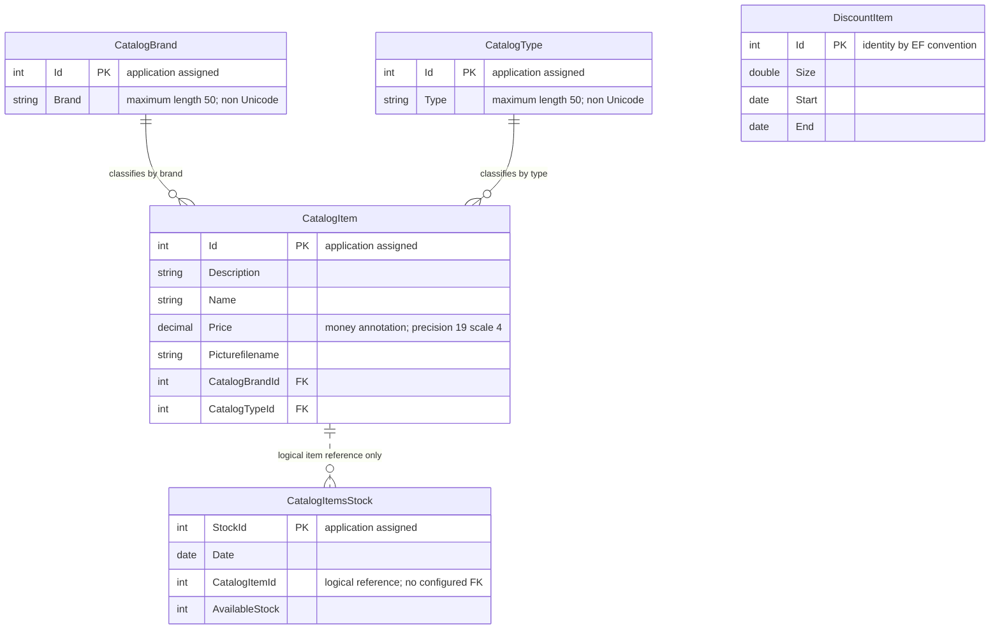

# Data Architecture & Persistence Layer

The scoped data layer has **five EF6 entity sets** persisted to SQL Server or its LocalDB development alternative. The service directly owns its DbContext; the desktop consumes serialized service contracts rather than a separate persistence API ([context][context], [startup][program]).

## Database Configuration

| Service/Module | DB Type | Profile | Driver | Connection | Migration Tool |
|---|---|---|---|---|---|
| eShopWCFService | SQL Server LocalDB | Default named-connection fallback | System.Data.SqlClient / EF6 SQL Server provider | Named connection to local development database; no credential values reproduced | EF `CreateDatabaseIfNotExists`; no versioned migrations found |
| eShopWCFService | SQL Server Windows Developer container | Root Compose environment override | Same driver/provider | Environment-provided SQL connection to the database container; credentials `[MASKED]` | Same initializer and seed logic |
| eShopWinForms | None directly used by actual startup/controller | Desktop | WCF client; EF package also declared | Calls service; no desktop DbContext instantiated in active path | None |

Connection selection is implemented by [CatalogConfiguration][connection]; provider and fallback are in [Web.config][web]. See `configuration-inventory.md` for property names and raw non-sensitive defaults.

`EntityModel` registers the initializer in its constructor. Database creation and seeding are deferred to EF initialization on use, not an explicit schema migration job. The initializer adds types, brands, items, stock and discounts and calls `SaveChanges` separately for each group. No checked-in migrations, schema-versioning scripts or explicit custom pooling configuration were found. Seeds contain 12 catalog items, 5 brands, 4 types, 6 date-specific stock rows and 6 historical discount windows ([initializer][initializer], [seed source][seeds]).

## Data Ownership per Service

| Service | Tables Owned | ORM Framework | Caching | Notes |
|---|---|---|---|---|
| eShopWCFService | `CatalogBrands`, `CatalogItems`, `CatalogTypes`, `DiscountItems` by EF convention; explicit `CatalogItemsStock` | Entity Framework 6.1.3 | No explicit application/query/second-level cache | Five DbSets in one context; stock table name explicitly overridden |
| eShopWinForms | None | No active desktop ORM path | No explicit cache | Generated entity-shaped contracts are response/request models, not separately owned tables |
| sql.data | Hosts service-owned tables | Database engine | Engine-internal caches only | Infrastructure, not a domain-owning service |

Evidence: [DbSets and mapping][context], [stock table annotation][stock], [service implementation][service], [desktop composition][program].

## Entity Model

The dotted stock relationship is a **logical association used by queries**, not an asserted database foreign key: stock has a scalar item ID but no navigation property or explicit relationship mapping. Item→brand and item→type are unidirectional navigations with non-null integer FKs; no inverse collections or custom cascade configuration appear. Convention-driven cascade behavior is not overridden. Navigation properties are not virtual, so lazy-loading proxies are not established by these declarations; `FindCatalogItem` explicitly loads its two lookup objects ([item][item], [stock][stock], [find behavior][service]).

| Entity | Source | Persistence details |
|---|---|---|
| CatalogBrand | [CatalogBrand.cs][brand] | Non-generated integer key; optional string of length at most 50; non-Unicode fluent mapping |
| CatalogType | [CatalogType.cs][type] | Non-generated integer key; optional string of length at most 50; non-Unicode fluent mapping |
| CatalogItem | [CatalogItem.cs][item] | Non-generated integer key; three text descriptors plus image filename; money price; brand/type scalar FKs and navigations |
| CatalogItemsStock | [CatalogItemsStock.cs][stock] | Explicit table name and primary key; SQL date; quantity; scalar item reference without mapped navigation |
| DiscountItem | [DiscountItem.cs][discount] | Convention-generated key; double fraction; start/end SQL dates; no item FK, so discounts are global |

All entity properties are mutable. No concurrency token, unique composite item/date index, field encryption annotation, explicit `TransactionScope`, or application-managed transaction appears in the mappings. Each mutation calls `SaveChanges`; EF supplies its ordinary per-save transactional behavior, not a multi-operation service transaction. See `business-workflows.md` for validation and business decisions.

## Key Repository Methods

There is **no separate repository interface**. `CatalogService` queries the five `DbSet` properties on `EntityModel`.

| Service | Repository | Notable Methods | Purpose |
|---|---|---|---|
| CatalogService | `EntityModel.CatalogItems` | `List<CatalogItem> GetCatalogItems(int brandIdFilter, int typeIdFilter)` | Materializes full table before applying optional in-memory filters |
| CatalogService | Items plus lookup DbSets | `CatalogItem FindCatalogItem(int id)` | Gets first item, then explicitly queries brand and type |
| CatalogService | Lookup DbSets | `List<CatalogBrand> GetCatalogBrands()`; `List<CatalogType> GetCatalogTypes()` | Returns full lookup lists |
| CatalogService | `EntityModel.DiscountItems` | `DiscountItem GetDiscount(DateTime day)` | Materializes discounts, then date-filters and returns first match |
| CatalogService | `EntityModel.CatalogItemsStocks` | `int GetAvailableStock(DateTime date, int catalogItemId)` | Filters item in SQL, then matches calendar date in memory |
| CatalogService | `EntityModel.CatalogItemsStocks` | `void CreateAvailableStock(CatalogItemsStock value)` | Queries item/date match, updates first result or allocates `Max(StockId)+1` and inserts |
| CatalogService | `EntityModel.CatalogItems` | Create/update/remove taking `CatalogItem` | Insert allocates `Max(Id)+1`; update marks entity modified; remove directly calls `Remove`; each saves |
| Compiled helper, no active caller found | `CatalogItemHiLoGenerator` | `int GetNextSequenceValue(EntityModel db)` | Contains raw `SELECT NEXT VALUE FOR catalog_hilo`; do not mistake it for the actual insert strategy |

Evidence: [service methods][service], [HiLo helper][hilo], [project compile list][compile]. No stored-procedure use or cross-service batch aggregation query was found. The HiLo sequence's creation is not present in the scoped initializer.

## Caching Strategy

No Redis, distributed cache, `MemoryCache`, explicit query cache or EF second-level cache configuration was discovered. EF's ordinary context-level entity tracking is not a shared cache or an application TTL policy. Materializing results with `ToList` does not establish caching across requests. The compiled mock holds in-memory seed lists, but actual desktop composition uses the generated remote client, not this mock ([service][service], [mock][mock], [program][program]). No cache TTL, region, invalidation or session-cache behavior can therefore be attributed to the deployed path.

## Data Ownership Boundaries

There is one service-owned database, not database-per-microservice or independently owned databases shared across multiple business services. LocalDB and Compose SQL Server are connection alternatives. Reads and writes use the same context/schema; no CQRS split, outbox, event replication or eventual-consistency mechanism was found.

The desktop exchanges data through WCF. It combines item responses with a global discount response for display, but performs no direct database join and is not a gateway. Catalog images remain desktop filesystem assets whose filenames come from catalog records; their binary data is not stored in the five mapped entities.

### Data Classification & Sensitivity

| Entity | Sensitive Fields | Classification (PII/PHI/PCI/None) | Controls in Place |
|---|---|---|---|
| CatalogItem | None of those categories; descriptive item name is a product name, not a person's name | None; commercial catalog data | No field-level masking/encryption or access controls found |
| CatalogBrand / CatalogType | None detected | None; lookup metadata | No field-level controls found |
| CatalogItemsStock | None detected | None; operational inventory data | No field-level controls found |
| DiscountItem | None detected | None; promotion schedule | No field-level controls found |

**No PII, PHI, or PCI data detected in entity model.** Inventory and pricing may still be commercially sensitive. No database encryption-at-rest provisioning or application data masking was found; deployment outside this scope may supply controls. Connection credentials are sensitive configuration, not entity data, and are documented only in masked form in `configuration-inventory.md`.

[context]: https://github.com/kaushganguly/eShopModernizing/blob/1732cb32a4e3e096341ca098b8fb54e2e8e9f08f/eShopModernizedNTier/src/eShopWCFService/EntityModel.cs#L10-L40
[program]: https://github.com/kaushganguly/eShopModernizing/blob/1732cb32a4e3e096341ca098b8fb54e2e8e9f08f/eShopModernizedNTier/src/eShopWinForms/Program.cs#L17-L27
[connection]: https://github.com/kaushganguly/eShopModernizing/blob/1732cb32a4e3e096341ca098b8fb54e2e8e9f08f/eShopModernizedNTier/src/eShopWCFService/Models/Infrastructure/CatalogConfiguration.cs#L10-L18
[web]: https://github.com/kaushganguly/eShopModernizing/blob/1732cb32a4e3e096341ca098b8fb54e2e8e9f08f/eShopModernizedNTier/src/eShopWCFService/Web.config#L52-L64
[initializer]: https://github.com/kaushganguly/eShopModernizing/blob/1732cb32a4e3e096341ca098b8fb54e2e8e9f08f/eShopModernizedNTier/src/eShopWCFService/Models/Infrastructure/CatalogDBInitializer.cs#L11-L79
[seeds]: https://github.com/kaushganguly/eShopModernizing/blob/1732cb32a4e3e096341ca098b8fb54e2e8e9f08f/eShopModernizedNTier/src/eShopWCFService/Models/Infrastructure/PreconfiguredData.cs#L10-L74
[stock]: https://github.com/kaushganguly/eShopModernizing/blob/1732cb32a4e3e096341ca098b8fb54e2e8e9f08f/eShopModernizedNTier/src/eShopWCFService/Models/CatalogItemsStock.cs#L10-L25
[item]: https://github.com/kaushganguly/eShopModernizing/blob/1732cb32a4e3e096341ca098b8fb54e2e8e9f08f/eShopModernizedNTier/src/eShopWCFService/Models/CatalogItem.cs#L10-L35
[brand]: https://github.com/kaushganguly/eShopModernizing/blob/1732cb32a4e3e096341ca098b8fb54e2e8e9f08f/eShopModernizedNTier/src/eShopWCFService/Models/CatalogBrand.cs#L10-L19
[type]: https://github.com/kaushganguly/eShopModernizing/blob/1732cb32a4e3e096341ca098b8fb54e2e8e9f08f/eShopModernizedNTier/src/eShopWCFService/Models/CatalogType.cs#L10-L19
[discount]: https://github.com/kaushganguly/eShopModernizing/blob/1732cb32a4e3e096341ca098b8fb54e2e8e9f08f/eShopModernizedNTier/src/eShopWCFService/Models/DiscountItem.cs#L11-L31
[service]: https://github.com/kaushganguly/eShopModernizing/blob/1732cb32a4e3e096341ca098b8fb54e2e8e9f08f/eShopModernizedNTier/src/eShopWCFService/CatalogService.svc.cs#L28-L118
[hilo]: https://github.com/kaushganguly/eShopModernizing/blob/1732cb32a4e3e096341ca098b8fb54e2e8e9f08f/eShopModernizedNTier/src/eShopWCFService/Models/CatalogItemHiLoGenerator.cs#L8-L30
[compile]: https://github.com/kaushganguly/eShopModernizing/blob/1732cb32a4e3e096341ca098b8fb54e2e8e9f08f/eShopModernizedNTier/src/eShopWCFService/eShopWCFService.csproj#L77-L92
[mock]: https://github.com/kaushganguly/eShopModernizing/blob/1732cb32a4e3e096341ca098b8fb54e2e8e9f08f/eShopModernizedNTier/src/eShopWCFService/CatalogServiceMock.cs#L13-L23
