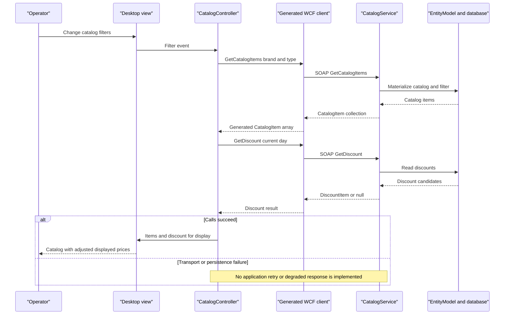

# API & Service Communication Contracts

Ten SOAP operations share one service endpoint; there is no REST route inventory in the scoped application. Desktop orchestration uses synchronous request/reply, while the generated client also offers Task-returning counterparts [S1, S3].

## Service Catalog

| Service | Port | Category | Purpose |
|---|---|---|---|
| eShopWCFService / eshopwcfservice | Container 80, host 5113; IIS development URL uses 5200 | Business | Catalog, dated stock, promotion operations; WCF and EF6 [S1, S4, S5] |
| eShopWinForms | No listening port identified | API consumer / presentation | Desktop client; generated WCF proxy [S2, S3] |
| sql.data | Container 1433, host 5433 | Infrastructure | Third-party SQL Server container, not source-built application service [S4] |

## API Endpoints Inventory

All rows target `/CatalogService.svc` on eShopWCFService using SOAP 1.1 HTTP **POST**, not distinct REST resources. SOAPAction distinguishes operations using `http://tempuri.org/ICatalogService/<operation>`; generated reply actions append `Response` [S3]. No explicit API versioning is declared.

| Service | Method | Path | Request Type | Response Type |
|---|---|---|---|---|
| CatalogService: FindCatalogItem | POST | /CatalogService.svc | int id | CatalogItem, nullable |
| CatalogService: GetCatalogBrands | POST | /CatalogService.svc | Empty operation body | List of CatalogBrand |
| CatalogService: GetCatalogItems | POST | /CatalogService.svc | int brandIdFilter, int typeIdFilter | List of CatalogItem |
| CatalogService: GetCatalogTypes | POST | /CatalogService.svc | Empty operation body | List of CatalogType |
| CatalogService: GetAvailableStock | POST | /CatalogService.svc | DateTime date, int catalogItemId | int |
| CatalogService: CreateAvailableStock | POST | /CatalogService.svc | CatalogItemsStock | void operation reply |
| CatalogService: CreateCatalogItem | POST | /CatalogService.svc | CatalogItem | void operation reply |
| CatalogService: UpdateCatalogItem | POST | /CatalogService.svc | CatalogItem | void operation reply |
| CatalogService: RemoveCatalogItem | POST | /CatalogService.svc | CatalogItem | void operation reply |
| CatalogService: GetDiscount | POST | /CatalogService.svc | DateTime day | DiscountItem, nullable |

Contract signatures: [S1]. Empty search results are represented as null, empty collections or stock zero depending on operation [S6]; no domain FaultContract or explicit HTTP status policy is declared. Successful SOAP request/reply conventionally uses HTTP 200 and failures may become SOAP faults; exact runtime faults/statuses have not been exercised.

## Management & Observability Endpoints

| Service | Endpoint | Custom Metrics (if any) |
|---|---|---|
| eShopWCFService | /CatalogService.svc?wsdl via HTTP GET metadata | None found |
| eShopWCFService | /CatalogService.svc/mex via mexHttpBinding | None found |
| eShopWCFService | No application health, Swagger or metric export endpoint found | No custom metric registrations identified |

Metadata is enabled for HTTP and HTTPS, but an HTTPS listener/certificate is not established by that flag alone [S5].

## DTOs & Contracts

`CatalogItem`, `CatalogBrand`, `CatalogType`, `CatalogItemsStock` and `DiscountItem` are service-level mutable data contracts, reused as persistence models. `CatalogItem` and stock objects are mutation requests; the same types and collections are responses. There are no immutable request records or gateway-owned composition DTOs. The generated proxy duplicates contracts through DataContract/DataMember XML serialization and maps server lists to client arrays [S1, S3]. Entity fields and persistence relationships are documented in `data-architecture.md`.

No OpenAPI, protobuf or GraphQL schema was found in the scoped files. WCF metadata and the generated SOAPAction declarations are the available contract evidence, not a checked-in authoritative WSDL snapshot.

## Communication Patterns

- **Synchronous:** view/controller calls to a generated `ClientBase<ICatalogService>` proxy; service-to-EF direct calls [S2, S3, S6].
- **Async:** generated Task APIs exist, but the handwritten controller calls synchronous methods. No broker/event bus, eventual-consistency mechanism, gateway or service-discovery client was found.
- **Composition:** the desktop separately fetches catalog and active discount and combines them for display; it is not an API gateway [S2].
- **Resilience:** no application retry, circuit breaker, bulkhead or fallback was found in the active path. Binding timeouts are not explicitly overridden; framework defaults apply, with effective runtime values unverified. The generated binding sets maximum message/buffer sizes and reader quotas to their maximums and permits cookies [S3].
- **Addressing:** generated default proxy hardcodes localhost:5113. App.config carries a matching address, but the constructor actually selects the generated programmatic binding/address, not an XML configuration-name constructor [S3]. No client-side load balancing is evident.
- **Availability:** SQL access is necessary for data operations; Compose ordering does not guarantee database readiness. See `configuration-inventory.md`.
- **Security posture:** the explicit service endpoint is basicHttpBinding and the generated client uses HTTP with default BasicHttpBinding security, without credentials. No application authorization/role checks were identified. An HTTPS protocol mapping exists but neither forces TLS on this endpoint nor proves deployed TLS; IIS authentication outside these files is unknown [S3, S5, S6]. Exception detail in faults is disabled in service configuration [S5].

## Service Technology Matrix

| Service | Web | Data Access | Discovery | Gateway | Actuator | Cache | Metrics |
|---|---|---|---|---|---|---|---|
| eShopWCFService | IIS WCF SOAP | EF6 | None found | None | None found; metadata only | No app cache found | None found |
| eShopWinForms | Desktop / WCF consumer | No direct DB access in active path | Hardcoded address | Client display composition only | None found | No app cache found | None found |
| sql.data | None | SQL Server | Compose service name | None | SQL command container check | Not an application cache | None configured |

## Service Communication Sequence

**Evidence:**

- [S1] `D:\a\eShopModernizing\eShopModernizing\eShopModernizedNTier\src\eShopWCFService\ICatalogService.cs:12-34`.
- [S2] `D:\a\eShopModernizing\eShopModernizing\eShopModernizedNTier\src\eShopWinForms\Program.cs:22-27`; `D:\a\eShopModernizing\eShopModernizing\eShopModernizedNTier\src\eShopWinForms\Controllers\CatalogController.cs:35-84`.
- [S3] Generated: `D:\a\eShopModernizing\eShopModernizing\eShopModernizedNTier\src\eShopWinForms\Connected Services\eShopServiceReference\Reference.cs:1-18,365-428,438-460,591-621`.
- [S4] `D:\a\eShopModernizing\eShopModernizing\eShopModernizedNTier\docker-compose.yml:3-13`; `D:\a\eShopModernizing\eShopModernizing\eShopModernizedNTier\docker-compose.override.yml:5-20`.
- [S5] `D:\a\eShopModernizing\eShopModernizing\eShopModernizedNTier\src\eShopWCFService\Web.config:22-42`; `D:\a\eShopModernizing\eShopModernizing\eShopModernizedNTier\src\eShopWCFService\eShopWCFService.csproj:125-135`.
- [S6] `D:\a\eShopModernizing\eShopModernizing\eShopModernizedNTier\src\eShopWCFService\CatalogService.svc.cs:28-117`.
