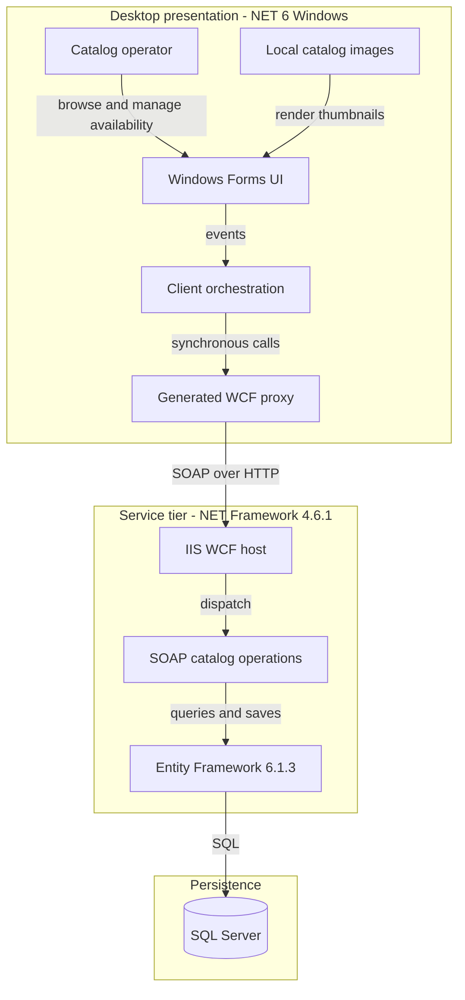
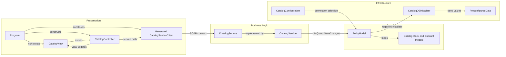

# Architecture Diagram

Static assessment of `D:\a\eShopModernizing\eShopModernizing\eShopModernizedNTier` only. The solution contains a Windows desktop client and an IIS-hosted catalog service; deployment and runtime behavior have not been executed.

## Application Architecture

### Technology Stack Summary

| Layer | Technology | Version | Purpose |
|---|---|---|---|
| Presentation | Windows Forms; WPF also enabled in project | net6.0-windows | Catalog and stock screens [A1] |
| Client transport | WCF client packages | 4.8.0 | Generated SOAP proxy [A1, A4] |
| Service | WCF, System.Web, IIS | .NET Framework 4.6.1 target | Ten service operations [A2, A5] |
| Persistence | Entity Framework | 6.1.3 server; 6.4.4 also declared by client | DbContext and SQL Server provider [A1, A2, A6] |
| Container runtime image | Microsoft WCF Windows image | 4.7.2 | Host published service output [A8] |
| Database | SQL Server Windows Developer image | Untagged | Container database; exact server version unresolved [A7] |

### Data Storage & External Services

One service-owned SQL Server database stores catalog, stock and promotion data. Compose supplies SQL Server, while the non-container connection is selected through the service configuration; connection strings are intentionally redacted in the companion inventory. Product images are client-local files, not database blobs or an image service [A6–A9]. No broker, external business API or distributed cache was identified in the scoped source/manifests.

### Key Architectural Decisions

- The client uses view events and a manually constructed controller/proxy, not an active DI container. `ApplicationModule.Load` contains commented registration examples only [A3, A10].
- The service directly uses an EF DbContext; no separate repository/business-service boundary exists in the active call chain [A5, A6].
- Server entity classes also define SOAP data contracts; the client uses generated mutable copies [A4, A5]. Source declares differing server/client runtimes; successful interoperability was not verified.

## Component Relationships

### Component Inventory

| Component | Layer | Type | Responsibility |
|---|---|---|---|
| Program | Presentation | Entry point | Manually constructs view, generated proxy and controller [A3] |
| CatalogView / ICatalogView | Presentation | Form / view abstraction | Display items, discounts, availability; raise user events [A9] |
| CatalogController | Presentation | Controller | Fetch/filter data, compose pricing display and stock actions [A10] |
| Generated CatalogServiceClient | Transport | Generated client | SOAP request/reply; generated code is not independently maintained domain logic [A4] |
| ICatalogService / CatalogService | Business | WCF contract / implementation | Catalog CRUD, stock date lookup/upsert, active promotion lookup [A5] |
| EntityModel | Data access | DbContext | Five entity sets and mapping rules [A6] |
| CatalogDBInitializer / PreconfiguredData | Infrastructure | Initializer / seed factory | Seed newly created database [A6] |
| CatalogConfiguration | Infrastructure | Configuration adapter | Environment connection override, named fallback [A6] |

**Evidence (absolute paths and line ranges):**

- [A1] `D:\a\eShopModernizing\eShopModernizing\eShopModernizedNTier\src\eShopWinForms\eShopWinForms.csproj:1-34`.
- [A2] `D:\a\eShopModernizing\eShopModernizing\eShopModernizedNTier\src\eShopWCFService\eShopWCFService.csproj:15-70`.
- [A3] `D:\a\eShopModernizing\eShopModernizing\eShopModernizedNTier\src\eShopWinForms\Program.cs:16-27`.
- [A4] `D:\a\eShopModernizing\eShopModernizing\eShopModernizedNTier\src\eShopWinForms\Connected Services\eShopServiceReference\Reference.cs:1-18,365-428,438-460,591-609`.
- [A5] `D:\a\eShopModernizing\eShopModernizing\eShopModernizedNTier\src\eShopWCFService\ICatalogService.cs:12-34`; `D:\a\eShopModernizing\eShopModernizing\eShopModernizedNTier\src\eShopWCFService\CatalogService.svc.cs:14-117`.
- [A6] `D:\a\eShopModernizing\eShopModernizing\eShopModernizedNTier\src\eShopWCFService\EntityModel.cs:10-40`; `D:\a\eShopModernizing\eShopModernizing\eShopModernizedNTier\src\eShopWCFService\Models\Infrastructure\CatalogConfiguration.cs:10-18`; `D:\a\eShopModernizing\eShopModernizing\eShopModernizedNTier\src\eShopWCFService\Models\Infrastructure\CatalogDBInitializer.cs:11-79`.
- [A7] `D:\a\eShopModernizing\eShopModernizing\eShopModernizedNTier\docker-compose.yml:3-13`.
- [A8] `D:\a\eShopModernizing\eShopModernizing\eShopModernizedNTier\src\eShopWCFService\Dockerfile:1-5`.
- [A9] `D:\a\eShopModernizing\eShopModernizing\eShopModernizedNTier\src\eShopWinForms\Views\CatalogView.cs:18-61,142-195`.
- [A10] `D:\a\eShopModernizing\eShopModernizing\eShopModernizedNTier\src\eShopWinForms\Controllers\CatalogController.cs:14-157`; `D:\a\eShopModernizing\eShopModernizing\eShopModernizedNTier\src\eShopWinForms\Modules\ApplicationModule.cs:12-34`.

**Scope caveats:** The alternate `eShopWinForms.fx.csproj` is not the solution-selected client. The server-side `CatalogServiceClient.cs` is not included in the server's explicit Compile items and is not the proxy instantiated by Program. Generated designer/resource/proxy code is distinguished from handwritten orchestration; no conclusions are drawn from `obj` output.

**Upgrade-report interpretation limitation:** The coordinator reports that core report `report-20261026195626` contains 1,688 occurrences across two solution projects, including 1,562 Windows Forms binary incompatibilities assessed against non-Windows `net10.0`, and labels the UI Wpf. These counts are coordinator-provided, not independently assessed here. The active project explicitly enables both Windows Forms and WPF [A1], while the examined UI and startup use a Windows Forms Form [A3, A9]. A desktop upgrade target must retain the Windows-specific TFM (`net10.0-windows` for a .NET 10 target); these reported occurrences, especially generated proxy/designer and desktop-platform APIs, must not automatically be interpreted as required application rewrites. This document does not perform or validate an upgrade assessment.
