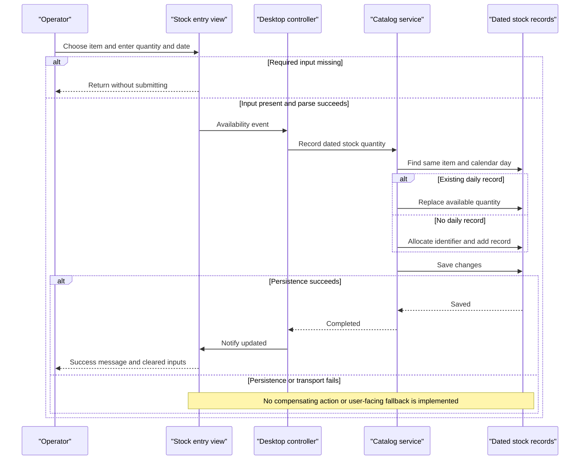

# Core Business Workflows

Operators browse a product catalog with date-active promotional pricing, check availability for a chosen day and record dated stock quantities. The scoped code does not implement checkout, payment, orders or shipment fulfilment.

## Domain Entities

| Entity | Service / Bounded Context | Description | Key Relationships |
|---|---|---|---|
| CatalogItem | CatalogService / catalog | Product offered for display and availability lookup | Belongs to brand/type; referenced by stock |
| CatalogBrand | CatalogService / catalog | Product brand grouping | Groups catalog items |
| CatalogType | CatalogService / catalog | Product category grouping | Groups catalog items |
| CatalogItemsStock | CatalogService / inventory | Available quantity for an item on a particular calendar day | Logical item reference; persistence caveat in data-architecture.md |
| DiscountItem | CatalogService / promotions | Date-bounded promotion applied to displayed catalog prices | Global, not linked to a particular product |

These are descriptive subdomains within one service, not independently deployed bounded contexts or separate DDD aggregates [B1, B2].

## Service-to-Domain Mapping

| Service | Domain Context | Owned Entities | External Dependencies |
|---|---|---|---|
| CatalogService | Catalog, inventory and promotions | All five domain entities | One database via EntityModel |
| Desktop controller/view | Operator experience | No authoritative persisted entities | SOAP service; local image assets |

The server is the source of truth. The desktop receives generated contract copies and joins product and discount information for display, not separate domain-service responses [B3, B4].

## Primary Workflows

### Workflow 1: Initialize and browse the discounted catalog

1. Program constructs the view, generated service client and controller, then loads data before displaying the modal form [B5].
2. The controller looks up today's promotion for the banner, loads all catalog items and today's discount, loads brand/type choices, and fills the shipment item selector [B3].
3. Changing either filter raises a view event. The controller reloads matching items, fetches today's discount again and passes both to the view [B3, B4].
4. The view computes displayed prices under the **Display discount rule** and loads product images from local assets. No discounted price is persisted [B4].
5. With no matching promotion, items display with no reduction; transport or image-load errors have no implemented fallback in this path.

### Workflow 2: Record dated stock availability

1. Operator chooses an item and enters quantity/date. The **Availability input guard** runs in the view; parse failures are not caught [B4].
2. Controller creates a stock contract and calls CreateAvailableStock [B3].
3. Service searches for the same item and calendar day under the **Daily overwrite rule**. An existing record's quantity is replaced; otherwise a new record is allocated under the **Manual identifier rule** [B1].
4. SaveChanges persists the result. Only after the service returns does the view show success and clear entry controls [B3, B4].

Although the UI calls the entry a shipment, it is not a shipment lifecycle: quantities are overwritten, not accumulated, and there is no receipt, reservation or dispatch state.

### Workflow 3: Check stock for a calendar day

1. Operator selects a product and a day; the view extracts its identifier from the selected label [B4].
2. Controller requests availability. The service compares calendar dates under the **Daily lookup rule** [B1, B3].
3. The integer result is appended to the view's result list. Zero does not distinguish a missing stock record from an explicit zero quantity.

### Workflow 4: Provision initial catalog state

On first database access, an absent database is created and populated with reference values, products, stock and historic promotions [B6]. This is an initialization routine, not a recurring synchronization task; it does not update an existing database or refresh old promotion dates. No scheduler, event consumer or batch workflow was identified in scope.

Other contract-only catalog operations provide item find/create/update/delete. The examined desktop controller does not expose catalog-edit calls; those operations should not be presented as verified UI workflows [B1, B3].

## Cross-Service Data Flows

The only application network boundary is desktop-to-CatalogService SOAP. The desktop separately obtains products and a date-active promotion, combines them locally and renders adjusted prices; brands/types populate independent selectors. Stock writes and reads use the same service and same underlying store [B1, B3].

There is no gateway, broker, cross-service saga, bulk remote aggregation or independent promotion service. No circuit breaker/fallback converts service failure into partial business results. A missing discount is a normal result, not a service-unavailability fallback. Generated Task methods are transport conveniences, not asynchronous business events [B7].

## Business Workflow Sequence

## Business Rules & Decision Logic

| Rule | Actual behavior and limitations | Evidence |
|---|---|---|
| All-filter sentinel | Brand/type identifier 0 means unrestricted; nonzero values filter by equality after materialization | [B1, B3] |
| Active promotion selection | Start and end dates inclusive; ignores time of day; returns first matching record without ordering or overlap resolution | [B1] |
| Display discount rule | Displayed price = product price multiplied by one minus promotion Size; no promotion means Size 0. Banner percentage rounds Size times 100. Uses current desktop time; no timezone policy or stored discounted price | [B3, B4] |
| Availability input guard | Missing selected product, empty quantity or empty date silently returns. Otherwise int.Parse and Convert.ToDateTime are used without TryParse/error handling | [B4] |
| Daily overwrite rule | First stock record for same item/date is replaced, not incremented. No explicit uniqueness constraint or concurrent upsert control was identified | [B1, B2] |
| Daily lookup rule | First same-day matching stock record returns its quantity; missing match returns 0. No cumulative stock or carry-forward computation | [B1] |
| Manual identifier rule | Product Id and new StockId allocated using maximum existing value plus one; empty-set and concurrent creation cases have no explicit handling | [B1] |
| Reference-value length | Brand and type strings have StringLength(50). No explicit service validation invocation or business-level error translation; EF validation may apply at save | [B2] |
| Missing range/domain checks | No positive-quantity requirement, price-range rule, discount-fraction range, promotion date-order check or item-existence check in stock service code | [B1, B2, B4] |
| Selection prerequisite | Stock search dereferences selected list item without a null guard; malformed/no selection can fail before a service call | [B4] |

**Transactions:** each mutation saves independently; no application transaction spans the initial lookup, identifier allocation and write. Database seeding saves each group separately. No compensation or distributed transaction behavior is implemented [B1, B6].

**Error handling:** null item/promotion and zero missing-stock results are explicit decisions; parse, transport, image and persistence failures are not translated to business errors in the active controller/view. RemoveCatalogItem passes the incoming entity directly to Remove without an explicit attach/find step, so disconnected-entity behavior is unverified rather than assumed successful [B1, B4].

**Authorization and audit:** no resource-owner/role checks, business audit events or durable change-history model was found in the active workflow code. External IIS/database policies are outside what these sources establish. There is no order/status state machine [B1–B4].

**Generated-code boundary:** the proxy and form designer are generated artifacts; the workflow decisions above are traced to handwritten controller, view, service and initializer code. The commented ApplicationModule registration and unused server-side client stub are not alternate active workflows [B5, B7].

**Evidence:**

- [B1] `D:\a\eShopModernizing\eShopModernizing\eShopModernizedNTier\src\eShopWCFService\CatalogService.svc.cs:28-117`.
- [B2] `D:\a\eShopModernizing\eShopModernizing\eShopModernizedNTier\src\eShopWCFService\Models\CatalogBrand.cs:10-19`; `D:\a\eShopModernizing\eShopModernizing\eShopModernizedNTier\src\eShopWCFService\Models\CatalogType.cs:10-19`; `D:\a\eShopModernizing\eShopModernizing\eShopModernizedNTier\src\eShopWCFService\Models\CatalogItem.cs:10-35`; `D:\a\eShopModernizing\eShopModernizing\eShopModernizedNTier\src\eShopWCFService\Models\CatalogItemsStock.cs:10-25`; `D:\a\eShopModernizing\eShopModernizing\eShopModernizedNTier\src\eShopWCFService\Models\DiscountItem.cs:11-31`.
- [B3] `D:\a\eShopModernizing\eShopModernizing\eShopModernizedNTier\src\eShopWinForms\Controllers\CatalogController.cs:14-157`.
- [B4] `D:\a\eShopModernizing\eShopModernizing\eShopModernizedNTier\src\eShopWinForms\Views\CatalogView.cs:48-61,106-167,173-195`.
- [B5] `D:\a\eShopModernizing\eShopModernizing\eShopModernizedNTier\src\eShopWinForms\Program.cs:16-27`.
- [B6] `D:\a\eShopModernizing\eShopModernizing\eShopModernizedNTier\src\eShopWCFService\EntityModel.cs:12-15`; `D:\a\eShopModernizing\eShopModernizing\eShopModernizedNTier\src\eShopWCFService\Models\Infrastructure\CatalogDBInitializer.cs:11-79`; `D:\a\eShopModernizing\eShopModernizing\eShopModernizedNTier\src\eShopWCFService\Models\Infrastructure\PreconfiguredData.cs:41-74`.
- [B7] `D:\a\eShopModernizing\eShopModernizing\eShopModernizedNTier\src\eShopWinForms\Connected Services\eShopServiceReference\Reference.cs:1-18,365-428`; `D:\a\eShopModernizing\eShopModernizing\eShopModernizedNTier\src\eShopWinForms\Modules\ApplicationModule.cs:12-34`.
